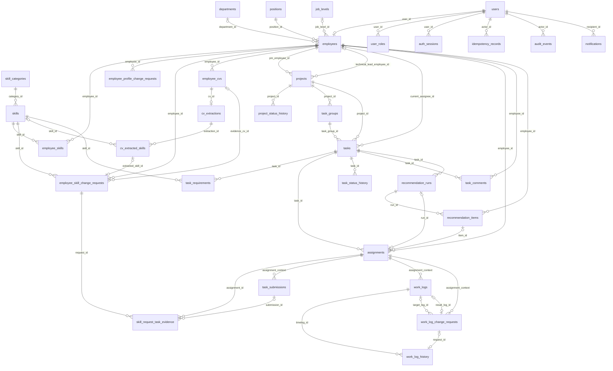

# Thiết kế database hợp nhất — bản đề xuất trình bày

**Tiếp nối 27/10/2026:** đề nghị kỹ năng nhân viên chỉ tạo ADD/UPDATE; REMOVE giữ tương thích thiết kế/lịch sử, không thêm quyền gỡ. Không đổi bảng/cột/ràng buộc. Xem [chốt hiện hành](database-review-decisions-2026-10-14.md) và [workflow kỹ năng](../../.claude/docs/skill_approval_workflow.md); không suy việc giữ giá trị operation thành quyền tạo đề nghị gỡ.

Cập nhật 26/10/2026 · Bước 5C · **33 bảng đề xuất; chưa phải DDL đã chốt hoặc DB đã triển khai.**

**Bổ sung 26/10/2026:** thêm job_levels do HR quản trị; employees.job_level_id nullable thay seniority_level nhập tự do, không enum cấp bậc cố định. Xem [quyết định tiếp nối](database-review-decisions-2026-10-14.md).

**Bổ sung 20/10/2026:** [địa chỉ khi hoàn thiện hồ sơ](../business-baseline-2026-10-20.md#quyết-định-tiếp-nối--địa-chỉ-khi-hoàn-thiện-hồ-sơ): thêm `employees.address TEXT NULL`, không bắt Admin nhập khi tạo; nhân viên đề nghị bổ sung/sửa, HR duyệt hoặc cập nhật trực tiếp. Không cho xóa trắng địa chỉ đã có, không đưa vào tra cứu chuyên môn. Dictionary 5B/DBML đã cập nhật thiết kế; không thêm bảng hoặc chạy migration.

Đây là điểm đọc chính thay cho việc ghép các bước nghiên cứu. Quyết định thay đổi ưu tiên [sổ rà soát, phần hiện hành và Bàn giao](database-review-decisions-2026-10-14.md), gồm xác nhận bổ sung result_log_id ngày 15/10. Các nội dung không bị thay thế theo [baseline 12/10](../business-baseline-2026-10-12.md), [bổ sung 13/10](../business-baseline-2026-10-13.md) và workflow hiện hành. Dictionary chi tiết chỉ giữ tại [5A](database-step5a-core-dictionary-2026-10-14.md) và [5B](database-step5b-supporting-dictionary-2026-10-14.md), không sao chép thêm một bộ cột dễ lệch. Bước 1–4 và V2 là nguồn lý giải/lịch sử; không dùng số bảng hoặc quyền cũ phủ định bản hợp nhất này.

## 1. Luận điểm thiết kế

**Xem bảng và trường trực quan:** [DBML 33 bảng](database-proposal-2026-10-14.dbml). Sao chép toàn bộ file vào trình soạn thảo DBML của dbdiagram.io để dựng sơ đồ. File chia 7 nhóm khớp bảng tổng hợp bên dưới. DBML là bản biểu diễn từ dictionary 5A/5B, không phải nguồn nghiệp vụ mới. Khi sửa dictionary cần đồng bộ file này.

DBML có các cột, PK, quan hệ FK đơn/ghép và khóa duy nhất chính. Các CHECK, partial index, hợp đồng JSON và kiểm tra quyền/giao dịch được mô tả trong note/dictionary, chưa được mã hóa đầy đủ. Trạng thái dùng text để chưa chốt ENUM vật lý. Không dùng SQL xuất từ sơ đồ làm migration. Không chứa dữ liệu nhân viên thật; cân nhắc quyền riêng tư của dịch vụ trước khi tải thiết kế lên.

PTCM thiết lập công việc, chọn người trong nguồn nhân lực toàn công ty và nghiệm thu; PM chỉ định PTCM, bắt đầu, theo dõi, hoàn thành/đóng dự án. Nhân viên làm, ghi effort và tự nộp. HR quản lý hành chính/CV; Giám đốc công nhận kỹ năng. Database phân biệt **dữ liệu hiện hành, đề nghị chưa duyệt, lịch sử và bản chụp tại thời điểm quyết định**.

Không roster trước, không bảng phân công reviewer, không quản lý kế hoạch Word/Slack. Một người thường làm 1–2 dự án là bối cảnh sử dụng, không hard limit hoặc trọng số mới. Không dùng số bảng làm tiêu chí đúng/sai.

## 2. Danh mục duy nhất và nơi đọc cột

| Nhóm | Các bảng | Số | Dictionary |
|---|---|---:|---|
| Tài khoản và cơ cấu | users, user_roles, employees, departments, positions, job_levels | 6 | 5B mục 1–5.1 |
| Kỹ năng và yêu cầu | skill_categories, skills, employee_skills, employee_skill_change_requests, employee_profile_change_requests, skill_request_task_evidence | 6 | 5B mục 6–11 |
| CV | employee_cvs, cv_extractions, cv_extracted_skills | 3 | 5B mục 12–14 |
| Dự án/công việc | projects, project_status_history, task_groups, tasks, task_requirements, assignments, task_submissions, task_status_history, task_comments | 9 | 5A; comments ở 5B mục 15 |
| Effort | work_logs, work_log_history, work_log_change_requests | 3 | 5A mục 11–13 |
| Gợi ý | recommendation_runs, recommendation_items | 2 | 5B mục 16–17 |
| Hạ tầng | auth_sessions, idempotency_records, audit_events, notifications | 4 | 5B mục 18–21 |
| Tổng | 11 bảng ở 5A + 22 bảng ở 5B | 33 | Không roster/event phân công/token refresh riêng |

## 3. ERD tổng thể theo quan hệ chính

Hình bao phủ **tất cả 33 bảng**, nhưng lược các FK actor lặp lại và thuộc tính để đọc được. Đây là bản đồ quan hệ, không thay dictionary/FK ghép ở mục 4. Ký hiệu 0..n thể hiện giới hạn FK, không khẳng định một giao dịch hợp lệ được thiếu requirement/history. Quan hệ tùy chọn là nullable ở phía con. Không vẽ quyền truy cập hoặc ID trong JSON như FK.

item→assignments vẽ theo FK item riêng; kết hợp UQ assignments.run_id và FK ghép thì một item thực tế chỉ được dùng tối đa một lần. Không thêm unique item riêng chỉ để lặp ràng buộc. evidence_cv_id đã chốt tối đa một CV dẫn trực tiếp; nhiều tệp ngoài CV nằm trong evidence_attachments JSONB trên request. Policy tệp vẫn cần đặc tả.

## 4. Những khóa ghép cần bảo vệ

| Bảng con và cột | Đích có PK/UQ | Bảo vệ được | Còn kiểm tra ở service |
|---|---|---|---|
| tasks(task_group_id, project_id) | task_groups(task_group_id, project_id) UQ | Nhóm cùng dự án | Quyền và khóa đặc tả |
| assignments(run_id, task_id) | recommendation_runs(run_id, task_id) UQ | Run đúng task | Run chưa dùng, spec/quyền hiện hành |
| assignments(item_id, run_id, employee_id) | recommendation_items(item_id, run_id, employee_id) UQ | Item đúng run/người | CHECK MANUAL/RECOMMENDED xử lý NULL |
| task_submissions: (assignment_id, task_id, employee_id) | assignments(assignment_id, task_id, employee_id) UQ | Đúng người/lượt/task | Ai được thao tác, trạng thái |
| work_log_change_requests(target_log_id, assignment_id), (result_log_id, assignment_id) | work_logs(timelog_id, assignment_id) UQ | Log đích/kết quả đúng lượt | ADD target NULL, chỉ ADD APPROVED có result; đối chiếu before_values |
| skill_request_task_evidence(submission_id, assignment_id) | task_submissions(submission_id, assignment_id) UQ | Lần nộp thuộc lượt dẫn chứng | Người trong request khớp assignment |

FK có cột NULL không thay CHECK theo nhánh. Mọi FK tới user/employee dùng đúng miền identity; không so hai số ID khác miền. Bộ actor FK lược trên hình: users cho các *_by/actor_id theo dictionary; assignments.assigned_by_employee_id và submissions.reviewed_by_employee_id tới employees. Tên bảng/PK không suy từ nhãn actor trong UC.

## 5. Nguồn chuẩn và dữ liệu lặp có chủ đích

| Thông tin | Nguồn chuẩn | Vì sao không thêm bảng/cột khác |
|---|---|---|
| Người hiện thực hiện task | assignments và bộ kết thúc lượt, projection tasks.current_assignee_id cập nhật cùng giao dịch | Không roster hoặc current_assignment pointer thứ hai |
| Ai từng được giao trong dự án | assignments JOIN tasks, DISTINCT | Không chứng minh thực làm; không suy quyền toàn dự án |
| Tải, số dự án mở | Task hiện hành theo điều kiện 4C | Không cache/bảng workload; số dự án không thay công thức |
| Năng lực | employee_skills đã công nhận và còn hiệu lực | Pending/CV chỉ là đề nghị |
| Kết quả mỗi lần nộp | task_submissions | PR merge/comment không thay quyết định |
| Effort hiện tại / phiên bản cũ / lúc nộp | work_logs / work_log_history / log_snapshot | Ba thời điểm khác nhau, không cộng lặp |
| Kết quả gợi ý cũ | run đầu vào + items đầu ra bất biến | Không output JSON trùng items hoặc is_selected |
| Phân công cuối | assignments liên kết item nếu RECOMMENDED | Manual không nhận điểm giả |

Không khẳng định toàn schema “3NF tuyệt đối”: projection và snapshot lặp có chủ đích, có nguồn và giao dịch đồng bộ. Đổi lại snapshot cho phép giải thích lịch sử; JSON cần validator/replay, không được FK tự kiểm tra từng ID.

## 6. Giao dịch cần trình bày với cô

1. **Xác nhận giao việc:** kiểm tra PTCM/người active/kỹ năng/quy tắc hiện hành → assignment/bộ kết thúc lượt + projection/status history + notification + idempotency cùng commit. Batch cùng dự án nguyên tử; draft không giữ chỗ.
2. **Nộp và review:** nhân viên nộp với snapshot đúng lượt; PTCM kết luận một lần. Không đạt quay lại thực hiện, lần nộp sau có ID mới. Không ép nhập giờ giả để được nộp.
3. **Duyệt kỹ năng:** khóa/đối chiếu official theo before_values và request.version; quyết định + cập nhật official + thông báo nguyên tử. Không tự duyệt, không ghi đè hồ sơ từ CV.
4. **Sửa effort:** Edit khi chưa khóa ghi history trực tiếp; khi khóa đi qua yêu cầu do PTCM duyệt. Approve ADD tạo log/result_log_id; UPDATE/DELETE tạo history trước/sau, cùng quyết định trong một commit, kiểm tra tổng phút xuyên dự án. Snapshot cũ không đổi.

Đây là thiết kế giao dịch, chưa phải bằng chứng test cạnh tranh. Giao thức khóa 3C là phương án cần thử, không gọi là tính năng PostgreSQL tự bảo vệ nghiệp vụ.

## 7. Đọc và trình bày thế nào

- Trình bày chính: [pitch 8 slide](database-pitch-2026-10-14.md); dùng nhóm dữ liệu và luồng, không đọc 33 bảng tuần tự.
- Trả lời “cột này để làm gì”: dictionary 5A/5B.
- Trả lời “DB cũ đổi ra sao”: [mapping chuyển đổi](database-step5c-migration-map-2026-10-14.md).
- Trả lời “đã chạy chưa”: mới review tài liệu và kiểm kê tĩnh, chưa SQL/live DB/concurrency test.

## 8. Trạng thái chốt: đề xuất để phản biện, chưa chốt triển khai

**Đã hợp nhất:** danh mục 33 bảng, bản đồ quan hệ, dictionary theo nhóm, nguồn dữ liệu, ranh giới DB–service, hướng chuyển đổi. Không đổi công thức hoặc mở lại lựa chọn nguồn nhân lực chung.

**Đã chốt theo các quyết định được xác nhận, cập nhật 26/10:** 33 bảng; HR quản trị cơ cấu/duyệt fullname/phone/address (address bổ sung 20/10), Giám đốc quản trị danh mục kỹ năng; official không source/is_effective/version; PTCM duyệt hiệu chỉnh; một cloud provider cấu hình chung; session phía server; upload metadata JSON. result_log_id cho ADD đã duyệt được người dùng xác nhận thêm ngày 15/10.

**Chi tiết còn phải đặc tả/kiểm chứng trước code:**

| Phạm vi | Phần còn mở, không tự coi đã triển khai |
|---|---|
| Công thức | Miền weight, kiểu vật lý phù hợp, chuẩn hóa, params/input/score_details, dữ liệu effort đủ điều kiện; không tự đưa Q/T vào điểm |
| CV/API | Provider/model, cách chạy worker; tạm giữ text/retry/lease; mapping trùng muộn không mở lại terminal |
| Tệp minh chứng | Loại/số/dung lượng, private access và cleanup upload chưa gắn; JSON không tự giải quyết quyền tệp |
| Session/retry | Timeout tuyệt đối, idle, reset, CSRF contract, phạm vi endpoint/retention; sáu cột chưa cam kết idle timeout |
| DTO/quyền | Chi tiết bốn nhóm nghề nghiệp; không CV gốc/contact/raw task khác dự án; HR không tự chọn CV hiện tại thay chủ |
| Lịch sử/legacy | Dữ liệu đóng góp cũ thiếu căn cứ, đổi PTCM ở terminal, phân loại actor/email/phút/lượt cũ trước migration |

Hủy khi review được diễn giải bằng trạng thái task/project hiện có, giữ submission chưa có kết luận; không giả không đạt hoặc tự đổi Q/T. ADD không bị buộc có history; truy vết result_log_id. Bộ kết thúc assignment và đối chiếu snapshot/before_values đọc dictionary 5A/5B.

Kiểm tra đợt đồng bộ được ghi tại [review 15/10](../reviews/database-sync-review-2026-10-15.md). Đây là thiết kế tài liệu, không chứng minh DDL, migration, race test hoặc engine đã chạy. Không chạy DROP/ALTER DB thật.
