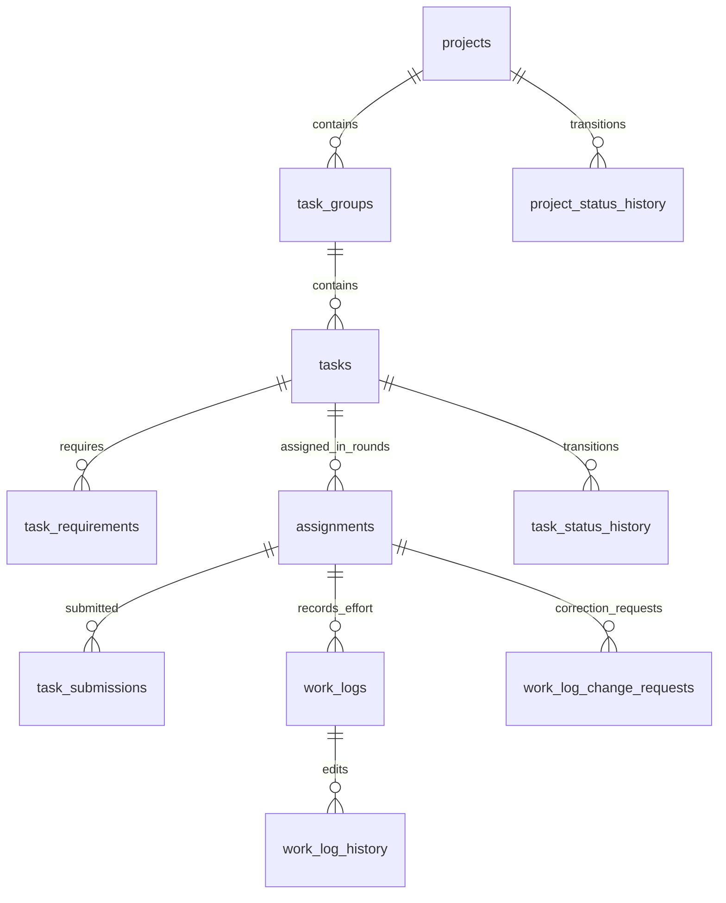

# Bước 5A — Từ điển dữ liệu lõi để review và trình bày

**Đồng bộ 15/10/2026:** ưu tiên [quyết định hiện hành và Bàn giao](database-review-decisions-2026-10-14.md), gồm xác nhận result_log_id. Chỉ thiết kế tài liệu, chưa DDL/migration. Các bước 1–4 là lịch sử.

Cập nhật 15/10/2026. **Thiết kế đề xuất, chưa DDL/migration.** Cụ thể hóa 11 bảng lõi. [5B](database-step5b-supporting-dictionary-2026-10-14.md) bổ sung 22 bảng còn lại; tổng hiện hành 33 sau chốt danh mục cấp bậc 26/10/2026. Bản 15/10 có 32 sau khi bỏ assignment_events và refresh_tokens; phần lõi 5A không đổi.

Nguồn: [3A](database-step3a-core-relations-2026-10-13.md), [3B](database-step3b-effort-profile-skills-cv-2026-10-13.md), [3C](database-step3c-roles-recommendation-technical-2026-10-13.md), [4C](database-step4c-shared-pool-2026-10-13.md), [effort](../../.claude/docs/work_effort_workflow.md). Khi khác V2 lịch sử, dùng baseline 12–13/10 và các quyết định tiếp nối.

## 1. Quy ước chung

- `NN`: không NULL; `?`: cho NULL, mặc định NULL; `—`: không default, người ghi phải cung cấp. Các tên/kiểu là đề xuất kỹ thuật tương thích INT hiện trạng.
- Mọi PK trong tài liệu: INT GENERATED ALWAYS AS IDENTITY, NN. Mọi FK người: INT. Actor `*_by`/`actor_id` trỏ users; subject `employee_id` trỏ employees. Riêng assigned_by_employee_id/reviewed_by_employee_id giữ ngữ nghĩa nhân sự; resolve qua employees.user_id để kiểm tra cùng người.
- Thời điểm: TIMESTAMPTZ, do server lấy, không client backdate. Ngày: DATE theo múi giờ nghiệp vụ. `created_at`, `updated_at`: NN default now(); updated_at phải được cập nhật bởi đường ghi, default không tự chạy khi UPDATE.
- Không còn version trên project/task/log. Đọc lại quyền/trạng thái và đối chiếu giá trị nền dưới khóa trong giao dịch; updated_at không thay cơ chế phát hiện màn hình cũ.
- Trạng thái: tập hữu hạn đã nêu; kiểu vật lý ENUM hay TEXT+CHECK sẽ chốt khi viết migration tương thích. Không nhận chuỗi bất kỳ.
- FK lõi mặc định ON DELETE NO ACTION, không cascade xóa lịch sử khi xóa project/task/employee. Vòng đời dùng trạng thái; chưa mở chức năng xóa cứng.
- Các trường text bắt buộc phải trim khác rỗng. Lý do có điều kiện kiểm tra theo thao tác, không bắt mọi trường nullable đều có giá trị.

## 2. projects

Một dòng là một dự án và trách nhiệm hiện hành; Giám đốc chọn PM ngay khi tạo, PM quản lý theo quyền.

| Cột | Kiểu / NULL / default | Ý nghĩa, nguồn ghi |
|---|---|---|
| project_id | PK | Identity |
| project_code | VARCHAR(30) NN / — | Mã UQ toàn hệ thống |
| project_name | VARCHAR(150) NN / — | Tên dự án |
| description, note | TEXT ? | Phạm vi, ghi chú; không phải kế hoạch Word |
| start_date, planned_end_date | DATE NN / — | Kế hoạch hiện hành, start ≤ end |
| original_start_date, original_end_date | DATE NN / — | Server chụp kế hoạch khi tạo; không sửa khi gia hạn |
| priority | priority_level NN / MEDIUM | Mức ưu tiên hiện có |
| status | project_status NN / PLANNING | PLANNING/IN_PROGRESS/COMPLETED/CLOSED/CANCELLED |
| pm_employee_id | INT NN / — | FK employees, đúng một PM |
| technical_lead_employee_id | INT ? | FK employees, chưa chỉ định được NULL |
| created_at, updated_at | TIMESTAMPTZ NN / now() | Server |

PM và PTCM có thể cùng người. Không CHECK hai ID phải khác. Thay trách nhiệm ghi audit trước/sau; không đổi actor cũ. Mốc triển khai/hoàn thành/đóng lấy từ status history, không suy từ ngày kế hoạch. Index đề xuất: pm_employee_id, technical_lead_employee_id; chưa thêm index status riêng nếu chưa có truy vấn cần.

## 3. task_groups

| Cột | Kiểu / NULL / default | Ý nghĩa |
|---|---|---|
| task_group_id | PK | Nhóm công việc |
| project_id | INT NN / — | FK projects |
| group_name | VARCHAR(150) NN / — | Tên nhóm |
| description | TEXT ? | Mô tả |
| created_at, updated_at | TIMESTAMPTZ NN / now() | Server |

PTCM tạo/sửa. UQ(project_id, group_name); UQ(task_group_id, project_id) làm đích FK ghép. Đề xuất trim đầu/cuối, giữ phân biệt hoa/thường theo UQ hiện hành; không tự tuyên bố chống mọi tên tương đương Unicode. Nhóm không có assignee/estimate/requirements, không tạo cấp nhóm cha.

## 4. tasks

| Cột | Kiểu / NULL / default | Ý nghĩa, nguồn ghi |
|---|---|---|
| task_id | PK | Đơn vị phân công |
| project_id, task_group_id | INT NN / — | FK projects và FK ghép tới group cùng project |
| task_code | VARCHAR(30) NN / — | UQ(project_id, task_code) |
| task_name | VARCHAR(150) NN / — | PTCM khai báo |
| description | TEXT ? | Phạm vi và đầu ra; phải đủ rõ trước giao, cùng quy tắc khóa đặc tả |
| acceptance_criteria | TEXT NN / — | Tiêu chí nghiệm thu |
| estimate_hours | NUMERIC(10,2) NN / — | >0; không thay bằng số giờ thực tế |
| planned_start_date, planned_end_date | DATE ? | Cả hai NULL hoặc đủ cặp, start ≤ end |
| original_start_date, original_end_date | DATE ? | Cặp kế hoạch ban đầu; không ghi đè bởi gia hạn |
| priority | priority_level NN / MEDIUM | Ưu tiên |
| status | task_status NN / PENDING_ASSIGNMENT | ASSIGNED/IN_PROGRESS/PAUSED/PENDING_REVIEW/DONE/CLOSED/CANCELLED và trạng thái đầu |
| current_assignee_id | INT ? | FK employees; projection của lượt hiện hành, không API sửa riêng |
| first_assigned_at | TIMESTAMPTZ ? | Đặt một lần khi giao đầu, không xóa khi thu hồi |
| accepted_at | TIMESTAMPTZ ? | Projection thời điểm lần nộp được chấp nhận |
| created_at, updated_at | TIMESTAMPTZ NN / now() | Server |

Quy tắc ngày ban đầu: nếu tạo task chưa có ngày, giữ NULL cho tới khi khai báo cặp kế hoạch đầu tiên; sau đó không ghi đè. Đây là chi tiết kỹ thuật đề xuất cần đồng bộ API, không lấy ngày nhập thay ngày kế hoạch. Kế hoạch task phải trong kế hoạch project qua service, không CHECK chéo bảng.

Spec/estimate/requirements đóng băng sau first_assigned_at. Thay đổi kế hoạch được phép theo workflow không sửa baseline gốc hoặc accepted_at. Không thêm parent_task_id/task_type, actual_hours lưu sẵn, effort_quality hoặc quality_reason chưa chốt D16.

Index đề xuất: task_group_id; (current_assignee_id, status, project_id) cho tải/số dự án; UQ theo mã đã hỗ trợ truy vấn đầu project_id. Không gọi index này tối ưu trước EXPLAIN.

## 5. task_requirements

| Cột | Kiểu / NULL / default | Ý nghĩa |
|---|---|---|
| task_req_id | PK | Một kỹ năng yêu cầu |
| task_id, skill_id | INT NN / — | FK tasks/skills; UQ(task_id, skill_id) |
| required_level | proficiency_level NN / — | Bốn mức chính thức hiện hành |
| weight | SMALLINT NN / — | PTCM đặt trước giao theo task; miền giá trị/chuẩn hóa chờ công thức. SMALLINT chỉ là kiểu tạm kế thừa, chưa chốt DDL; không áp CHECK 1..5 |
| is_mandatory | BOOLEAN NN / — | PTCM chỉ rõ, không default ngầm |

PTCM ghi cùng task. ≥1 requirement/task tại commit do giao dịch bảo vệ; FK chỉ bảo đảm mỗi requirement có task. Không coi requirement tùy chọn là điều kiện loại cứng.

## 6. assignments

Một dòng là một lượt giao đã xác nhận. Nội dung giao bất biến; chỉ bộ kết thúc được ghi một lần. Giao lại kể cả cùng người tạo ID mới.

| Cột | Kiểu / NULL / default | Ý nghĩa |
|---|---|---|
| assignment_id | PK | Identity lượt |
| task_id, employee_id | INT NN / — | FK tasks/employees |
| assigned_by_employee_id | INT NN / — | FK employees; PTCM thực tế lúc giao |
| assigned_at | TIMESTAMPTZ NN / now() | Thời điểm commit nghiệp vụ |
| assignment_type | tập MANUAL/RECOMMENDED NN / — | Cách chọn |
| run_id | INT ? | Run đã dùng, kể cả manual sau run |
| item_id | INT ? | Chỉ RECOMMENDED; item đúng run/người |
| adjust_reason | TEXT ? | Lý do khác Top-1/manual sau run/ngoại lệ kỹ năng theo workflow |
| ended_at | TIMESTAMPTZ ? | Server ghi khi kết thúc lượt |
| ended_by | INT ? FK users | Người gây thao tác kết thúc thực tế |
| end_reason | TEXT ? | Nhãn kết thúc và lý do, ghi cùng bộ kết thúc |

Khóa: UQ(assignment_id, task_id); UQ(assignment_id, task_id, employee_id). FK(run_id, task_id) → runs(run_id, task_id); FK(item_id, run_id, employee_id) → items(item_id, run_id, employee_id), các đích phải có UQ. Unique run_id WHERE NOT NULL để không confirm lại run. MANUAL: item NULL, run tùy chọn; RECOMMENDED: cả run/item NN.

Không matching_score lặp; đọc điểm từ item bất biến. Không current_assignment_id thứ hai hoặc R05 acknowledgement. Index(task_id, assigned_at, assignment_id), employee_id. Partial UQ(task_id) WHERE ended_at IS NULL bảo đảm tối đa một lượt mở.

CHECK bộ ended_at/ended_by/end_reason cùng NULL hoặc cùng có; ended_at >= assigned_at; end_reason không trắng. Bộ kết thúc không được sửa lại. Service khóa project/task/lượt liên quan theo thứ tự thống nhất:

| Thao tác | Kết thúc lượt và projection |
|---|---|
| Giao đầu | Tạo lượt mở; current_assignee_id = người nhận |
| Giao lại trực tiếp | Đóng lượt cũ với REASSIGN + lý do, tạo lượt mới và đổi projection cùng transaction |
| Thu hồi | Đóng lượt với UNASSIGN + lý do; projection NULL, task PENDING_ASSIGNMENT |
| Nghiệm thu đạt | Đóng lượt với DONE, actor là PTCM review; giữ người cuối trên task terminal |
| Hủy task/project | Đóng các lượt còn mở với CANCELLED + lý do, actor người hủy; giữ người cuối và lịch sử; không ghi lại lượt DONE đã đóng |
| Đóng project | Không kết thúc lại lượt đã DONE; chỉ chuyển trạng thái theo workflow |

Các nhãn trên là contract nội dung end_reason, không thêm cột enum. Tải dùng trạng thái task/project và current_assignee theo baseline, không chỉ ended_at NULL. Lượt kết thúc vẫn cho đọc đóng góp/đề nghị hiệu chỉnh trong phạm vi dự án cho phép; không chuyển log cho người mới.

Giao lại/thu hồi task đã bắt đầu vẫn cần nội dung bàn giao theo workflow. Ghi cùng end_reason của lượt cũ (nhãn, lý do, phần đã làm/còn lại/tài liệu/vướng mắc), không làm mất dữ liệu bàn giao khi bỏ bảng event; không thêm trường hoặc quy trình duyệt bàn giao. PTCM lập nội dung, không bắt người cũ xác nhận.

assignments thay thế hoàn toàn trách nhiệm lưu lượt/kết thúc của assignment_events; không duy trì hai nguồn chuẩn.

## 8. task_submissions — đường nộp/nghiệm thu thông thường

| Cột | Kiểu / NULL / default | Ý nghĩa |
|---|---|---|
| submission_id | PK | Mỗi lần nộp một dòng |
| assignment_id, task_id, employee_id | INT NN / — | FK ghép tới assignments cùng bộ ba |
| submitted_by | INT NN / — | FK users; phải là user của employee, không nộp thay |
| submitted_at | TIMESTAMPTZ NN / now() | Server |
| result_summary | TEXT NN / — | Người thực hiện nộp |
| evidence_links | JSONB NN / [] | Mảng URL minh chứng; không tích hợp GitHub |
| log_snapshot | JSONB NN / — | Server tạo, có schema_version và logs; không nhận client snapshot |
| review_result | ACCEPTED/REJECTED ? | NULL trước quyết định; không đồng nghĩa project CANCELLED |
| reviewed_by_employee_id | INT ? | FK employees, PTCM thực tế lúc review |
| reviewed_at | TIMESTAMPTZ ? | Thời điểm quyết định |
| review_comment | TEXT ? | REJECTED bắt buộc lý do |

Review result/reviewer/time cùng NULL hoặc cùng có; không tự review, kiểm tra xung đột đóng góp theo nghiệp vụ. Nội dung nộp bất biến, kết luận ghi tối đa một lần qua service. Index(task_id, submitted_at, submission_id). Unique task WHERE review_result='ACCEPTED' là đề xuất; chưa viết unique pending chỉ bằng review_result IS NULL vì trường hợp hủy còn cần xử lý kỹ thuật.

UQ(submission_id, assignment_id) làm đích FK ghép cho skill_request_task_evidence ở 5B; bảo đảm minh chứng không ghép lần nộp với lượt giao khác.

**Hủy khi đang review:** cùng giao dịch hủy task/project, ghi status history/lý do và kết thúc lượt đang mở; giữ nguyên submission, review_result/reviewer/time NULL nếu chưa có quyết định. Hàng chờ review chỉ lấy submission chưa có kết luận của task PENDING_REVIEW thuộc project IN_PROGRESS và lượt hiện hành; terminal không được review. Giao dịch review và hủy khóa cùng project/task trước kiểm tra nên chỉ một nhánh hợp lệ commit trước. Không thêm trạng thái submission, không giả REJECTED, không tự thay tập tính Q/T. Không đặt unique pending chỉ dựa review_result IS NULL.

Snapshot schema_version=2 (contract mới, không sửa snapshot cũ): logs là mảng đối tượng timelog_id/assignment_id/work_date/duration_minutes/description/over_daily_limit_reason của log hiệu lực thuộc lượt nộp. Rỗng hợp lệ, không kết luận thực tế 0 giờ. Kiểm tra kiểu/cấu trúc và dựng từ DB; ID trong JSON không có FK. Không lưu tổng riêng trong snapshot để tránh hai nguồn; tính tổng từ logs khi đọc.

## 9–10. project_status_history và task_status_history

Hai bảng cùng cấu trúc nhưng FK khác; không gộp thành object_type/object_id mất FK.

| Cột | Kiểu / NULL / default | Ý nghĩa |
|---|---|---|
| history_id | PK | Một chuyển trạng thái |
| project_id hoặc task_id | INT NN / — | FK đúng bảng đối tượng, không lưu cả hai |
| old_status | tập trạng thái tương ứng ? | NULL chỉ lúc khởi tạo |
| new_status | tập trạng thái tương ứng NN / — | Trạng thái sau |
| actor_id | INT NN / — | FK users, người gây thao tác kể cả hệ thống cập nhật theo thao tác đó |
| occurred_at | TIMESTAMPTZ NN / now() | Thời điểm thật, không backdate |
| reason | TEXT ? | Theo chuyển trạng thái, hủy/trả lại cần lý do |

Append-only cùng transaction đổi trạng thái; CHECK old NULL hoặc old<>new; service kiểm tra transition. Index(entity_id, occurred_at, history_id). Không dùng history này thay bộ kết thúc assignment hay nội dung nghiệm thu; ghi reason chuyển tiếp không tạo quyết định review thứ hai.

## 11. work_logs

| Cột | Kiểu / NULL / default | Ý nghĩa |
|---|---|---|
| timelog_id | PK | Khoản effort hiện hành |
| assignment_id | INT NN FK assignments | Người/task suy từ lượt giao bất biến |
| work_date | DATE NN / — | Ngày thực tế theo múi giờ nghiệp vụ |
| duration_minutes | INT NN / — | 1..1440; tổng ngày kiểm tra riêng |
| description | TEXT NN / — | Nội dung đã làm |
| over_daily_limit_reason | TEXT ? | Lý do khi thao tác làm tổng ngày vượt 480 phút |
| deleted_at | TIMESTAMPTZ ? | Xóa mềm, không cộng vào tổng; không khôi phục/xóa lại |
| created_at, updated_at | TIMESTAMPTZ NN / now() | Server |

UQ(timelog_id, assignment_id) làm đích FK ghép; index(assignment_id, work_date) WHERE deleted_at IS NULL. JOIN assignments.employee_id để tổng hợp xuyên dự án. Không giữ task_id/employee_id/created_by/updated_by/version lặp. Người thực hiện tự ghi, không nhập thay. Log tạo từ yêu cầu ADD truy qua result_log_id và requested_by/resolved_by của yêu cầu.

Nhiều khoản/ngày hợp lệ, không unique ngày/nội dung. Tổng ngày của người ≤1440; >480 cần lý do. Khóa employee rồi kiểm tra cả ngày cũ/mới khi sửa; mọi đường ghi dùng cùng quy ước khóa. Ngày phải thuộc khoảng thực hiện của lượt, không tương lai, không dùng deadline hay Start làm cổng duy nhất. Identity không sửa. Edit/DELETE trực tiếp cần lý do và history; sau khóa phải gửi yêu cầu, PTCM hiện hành duyệt. CLOSED/CANCELLED chỉ đọc.

## 12. work_log_history

| Cột | Kiểu / NULL / default | Ý nghĩa |
|---|---|---|
| history_id | PK | Một lần sửa/xóa mềm |
| timelog_id | INT NN FK work_logs | Nhật ký được thay đổi |
| operation | UPDATE/DELETE NN / — | Không history ADD |
| before_values, after_values | JSONB NN / — | Hai bản trước/sau |
| actor_id | INT NN FK users | Nhân viên Edit hoặc PTCM áp dụng yêu cầu |
| occurred_at | TIMESTAMPTZ NN / now() | Server |
| reason | TEXT NN / — | Lý do sửa/xóa |
| request_id | INT ? FK work_log_change_requests | UQ khi khác NULL, chỉ UPDATE/DELETE đã duyệt |

Append-only; index(timelog_id, occurred_at, history_id). Không version. Tạo mới không tạo history Edit. Contract before/after: schema_version, assignment_id, work_date, duration_minutes, description, over_daily_limit_reason, deleted_at; giữ phút cũ khi DELETE. Không cộng history/snapshot vào tổng.

Nếu có request_id, service bảo đảm history.timelog_id = request.target_log_id, operation khớp và request được APPROVED cùng giao dịch. FK đơn/UNIQUE không tự bảo vệ các điều kiện chéo bảng này. Edit trực tiếp để request_id NULL.

## 13. work_log_change_requests

14 trường sau xác nhận thêm result_log_id ngày 15/10/2026.

| Cột | Kiểu / NULL / default | Ý nghĩa |
|---|---|---|
| request_id | PK | Một yêu cầu cho một khoản effort |
| assignment_id | INT NN FK assignments | Suy task/người thực hiện |
| operation | ADD/UPDATE/DELETE NN / — | Loại hiệu chỉnh |
| target_log_id | INT ? | NULL cho ADD, có với UPDATE/DELETE |
| result_log_id | INT ? | Chỉ ADD đã APPROVED: log mới được tạo, UQ khi khác NULL |
| before_values | JSONB ? | NULL cho ADD; bản nền server chụp với UPDATE/DELETE |
| proposed_values | JSONB ? | ADD/UPDATE có ngày/phút/nội dung/lý do >8h; DELETE NULL |
| requested_by | INT NN FK users | Phải là user của người trong assignment; không gửi thay |
| requested_at | TIMESTAMPTZ NN / now() | Server |
| reason | TEXT NN / — | Lý do, gộp căn cứ tùy chọn |
| status | PENDING/APPROVED/REJECTED/WITHDRAWN NN / PENDING | Vòng đời |
| resolved_by | INT ? FK users | PTCM hiện hành duyệt/từ chối hoặc người rút |
| resolved_at | TIMESTAMPTZ ? | Terminal bắt buộc |
| decision_reason | TEXT ? | Từ chối bắt buộc; chấp thuận có thể trống |

FK(target_log_id, assignment_id) và FK(result_log_id, assignment_id) → work_logs(timelog_id, assignment_id). Partial UQ(target_log_id) WHERE status='PENDING' AND target_log_id IS NOT NULL. Index(assignment_id, status).

CHECK theo nhánh: ADD target/before NULL, proposed NN; UPDATE target/before/proposed NN; DELETE target/before NN, proposed NULL. result_log_id NN khi và chỉ khi operation=ADD AND status=APPROVED; các trường hợp khác NULL. PENDING resolved_by/resolved_at NULL; terminal cả hai NN. Không base_version/evidence/version riêng.

PTCM hiện hành kiểm tra quyền/trạng thái dưới khóa project/task/employee/request/log. UPDATE/DELETE đối chiếu before_values với bộ giá trị hiện tại gồm cả deleted_at, từ chối dữ liệu nền đã đổi; log đã xóa không sửa/xóa lại. Kiểm tra với giá trị người dùng đã xem khi Edit trực tiếp, không dùng updated_at làm token.

Approve ADD: khóa request còn PENDING → tạo log → ghi result_log_id + APPROVED + actor/time + thông báo cùng giao dịch; không tạo history ADD. UPDATE/DELETE: ghi log + history(request_id) + quyết định + thông báo cùng giao dịch. Retry terminal không áp dụng lại; UQ history.request_id bảo vệ UPDATE/DELETE, result_log_id và khóa trạng thái bảo vệ ADD. REJECTED/WITHDRAWN không sửa log. Không suy rằng mọi APPROVED phải có history.

Snapshot nộp bất biến, không cộng log đã deleted_at; hiệu chỉnh không thay accepted_at hoặc mở lại task. Yêu cầu cũ chưa thể khớp bản nền có đường từ chối/rút và gửi mới, không treo hàng chờ.

## 14. Quan hệ rút gọn để giải thích

Hình chỉ trình bày xương sống, không thay FK đầy đủ; task_comments ngoài 11 bảng này. ≥1 requirement/task tại commit là hợp đồng transaction, hình dùng 0..n để không giả FK tự bắt được số dòng con tối thiểu. Chưa render kiểm chứng hình.

## 15. Kiểm tra trước migration

1. Đủ UQ đích cho mọi FK ghép; NULL theo operation được CHECK rõ.
2. Confirm/giao lại/thu hồi nguyên tử, current_assignee khớp lượt mở hoặc người cuối ở task terminal; rollback không để lịch sử một phần.
3. PTCM không nhận task cùng dự án; FK hợp lệ không thay kiểm tra quyền/active.
4. Nộp lại tạo submission mới, không sửa lần bị trả; review cạnh tranh không có hai quyết định.
5. Sửa log sau nộp không sửa snapshot/accepted_at; history không bị cộng đôi.
6. Hai giao dịch ghi effort xuyên dự án phải không vượt 1440 tổng ngày.
7. Không xóa membership cũ trước kiểm kê/backfill/an toàn consumer theo 4C.
8. Không suy tập Q/T từ hủy submission; contract công thức/chất lượng effort còn chờ, không thêm trường bằng suy đoán.

Nguồn kỹ thuật kiểm tra 14/10: [PostgreSQL Constraints](https://www.postgresql.org/docs/18/ddl-constraints.html) cho FK/CHECK/NULL; [Partial indexes](https://www.postgresql.org/docs/18/indexes-partial.html) cho unique theo điều kiện. Không dùng tài liệu PostgreSQL để chứng minh lựa chọn nghiệp vụ; chưa xác minh phiên bản DB thật. Chưa có SQL/integration test trong bước này.
