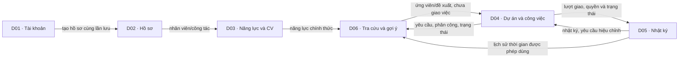

# Bản đồ miền nghiệp vụ — DATN

Ngày lập: **05/11/2026**. Trạng thái: **người dùng đã duyệt hướng phân miền sau review; đang soạn proposal feature đầu**.

## 1. Mục tiêu, nguồn và giới hạn

Mục tiêu đợt này: gom [FR/AC hiện hành](functional-requirements.md) theo trách nhiệm, xác định nơi chịu trách nhiệm dữ liệu/quyết định và các phụ thuộc. Tiêu chí đạt: 62 FR đang dùng đều có đúng một miền/phần hỗ trợ chủ trì; 33 bảng thiết kế có trách nhiệm rõ; các luồng liên miền không mất quyền, lịch sử hoặc tính nhất quán.

Nguồn ưu tiên theo [mục lục tài liệu](../README.md). Các phần cần đối chiếu trực tiếp:

- [Phân quyền](../../.claude/docs/roles_permissions.md), mục 1–4/R06 và [quy tắc miền](../../.claude/docs/domain_rules.md), mục 1–5.
- [Dự án và phân công](../../.claude/docs/project_task_assignment_workflow.md), UC001–UC004/Thay người; [effort](../../.claude/docs/work_effort_workflow.md), mục 3–6.
- [Hồ sơ](../../.claude/docs/employee_profile_workflow.md), mục 1–5; [kỹ năng](../../.claude/docs/skill_approval_workflow.md), chốt 27/10 và mục 1–8; [CV](../../.claude/docs/cv_extraction_approval_workflow.md), mục 1–3.
- [Gợi ý](../../.claude/docs/ai_recommendation_workflow.md), mục 1/3 và Contract lưu trữ; công thức mục 2 chưa chốt cuối.
- [Bàn giao và quyết định hiện hành](../design/database-review-decisions-2026-10-14.md#bàn-giao-cho-chat-cập-nhật-tài-liệu-và-thiết-kế-db), [DBML](../design/database-proposal-2026-10-14.dbml), [dictionary lõi](../design/database-step5a-core-dictionary-2026-10-14.md), [dictionary hỗ trợ](../design/database-step5b-supporting-dictionary-2026-10-14.md).
- [Kiến trúc](../../.claude/docs/architecture.md), đặc biệt chiều phụ thuộc/transaction; [bảo mật](../../.claude/docs/security.md), quyền và upload; [contract UI](../design/figma-make/screen-contracts.md), thông báo 29/10.

Đây là bản tổ chức yêu cầu, không phải một bản sao workflow. Actor/điều kiện/AC tra tại FR, quy tắc chi tiết tra nguồn. Không đổi nghiệp vụ, schema, công thức, dependency, code, migration/seed/DB hoặc xuất Jira. Chưa chốt tên package, interface, endpoint, WBS hay thứ tự triển khai.

## 2. Cách chia phù hợp với DATN solo

**Đề xuất 6 miền nghiệp vụ và 1 phần hỗ trợ thông báo**, trong một backend Go và cơ sở dữ liệu dùng chung theo kiến trúc hiện hành. Không tạo 7 ứng dụng/service, không chia người phụ trách như dự án nhóm, không yêu cầu mỗi miền có đủ mọi tầng/package riêng.

- **Miền** gom trách nhiệm nghiệp vụ có liên hệ chặt chẽ. **Feature** là luồng sẽ triển khai xuyên những miền cần thiết. FR là cơ sở nghiệm thu, không phải đơn vị deploy hoặc số lượng ticket.
- “Chủ trì FR” là nơi chịu trách nhiệm kết quả nghiệp vụ cuối của FR; miền khác có thể cung cấp dữ liệu/kiểm tra. Không suy actor từ tên miền: HR upload CV và Giám đốc duyệt kỹ năng vẫn ở cùng miền năng lực nhưng khác quyền.
- “Chịu trách nhiệm dữ liệu” là nơi định nghĩa cách thay đổi hợp lệ, không phải quyền SQL riêng hoặc bắt buộc mỗi bảng chỉ được đọc qua một API. Read model được join/projection theo quyền trên nguồn hiện có, không tạo bảng sao chép chỉ để phân miền.
- Các luồng cần nguyên tử vẫn có thể ghi nhiều nhóm bảng trong cùng transaction. Service điều phối theo kiến trúc đã có; phân miền không cho phép từng phần commit riêng, chờ đồng bộ rồi mới sửa sai.
- BR-001, CR-001, CR-002 được áp dụng cùng feature liên quan; không biến thành ba phân hệ hay ticket độc lập mặc định. Các quy tắc chưa được cấp mã BR/CR vẫn có hiệu lực tại workflow nguồn.

## 3. Miền chủ trì và FR

| Mã | Miền/phần hỗ trợ | Kết quả chịu trách nhiệm | FR chủ trì | Số FR |
|---|---|---|---|---:|
| D01 | Tài khoản và truy cập | Ai được truy cập và có quyền hệ thống nào | FR-001–FR-008, FR-063–FR-064 | 10 |
| D02 | Hồ sơ và cơ cấu công tác | Thông tin nhân viên chính thức, cơ cấu và đề nghị thông tin cá nhân | FR-009–FR-013, FR-015 | 6 |
| D03 | Năng lực, kỹ năng và CV | Năng lực được công nhận, danh mục kỹ năng và nguồn/căn cứ xét duyệt | FR-016–FR-028 | 13 |
| D04 | Dự án và công việc | Trách nhiệm dự án, đặc tả, giao việc, thực hiện, nộp và nghiệm thu | FR-029–FR-041, FR-043, FR-045–FR-053 | 23 |
| D05 | Nhật ký và hiệu chỉnh | Thời gian thực hiện đã ghi nhận, sửa sai và tổng effort | FR-054–FR-058 | 5 |
| D06 | Tra cứu và gợi ý nhân sự | Góc nhìn nghề nghiệp, tải công việc và đề xuất có giải thích | FR-042, FR-044, FR-065 | 3 |
| H01 | Thông báo nội bộ — hỗ trợ | Thông báo của người nhận, trạng thái đọc và mở tài nguyên đúng quyền | FR-059–FR-060 | 2 |

Tổng: **62 FR**. FR-014/FR-061/FR-062 đã chuyển loại tại bảng truy vết của tài liệu FR, không phân công lại như FR hiện hành.

### D01 — Tài khoản và truy cập

- **Chịu trách nhiệm:** tạo tài khoản kèm hồ sơ ban đầu qua luồng phối hợp D02; cấp mã nhân viên trong luồng tạo; đăng nhập/đăng xuất/thu hồi phiên; quản lý quyền hệ thống; khóa/mở; đổi/reset mật khẩu khi đã chốt chính sách.
- **Dữ liệu chính:** `users`, `user_roles`, `auth_sessions`. Mã nhân viên lưu ở D02 nhưng việc cấp mã là phần của luồng tạo do D01 chủ trì, không có hai bộ cấp mã độc lập.
- **Cần từ miền khác:** D02 cung cấp hồ sơ/trạng thái công tác và kiểm tra dữ liệu tạo; D04 cung cấp trách nhiệm hiện hành khi cần kiểm tra tác động đổi quyền. Xác thực quyền không thể chỉ dựa dữ liệu lúc đăng nhập.
- **Không nhận thêm:** D01 không quyết định PM/PTCM, không sửa hồ sơ thường xuyên thay HR hoặc duyệt kỹ năng. Không suy quyền từ cấp bậc/vị trí.
- **Điểm mở:** O01 của FR; không áp username/mật khẩu/phiên demo thành contract thật.

### D02 — Hồ sơ và cơ cấu công tác

- **Chịu trách nhiệm:** hồ sơ cá nhân/HR, duyệt cập nhật thông tin cá nhân, sửa hành chính trực tiếp, vô hiệu hóa và danh mục phòng ban/vị trí/cấp bậc.
- **Dữ liệu chính:** `employees`, `departments`, `positions`, `job_levels`, `employee_profile_change_requests`. Giá trị địa chỉ và các trường hồ sơ được thay đổi theo cùng quy tắc, dù từ Admin tạo ban đầu hay HR/người đề nghị về sau.
- **Cần từ miền khác:** D01 cho trạng thái tài khoản/quyền; D04 cho task/trách nhiệm mở để chặn vô hiệu hóa; H01 nhận sự kiện đề nghị/kết quả theo nguồn.
- **Không nhận thêm:** HR cập nhật hành chính không tự sửa năng lực chính thức/cấp quyền/đổi PM. Khóa tài khoản ở D01 không đồng nhất vô hiệu hóa hồ sơ ở D02; không tự mở lại trạng thái còn lại.
- **Quy tắc dùng chung:** BR-001 và R06. D02 giữ dữ liệu hành chính đầy đủ; projection nghề nghiệp D06 không được sao chép địa chỉ/liên hệ riêng tư.

### D03 — Năng lực, kỹ năng và CV

- **Chịu trách nhiệm:** danh mục nhóm/kỹ năng, năng lực chính thức; đề nghị chủ động và căn cứ; CV/phiên bản hiện tại, xử lý trích xuất và xét kỹ năng từ CV. Cùng một cơ chế quyết định công nhận cho cả hai nguồn, không hai bản official.
- **Dữ liệu chính:** `skill_categories`, `skills`, `employee_skills`, `employee_skill_change_requests`, `skill_request_task_evidence`, `employee_cvs`, `cv_extractions`, `cv_extracted_skills`.
- **Ba phần có thể làm từng feature:** danh mục/năng lực và đề nghị thủ công; quản lý/đọc tệp CV/căn cứ; trích xuất và đối chiếu kỹ năng từ CV. Cùng miền không buộc hoàn thành AI/model trước khi làm luồng thủ công.
- **Cần từ miền khác:** D02 cho nhân viên/công tác; D01 cho quyền/active; D04 cung cấp đúng đóng góp/lần nộp/nhận xét nghiệm thu được dẫn làm căn cứ. Không mặc định đọc nhật ký D05 hoặc toàn bộ trao đổi dự án.
- **Không nhận thêm:** HR hỗ trợ tệp không có quyền công nhận kỹ năng; chọn CV hiện tại không là duyệt tệp hoặc duyệt kỹ năng. CV mới không ghi đè official; không tự duyệt, không mở quyền xin gỡ kỹ năng.
- **Điểm mở:** O03–O05/O09; xử lý model được hoãn. Storage/parser/worker là thành phần kỹ thuật hỗ trợ D03, không tự thành miền nghiệp vụ hoặc nhà cung cấp đã chốt.

### D04 — Dự án và công việc

- **Chịu trách nhiệm:** vòng đời dự án, PM/PTCM, nhóm/task/requirements, đóng băng đặc tả/hạn; lựa chọn thủ công, bản nháp, xác nhận/thay/thu hồi phân công; trạng thái thực hiện, lần nộp, nghiệm thu, trao đổi và lịch sử đóng góp từ lượt giao.
- **Dữ liệu chính:** `projects`, `project_status_history`, `task_groups`, `tasks`, `task_requirements`, `assignments`, `task_submissions`, `task_status_history`, `task_comments`.
- **Vì sao giữ chung dù nhiều FR:** phân công, người hiện tại, trạng thái task, lần nộp và kết luận nghiệm thu cùng quyết định ai đang chịu trách nhiệm cho đầu ra. Tách thành các miền độc lập ngay sẽ phải phối hợp nhiều nơi cho mỗi thao tác. Khi viết feature có thể chia phạm vi nội bộ thành vòng đời dự án, cấu trúc, phân công và thực hiện/nghiệm thu; chưa chốt package.
- **Cần từ miền khác:** D01/D02 cho actor/người đủ điều kiện; D03 cho danh mục và năng lực; D06 cho projection ứng viên/kết quả gợi ý; D05 cho log tại lần nộp, yêu cầu hiệu chỉnh và tổng effort; H01 cho thông báo.
- **Ranh giới quyết định:** D06 trả đề xuất, **D04 mới xác nhận phân công** sau kiểm tra hiện hành. Điều kiện không giao task cho PTCM cùng dự án phải dùng thống nhất ở cả nhánh thủ công/gợi ý/xác nhận/thay PTCM, không tạo bốn quy tắc khác nhau.
- **Không nhận thêm:** PM-only không có quyền chuyên môn, Giám đốc tạo/thay PM không tự thành người điều hành chuyên môn; không roster, reviewer riêng, PM duyệt từng phân công hoặc mở lại task đã nghiệm thu.
- **Điểm mở:** O06/O08 và phần công thức/weight O02 có liên quan; ghi nhận chưa chốt không cho phép mở form sửa frozen spec.

### D05 — Nhật ký và hiệu chỉnh

- **Chịu trách nhiệm:** log thực tế theo lượt giao, sửa/xóa mềm, yêu cầu sửa sai khi khóa/lượt cũ, quyết định hiệu chỉnh và tổng effort. D05 kiểm tra tổng phút theo người/ngày xuyên dự án, không mỗi task tự kiểm tra tổng riêng.
- **Dữ liệu chính:** `work_logs`, `work_log_history`, `work_log_change_requests`.
- **Cần từ miền khác:** D04 cung cấp assignment, quyền PTCM hiện hành, trạng thái và khoảng thực hiện; D01/D02 cho active. H01 thông báo yêu cầu/kết quả theo luồng đã chốt.
- **Ranh giới quyết định:** D05 quyết định khoản log/yêu cầu hiệu chỉnh hợp lệ; D04 quyết định trạng thái task và nghiệm thu đầu ra. D04 chủ trì nộp kết quả nhưng chụp đúng dữ liệu log từ D05; hiệu chỉnh sau đó không sửa snapshot lần nộp.
- **Không nhận thêm:** không timer/chấm công/lương/OT, không PM ghi/duyệt thay từ quyền PM. Tổng effort không là tải tồn đọng; thiếu log không tự chặn nghiệm thu. Tập mẫu lịch sử dùng chấm điểm chưa chốt không làm thay đổi sổ nhật ký.

### D06 — Tra cứu và gợi ý nhân sự

- **Chịu trách nhiệm:** projection nghề nghiệp theo mục đích, tải xuyên dự án/số dự án đang có việc, dữ liệu so sánh ứng viên, chạy và lưu gợi ý có giải thích. Đây là miền hỗ trợ quyết định sử dụng nhân sự, không quản lý hồ sơ gốc.
- **Dữ liệu chính do D06 tạo:** `recommendation_runs`, `recommendation_items`. Dữ liệu đọc lấy từ D01/D02 (eligibility/nhận diện), D03 (official), D04 (đặc tả/phân công/trạng thái/đầu ra), D05 (tổng lịch sử được dùng theo chính sách).
- **Ranh giới tải:** D04 giữ nguồn assignment/estimate/trạng thái; D06 tính góc nhìn tải và tải dự kiến trên nguồn đó. D05 giữ phút thực tế, không lấy estimate trừ effort làm remaining load hoặc lưu một bản tải độc lập trong nhân viên.
- **Ranh giới thuật toán:** phần matching nhận snapshot thuần dữ liệu, không DB/HTTP theo kiến trúc. Dữ liệu nguồn/ABAC và lưu run do service/adapters thực hiện; không đưa quyền dự án vào scorer như một quyền ghi. Run bất biến không có nghĩa người đọc run có quyền xem raw snapshot.
- **Không nhận thêm:** không công nhận kỹ năng, không tự giao task, không viết bảng nguồn của các miền khác. Thủ công có thể dùng cùng projection mà không chạy engine hoặc sinh điểm/hạng.
- **Điểm mở:** O02/O08. Không tự dùng công thức thử nghiệm làm công thức cuối hoặc tạo bảng read model mới.

### H01 — Thông báo nội bộ

- **Chịu trách nhiệm:** bản ghi của từng người nhận, danh sách/chưa đọc, đánh dấu đọc và điều hướng đến tài nguyên sau kiểm tra quyền hiện hành.
- **Dữ liệu chính:** `notifications`. Miền phát sinh nghiệp vụ chịu trách nhiệm sự kiện hợp lệ/người nhận theo workflow; H01 cung cấp cách ghi/đọc dùng chung, không tự suy một lần duyệt hoặc tạo sự kiện mới.
- **Phụ thuộc:** quyền tài nguyên D02/D03/D04/D05 khi mở liên kết; D01/D02 cho người dùng hợp lệ. Dữ liệu đích đã mất quyền phải từ chối mở; vẫn xử lý trạng thái đọc của chính chủ theo FR-060.
- **Không nhận thêm:** không email/push/broker/outbox hoặc quyền phê duyệt từ notification. Ghi thông báo cho nghiệp vụ đã chốt cùng transaction nghiệp vụ; không phát lại từ render/fixture hoặc chạy một luồng commit riêng để bù lỗi.

## 4. Trách nhiệm dữ liệu trên 33 bảng thiết kế

Các nhóm dưới đây không đổi TableGroup trong DBML và không là phương án tách DB/schema SQL. Cụm “chủ trì thay đổi” nghĩa là quy tắc thay đổi do miền tương ứng định nghĩa; các thao tác nhiều miền xem mục 6.

| Chủ trì thay đổi | Bảng thiết kế hiện hành | Số bảng |
|---|---|---:|
| D01 | `users`, `user_roles`, `auth_sessions` | 3 |
| D02 | `employees`, `departments`, `positions`, `job_levels`, `employee_profile_change_requests` | 5 |
| D03 | `skill_categories`, `skills`, `employee_skills`, `employee_skill_change_requests`, `skill_request_task_evidence`, `employee_cvs`, `cv_extractions`, `cv_extracted_skills` | 8 |
| D04 | `projects`, `project_status_history`, `task_groups`, `tasks`, `task_requirements`, `assignments`, `task_submissions`, `task_status_history`, `task_comments` | 9 |
| D05 | `work_logs`, `work_log_history`, `work_log_change_requests` | 3 |
| D06 | `recommendation_runs`, `recommendation_items` | 2 |
| H01 | `notifications` | 1 |
| Dùng chung theo CR-001/CR-002 | `audit_events`, `idempotency_records` | 2 |

Tổng: **33 bảng**, mỗi bảng có một đầu mối trách nhiệm trong bảng này. Không phát sinh bảng từ việc phân miền.

`audit_events` và `idempotency_records` là cơ chế dùng chung: miền thực hiện use case quyết định nội dung audit hoặc kết quả chống ghi lặp và lưu cùng giao dịch cần bảo vệ. Không có một “miền audit” quyết định thay nghiệp vụ; adapter ghi dùng chung không thành chủ thể có toàn quyền sửa mọi dữ liệu. Phạm vi/retention theo O07, không ép mọi API có key.

## 5. Quan hệ dữ liệu và quyết định giữa các miền

Mũi tên biểu thị dữ liệu/kết quả trao đổi, **không phải chiều import Go** hoặc kiến trúc gọi HTTP giữa service. Quan hệ D04–D05/D06 hai chiều thể hiện nhu cầu nghiệp vụ; chưa có nghĩa được tạo vòng import. Khi thiết kế feature, service dùng interface/projection và transaction runner theo kiến trúc nguồn; matching vẫn thuần dữ liệu.

Các kiểm tra active/quyền, audit/chống lặp và thông báo áp dụng xuyên luồng nên không vẽ lại mọi cạnh vào sơ đồ. Danh sách trao đổi chính để phân biệt nguồn và người quyết định:

| Nơi sử dụng | Nguồn cần đọc/phối hợp | Quyết định vẫn thuộc |
|---|---|---|
| Đăng nhập/truy cập nghiệp vụ | D01 phiên/quyền hệ thống + D02 active + D04 trách nhiệm tài nguyên khi cần | Kiểm tra truy cập và quyền của từng use case; không một role snapshot cấp quyền vĩnh viễn |
| HR vô hiệu hóa | D04 công việc/trách nhiệm mở; D01 điều kiện Admin cuối và truy cập | D02 thao tác vô hiệu hóa; D01 khóa tài khoản là thao tác khác |
| Xét kỹ năng có căn cứ task | D04 đóng góp/lần nộp/nghiệm thu đúng người, đúng căn cứ | D03 quyết định năng lực, không nghiệm thu lại task |
| Tra cứu/gợi ý | D02 thông tin nghề nghiệp, D03 official, D04 tải nguồn, D05 dữ liệu lịch sử hợp lệ | D06 projection/run; D04 kiểm tra lại trước khi phân công |
| Nghiệm thu đầu ra | D04 criteria/submission; D05 log/snapshot để đối chiếu | D04 kết luận đầu ra; D05 hiệu chỉnh là quyết định riêng |
| Mở thông báo | H01 bản ghi của người nhận + miền đích kiểm tra quyền hiện tại | Miền đích cho/không cho đọc; H01 không khôi phục quyền |

Những lần đọc tổng hợp không được trả toàn bộ entity/JSON/snapshot nguồn. R06/BR-001 áp dụng cả kết quả tra cứu, lỗi, lịch sử và thông báo; biết ID hoặc có quan hệ FK không đồng nghĩa có quyền đọc.

## 6. Các luồng liên miền phải giữ nhất quán

Đây là nhận diện nơi cần phối hợp cho proposal, không thiết kế lại thứ tự khóa/SQL hoặc chốt API. Một luồng dùng nhiều miền vẫn có một kết quả nghiệp vụ; không tách commit theo tên miền.

| Luồng | Chủ trì và phần phối hợp | Điều phải giữ khi thiết kế |
|---|---|---|
| Admin tạo tài khoản kèm hồ sơ | D01 chủ trì/cấp mã; D02 kiểm tra và ghi hồ sơ/mã/danh mục; CR dùng chung | User/employee/cấp mã và quyền ban đầu nhất quán, không tài khoản mồ côi hoặc mã trùng. Không mở Admin sửa hành chính về sau. |
| Khóa tài khoản/đổi quyền | D01; tham chiếu D02/D04 theo điều kiện thao tác | Khóa khẩn cấp không tự bàn giao; thay quyền không đổi PM/PTCM. Thu hồi phiên cùng thao tác cần bảo vệ; giữ ngoại lệ Admin cuối theo nguồn. |
| Đổi PTCM/phân công | D04; D01/D02 active, D03 official, D06 ứng viên/run | Điều kiện đối ứng không giao task cho PTCM và tránh tự nghiệm thu phải được kiểm tra thống nhất tại lưu; không chỉ lọc UI hoặc tin run cũ. |
| Duyệt kỹ năng MANUAL/CV | D03; D04 căn cứ giới hạn; H01/CR | Quyết định/official/phiên bản căn cứ cùng giao dịch theo workflow; không hai nơi tự ghi official. CV và đề nghị thủ công dùng cùng giới hạn pending; không nhân đôi quyết định. |
| Xác nhận batch phân công | D04; D06 run bất biến, D03 giá trị kỹ năng, D01/D02 eligibility, H01/CR | Tất cả thành công hoặc không dòng nào được giao. Task/lượt giao/lịch sử/thông báo/chống lặp nhất quán. Không giữ transaction khi người dùng đang so sánh nháp hoặc âm thầm cập nhật điểm của run cũ. |
| Nộp kết quả | D04 chủ trì; D05 bộ log đúng lượt; H01/CR | Lần nộp/snapshot/trạng thái chờ nghiệm thu nhất quán, không bắt có đủ log. Hiệu chỉnh sau đó không viết lại snapshot nộp. |
| Duyệt hiệu chỉnh | D05 chủ trì; D04 trạng thái/assignment/PTCM; H01/CR | Log/quyết định/history hoặc log kết quả/thông báo áp dụng một lần; kiểm tra tổng người/ngày xuyên dự án. Không tự đổi task sang chưa nghiệm thu hoặc viết lại accepted_at. |
| Đóng/hủy dự án | D04 chủ trì; D05 pending correction; H01/CR | Đóng kiểm tra không còn pending; hủy xử lý pending theo nguồn. Cùng transaction với các thay đổi liên quan; không giả kết luận nghiệm thu chưa có hoặc xóa effort. |
| Upload/xử lý CV | D03; storage/provider/parser theo thiết kế sau | File/cloud và DB không cùng transaction: cần cleanup/recovery, không giữ transaction chờ model. Không lấy quy tắc atomic DB để tuyên bố đã có giao dịch phân tán. |

Hủy task riêng, thu hồi/thay người và các nhánh lỗi vẫn theo FR/workflow hiện hành, không bị bỏ vì bảng trên chỉ nêu các điểm phối hợp chính.

## 7. Điểm mở, review và bước tiếp theo

Các O01–O09 tiếp tục nằm tại tài liệu FR, không sao chép nội dung để tạo hai sổ quyết định. Đầu mối chuẩn bị chốt:

| Điểm mở tại FR | Miền phối hợp |
|---|---|
| O01 | D01 với D02; chỉ chốt phần ảnh hưởng luồng auth/tạo tài khoản sẽ làm |
| O02 | D06 với D03/D04/D05; không áp tham số thử nghiệm hoặc thêm công thức mới |
| O03–O05 | D03; D01/D02 cho quyền, storage/parser là adapter chưa chọn |
| O06 | D04; chưa mở sửa frozen spec |
| O07 | Miền chủ trì feature cùng cơ chế CR dùng chung |
| O08 | D06 với D04 và miền cung cấp dữ liệu; không coi chọn các dòng hiện có là đã chọn toàn bộ các trang |
| O09 | D03; tiếp tục hoãn, không tự duyệt/người duyệt thay |

Các điểm đã review ở mức tài liệu:

- **Độ phủ:** mỗi FR hiện hành có một nơi chủ trì; BR/CR không bị tính lại như FR, các ID cũ không mất dấu.
- **Dữ liệu:** phân trách nhiệm đủ 33 bảng thiết kế, không bảng có hai nơi tự định nghĩa quy tắc ghi; projection không thành bản hồ sơ/năng lực/tải chính thức thứ hai.
- **Quyền:** không chia miền theo actor; cùng người kiêm nhiệm vẫn kiểm tra đúng quyền. Trách nhiệm PM/PTCM thuộc D04 theo từng dự án, không role toàn hệ thống của D01 hoặc chức danh D02.
- **Quyết định:** D06 gợi ý/D04 giao việc; D04 nghiệm thu/D05 hiệu chỉnh; D02 hành chính/D03 công nhận kỹ năng; H01 thông báo không cấp quyền.
- **Khả thi cho solo:** một backend/DB theo kiến trúc hiện hành; D03 và D04 có thể triển khai từng feature, không phải viết hết miền trước khi nối FE hoặc buộc tách microservice/package.

Đây là review phân tích và kiểm kê, không xác nhận backend, migration, giao dịch cạnh tranh, file storage hoặc UI đã đáp ứng. Chưa chạy DB hoặc đổi schema. Danh sách dependency trên là nhu cầu nghiệp vụ; thiết kế interface/SQL/khóa cần được kiểm chứng ở proposal của feature thực tế.

**Tiếp nối sau duyệt bản đồ 05/11:** đã soạn [proposal auth/session](../proposals/backend-auth-session.md) làm feature đầu, cùng các mục nền bắt buộc. Người dùng chọn email công ty để login; các lựa chọn kỹ thuật khác còn chờ duyệt trong proposal. Sau duyệt phạm vi/API/dữ liệu/quyền/kiểm thử/WBS mới chốt phần tự viết Go/phần agent hỗ trợ và tạo Jira/code. Chưa mở bài tập config hoặc triển khai toàn bộ một miền.

**Tiếp nối 06/11/2026:** D01 chịu trách nhiệm cấp mật khẩu tạm qua email và bắt buộc đổi trước nghiệp vụ theo [quyết định tiếp nối](../business-baseline-2026-10-20.md#quyết-định-tiếp-nối-06112026--cấp-mật-khẩu-tạm-qua-email). Không thêm miền; đã chốt thêm users.must_change_password, không hạn mật khẩu tạm; vẫn 33 bảng. A02–A09 đã duyệt ngày 06/11, nguồn baseline và proposal auth; OpenAPI/ports/SQL cụ thể còn phải hoàn thiện. Chưa đồng bộ toàn bộ Neon hoặc có auth runtime.
