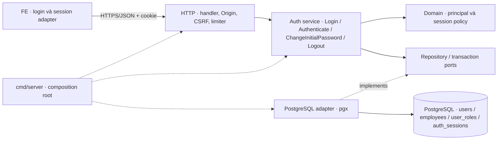
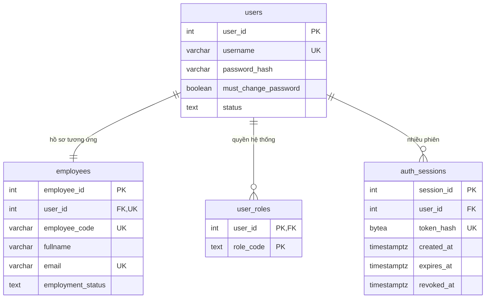
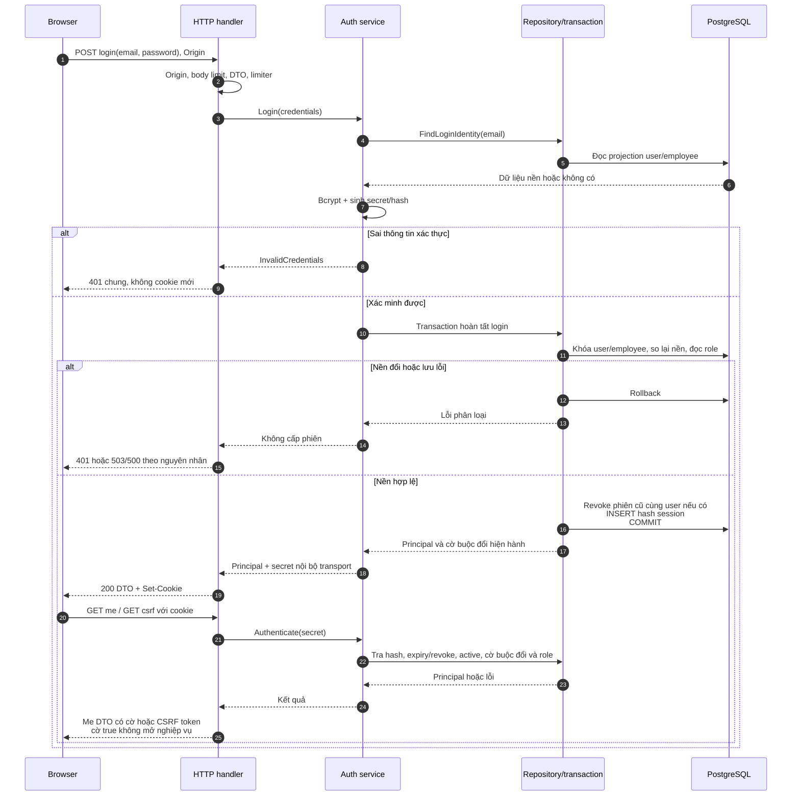
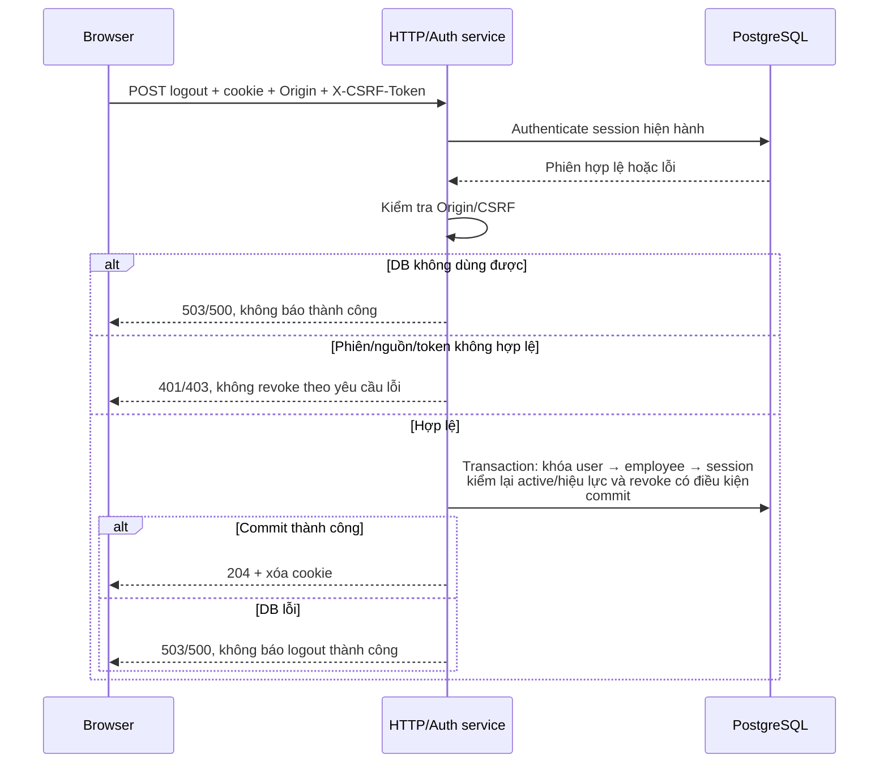
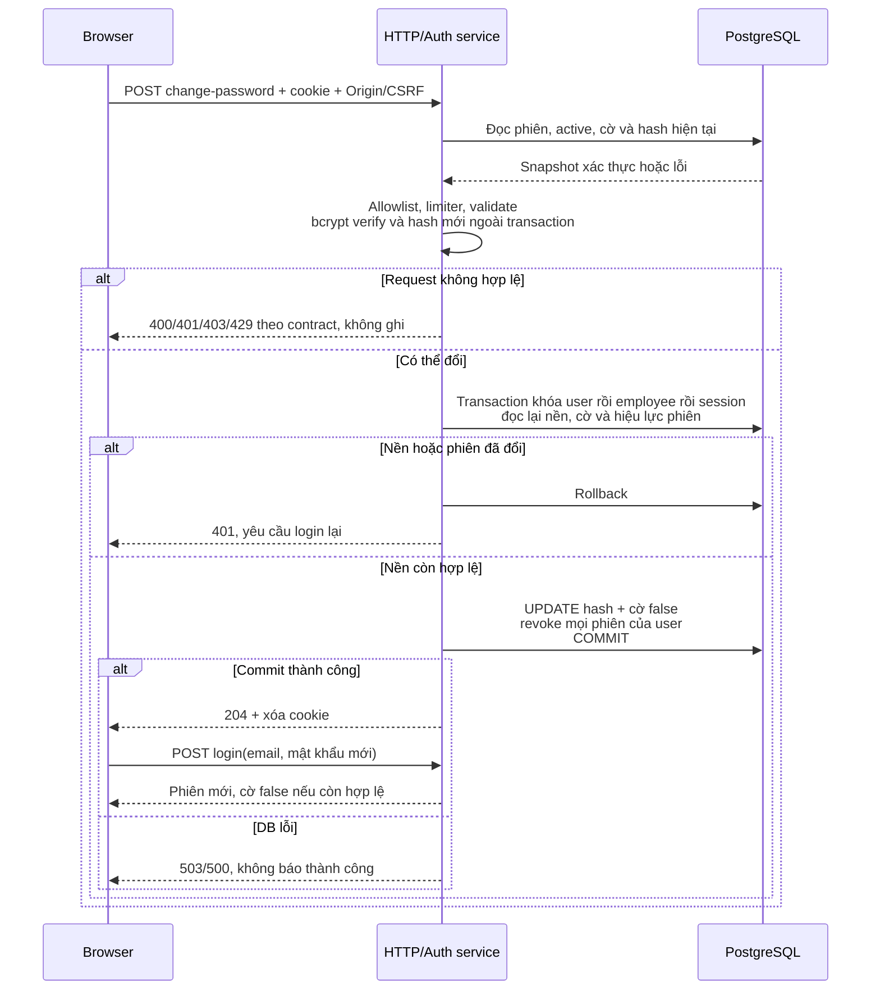

# Proposal — Đăng nhập và phiên truy cập backend

Ngày lập: **05/11/2026** · Cập nhật contract: **07/11/2026 (DATN-2 / AUTH-T01)** · Review WBS: **07/11/2026** · Trạng thái: **A01–A09 đã duyệt; chi tiết triển khai đang chuẩn bị, chưa có code auth** · Nhánh contract: `feature/DATN-2-auth-contract`.

Feature đầu tiên thuộc D01, phối hợp D02: đăng nhập bằng email công ty, đăng xuất, xác định người dùng/quyền hệ thống hiện hành và bảo vệ API bằng phiên phía server; bổ sung cổng đổi mật khẩu tạm lần đầu theo chốt 06/11. Không triển khai toàn bộ miền tài khoản. A01–A09 đã được người dùng duyệt theo chốt tiếp nối 06/11; các đề xuất khác còn ghi rõ bên dưới không tự trở thành quyết định.

## 1. Bối cảnh và nguồn

Backend hiện có health/router, cấu hình, pool và công cụ migration/seed; chưa có auth service/session middleware hoặc API nghiệp vụ. FE có phiên trong bộ nhớ, không xử lý mật khẩu thật. Migration 000001 lưu `users.system_role` theo mô hình cũ, chưa có `user_roles`/`auth_sessions`; không được dùng nguyên trạng để tuyên bố đã đáp ứng auth mới.

Nguồn áp dụng:

- [FR](../product/functional-requirements.md): FR-001–FR-003, phần đổi mật khẩu lần đầu của FR-004, CR-001/CR-002; O01 về auth, O07 khi cần xác định phạm vi chống lặp.
- [Miền nghiệp vụ](../product/business-domains.md): D01/D02, trách nhiệm theo tài nguyên vẫn thuộc miền nghiệp vụ.
- [Quyết định mật khẩu tạm 06/11](../business-baseline-2026-10-20.md#quyết-định-tiếp-nối-06112026--cấp-mật-khẩu-tạm-qua-email).
- [Quyết định đăng nhập 05/11](../business-baseline-2026-10-20.md#quyết-định-tiếp-nối-05112026--định-danh-đăng-nhập-backend).
- [Phân quyền](../../.claude/docs/roles_permissions.md): mục 2–4; [bảo mật](../../.claude/docs/security.md): mục 1–4; [API](../../.claude/docs/api_design.md): mục 1–2/6; [kiến trúc](../../.claude/docs/architecture.md): mục 1–3/5.
- [DBML](../design/database-proposal-2026-10-14.dbml), [dictionary phiên](../design/database-step5b-supporting-dictionary-2026-10-14.md): mục 18; [mapping chuyển đổi](../design/database-step5c-migration-map-2026-10-14.md).
- [Frontend](../../web/README.md): hiện trạng phiên mô phỏng; [contract màn hình](../design/figma-make/screen-contracts.md): UI-01/tiếp nối phiên 29/10.

Proposal dẫn lại nguồn, không thay AC hoặc tạo một bộ quy tắc nghiệp vụ song song. Không lấy các mốc M1 trong tài liệu kiểm thử cũ làm cam kết hoàn thành reset trong feature này.

## 2. Mục tiêu — Objective

Cho nhân viên có tài khoản hợp lệ đăng nhập bằng email công ty, duy trì phiên có thể thu hồi, đổi mật khẩu tạm lần đầu và đăng xuất; server xác định danh tính/quyền hiện hành để làm nền cho các API nghiệp vụ sau. Kết quả đợt này là luồng auth chạy xuyên FE → HTTP → service → DB test được phép, chưa phải toàn bộ FE được nối API.

## 3. Mục tiêu cụ thể và ngoài phạm vi — Goals / Non-goals

| Goal / kết quả | Truy vết | Tiêu chí demo khi đã triển khai |
|---|---|---|
| G1 — Đăng nhập thật | FR-001 | Email/mật khẩu hợp lệ và user/employee active mở được phiên; sai thông tin báo chung |
| G2 — Khôi phục danh tính từ phiên | FR-001 | Reload gọi `me`, lấy danh tính/quyền từ server, không chọn danh tính để cấp quyền |
| G3 — Đăng xuất | FR-002 | Phiên hiện tại bị thu hồi; cookie cũ không dùng lại được, phiên khác không bị logout theo |
| G4 — Hết hạn/thu hồi/khóa | Phần nền FR-003 | Lần truy cập sau bị chặn theo dữ liệu DB hiện hành; không chỉ tin role lúc login |
| G5 — Bảo vệ mutation | CR-002 và security | Origin/CSRF hợp lệ mới ghi; không đưa secret vào JSON/log/localStorage |
| G6 — Bắt buộc đổi mật khẩu tạm | FR-001/004, chốt 06/11 | Chưa đổi không vào nghiệp vụ; đổi thành công phải đăng nhập lại bằng mật khẩu mới |

**Trong phạm vi bổ sung:** đăng nhập hạn chế khi cờ buộc đổi đang bật, bootstrap trạng thái này, đổi mật khẩu lần đầu và đăng nhập lại. Chỉ phần này của FR-004 được đưa vào feature; chưa làm đổi mật khẩu tự nguyện cho tài khoản đã hoàn tất lần đầu.

**Ngoài phạm vi:** tạo tài khoản/hồ sơ, cấp username, sinh/gửi email mật khẩu tạm, reset/quên mật khẩu, màn quản trị khóa/đổi quyền, MFA/SSO, JWT/refresh, chức năng dự án, CV/model, thông báo auth hoặc chuyển toàn bộ FE mock sang API. Không thêm bảng/cột ngoài cờ đã chốt, dependency, idle timeout hoặc “ghi nhớ đăng nhập”. Fixture được phép thay luồng cấp tài khoản chỉ để kiểm thử, không coi đã có chức năng gửi thư.

FR-003 chỉ được đáp ứng một phần: cung cấp kiểm tra hiện hành và cơ chế revoke để các mutation quản trị dùng sau. Chưa có API khóa/đổi role/reset thì không đánh dấu hoàn thành toàn FR-003. Quyền PM/PTCM không được thêm vào `user_roles` hoặc cache lâu dài trong phiên; chưa có API dự án thì chưa chứng nhận ABAC dự án đã triển khai.

## 4. Câu hỏi mở và giả định — Open questions & assumptions

| ID | Nội dung | Trạng thái / cổng thực hiện |
|---|---|---|
| A01 | Đăng nhập bằng email công ty và mật khẩu; username vẫn là dữ liệu riêng | **Người dùng đã chốt 05/11**. Không đổi schema/username cũ |
| A02 | Email trim đầu/cuối, so không phân biệt hoa/thường; không viết lại dữ liệu đã lưu; trùng chuẩn hóa thì dừng | **Đã duyệt 06/11**; kiểm kê/mapping/ràng buộc vẫn là công việc P04, không tự thêm index |
| A03 | Phiên có hạn tuyệt đối 8 giờ từ login; không tự gia hạn/idle timeout/ghi nhớ | **Đã duyệt 06/11**; áp cả phiên hạn chế, fake clock kiểm biên |
| A04 | Chưa xóa vật lý phiên hết hạn/revoked trong feature | **Đã duyệt 06/11**; retention/lịch dọn trước vận hành lâu dài còn mở |
| A05 | PostgreSQL local riêng, dữ liệu giả; đề xuất dựng bằng Docker, cùng major Neon (hiện 18) | **Đã duyệt hướng test 06/11**; chưa kiểm tra/cài Docker, dựng DB hoặc fixture; không dùng DB phát triển làm DB test |
| A06 | Migration tiến thêm, giữ nguyên 000001, không reset/tạo baseline mới | **Đã duyệt hướng 06/11**; SQL/mapping legacy và kế hoạch áp DB phải review ở P04 trước thực thi; 000002 diễn tập riêng không hoàn tất nền auth |
| A07 | Cookie staffing_session, CSRF HMAC-SHA256 gắn phiên/Origin, proxy dev /api; login thay secret và revoke cookie cũ cùng user | **Đã duyệt 06/11**; kiểm thử theo mục 6.2.4, không thu hồi xuyên user |
| A08 | Cùng bảng/cookie phiên hạn chế; đổi lần đầu thay hash + false + revoke mọi phiên cùng transaction, login lại | **Đã duyệt 06/11**; giao thức khóa và kiểm hiện hành ở mục 6.1.2/6.2.5 |
| A09 | Mật khẩu mới ≥15 ký tự Unicode và ≤72 byte UTF-8, không cắt/trim/ép nhóm ký tự; limiter đổi riêng | **Đã duyệt 06/11**; ngưỡng/chi tiết tại mục 6.2.5, không áp lên login credential cũ |

Nguồn quyết định: [chốt auth A02–A09 ngày 06/11](../business-baseline-2026-10-20.md#quyết-định-tiếp-nối-06112026--chốt-lựa-chọn-auth-a02a09). Không yêu cầu người dùng chốt lại các lựa chọn này ở từng task. P01 đã có bản soạn OpenAPI/ports và ca kiểm tra để review; giới hạn body login/đổi lần đầu cũng đã chốt 8 KiB theo tiếp nối cùng ngày; P04 còn mapping/SQL và môi trường cụ thể. Việc duyệt hướng test/migration không tự cho phép áp SQL lên Neon.

A02–A09 chỉ đóng phần cần cho feature này, không đóng toàn bộ O01. Quy tắc cấp username, sinh/gửi lại mật khẩu tạm, reset và retention vẫn thuộc đợt sau. Login xác minh bcrypt hiện có; không áp chính sách tạo mật khẩu mới ngược lên credential cũ.

### 4.1. Thay đổi đã chốt 06/11 — mật khẩu tạm và phạm vi thiết kế bổ sung

Theo [quyết định 06/11](../business-baseline-2026-10-20.md#quyết-định-tiếp-nối-06112026--cấp-mật-khẩu-tạm-qua-email), cấp tài khoản mới dùng mật khẩu tạm qua email và bắt buộc đổi trước nghiệp vụ. Chốt này không quyết định reset của Admin.

- **Đã chốt:** `users.must_change_password BOOLEAN NOT NULL DEFAULT false`; tài khoản cũ false, cấp mật khẩu tạm true, đổi thành công thay hash và đặt false cùng giao dịch. Mật khẩu tạm chưa có hạn; hạn phiên vẫn riêng. Sau đổi phải đăng nhập bằng mật khẩu mới.
- **Thiết kế lựa chọn đã duyệt A08/A09:** năm route ở mục 6.2, DTO cờ buộc đổi, allowlist phiên hạn chế, transaction đổi mật khẩu/thu hồi phiên và sequence ở mục 6.2.5. A08/A09 đã chốt cách giới hạn phiên/đổi lần đầu và chính sách mật khẩu; không biến thiết kế thành hiện thực đã chạy.
- **WBS/estimate:** mục 9–10 giữ 26 task/81 giờ cũ làm mốc so sánh, thêm 7 task/24 giờ cho delta đã biết. Cơ sở mới đề xuất 105 giờ, chưa phải cam kết hoặc thời gian còn lại; gửi thư/tạo tài khoản không nằm trong đó.
- **DB thực tế:** migration riêng 000002 thêm cờ đã được diễn tập trên nhánh tạm, chưa áp lên production; bằng chứng và cổng áp dụng xem [mapping 5C, mục 0](../design/database-step5c-migration-map-2026-10-14.md). Không đánh dấu toàn bộ nền auth hoặc 33 bảng đã migrate.

Mục tiêu đợt cập nhật tài liệu này là đồng bộ thiết kế/đầu việc và ghi nhận xác nhận A02–A09; không viết code, gửi thư hoặc áp migration.

## 5. Thiết kế tổng thể — High-level design

1. FE gửi email/password qua HTTPS (localhost dev là ngoại lệ cấu hình); server giới hạn body/attempts và kiểm tra nguồn login.
2. Tìm tài khoản qua email theo A02; kiểm tra mật khẩu bằng bcrypt. Sai email/mật khẩu, user không active hoặc employee không active đều trả lỗi chung; tài khoản không tồn tại vẫn dùng phép kiểm tra hash giả để giảm khác biệt thời gian, không cam kết chống mọi timing attack.
3. Tạo secret ngẫu nhiên, kiểm tra lại hash/status nền trước khi ghi session; chỉ sau commit thành công mới đặt cookie. Login mới không mặc định logout mọi thiết bị. Nếu request đã mang phiên hợp lệ của cùng user đang login, thu hồi đúng phiên đó cùng giao dịch để thay bằng secret mới, không tái sử dụng secret do client đưa.
4. Login/me trả cờ `must_change_password` hiện hành. Khi true, chỉ cho me/csrf/logout và đổi mật khẩu lần đầu; mọi API nghiệp vụ bị chặn ở server dù user có role đặc biệt. Khi đổi thành công, thu hồi phiên theo phương án A08, xóa cookie và yêu cầu login mới; không tự nâng phiên hạn chế thành phiên nghiệp vụ.
5. Mỗi request bảo vệ tra hash/session, expiry/revocation, user/employee hiện hành, cờ buộc đổi và role hiện hành. Trả principal tối thiểu, không lấy actor từ body. DB lỗi trả 503, không cho qua và không giả là sai mật khẩu.
6. FE lấy CSRF token cho phiên hợp lệ; logout kiểm tra nguồn/CSRF, revoke phiên hiện tại rồi xóa cookie cùng thuộc tính/path. Nếu DB lỗi không báo logout thành công; cookie bị mất sau commit thì retry không phục hồi phiên đã revoke.

```text
HTTP handlers/middleware → service auth → domain principal/session policy
PostgreSQL adapter → interface do service định nghĩa
Composition root nối config + adapter + service + router
```

Đề xuất thêm mã theo trách nhiệm trong các tầng hiện hữu (`internal/service`, `internal/domain`, `internal/repository/postgres`, `internal/transport/http`); chỉ tạo package/file thực sự có nội dung khi làm task. Service không import pgx/HTTP; transport không tự query DB. Dùng chi/pgx/x/crypto và thư viện chuẩn đã có, không thêm framework/session library.

Không tạo generic RBAC engine, bảng permissions hoặc endpoint demo cấp quyền. Role hệ thống không thay kiểm tra tài nguyên; mỗi feature nghiệp vụ sau phải dùng trách nhiệm hiện hành và transaction phù hợp.

### 5.1. Thành phần và đường đi runtime



Cạnh liền là luồng sử dụng runtime; cạnh `implements` là quan hệ hiện thực interface, không yêu cầu service import adapter. Service gọi adapter qua port; không có HTTP giữa các miền trong cùng backend.

| Thành phần | Trách nhiệm / thay đổi dự kiến |
|---|---|
| `cmd/server/main.go` | Wire config, repo, auth service, router; redaction lỗi khởi động |
| `internal/config` | Validate env/port/Origin/TTL/cookie dev; test không đọc `.env` thật |
| `internal/domain` | Principal và kiểm tra expiry/active thuần dữ liệu, không pgx/HTTP |
| `internal/service` | Login/Authenticate/ChangeInitialPassword/Logout; interface repo/transaction/clock; điều phối bcrypt và session |
| `internal/repository/postgres` | SQL projection, khóa và transaction theo mục 6.1, không trả pgx type lên service |
| `internal/transport/http` | Parse DTO, middleware, cookie, CSRF/rate limit, map lỗi; không tự query DB |
| FE auth adapter | Login/me/csrf/change-password/logout, tách khỏi bộ điều khiển demo; chưa nối toàn bộ tính năng |

Đây là vị trí trách nhiệm đề xuất, không yêu cầu mỗi hàng thành package hoặc framework riêng. Tên interface/file cụ thể chốt khi làm task để tránh tầng rỗng.

### 5.2. Phương án đã cân nhắc

| Phương án | Đánh giá |
|---|---|
| Cookie secret + session DB | Theo kiến trúc đã chốt; tra expiry/revocation/quyền hiện hành, chấp nhận truy vấn DB cho request bảo vệ |
| Access JWT/refresh hoặc lưu token localStorage | Không chọn: khác kiến trúc session hiện hành, thêm vòng đời token không thuộc feature |
| Cache role trong session lâu dài | Không chọn: quyền có thể thay đổi, không thay kiểm tra nguồn hiện hành |
| Dựng toàn bộ quản trị tài khoản trước auth | Không chọn trong đợt này: mở quá rộng; dùng fixture test được phép để nghiệm thu auth trước |
| Tách auth thành microservice/BFF riêng | Không cần cho DATN solo; tăng vận hành, không có yêu cầu nguồn |

Entrypoint là HTTP đồng bộ vì FE cần biết kết quả đăng nhập ngay. Không có queue/event/model hoặc external provider trên đường login.

### 5.3. Contract service/repository — đầu ra thiết kế P01.3

Đây là chữ ký thiết kế để review trước task Go, không phải package/interface đã triển khai. Giữ các tầng hiện hữu; chưa tạo package rỗng hoặc thay NewRouter. Transport dùng DTO OpenAPI, không marshal kiểu nội bộ chứa credential/hash. Clock và nguồn random là hai điểm truyền phụ thuộc để kiểm biên/thất bại; không dựng framework DI hoặc generic repository.

```go
// Các kiểu nội bộ chỉ minh họa contract, không phải DTO JSON.
type SessionSecret [32]byte
type SessionHash [32]byte

type Clock interface {
    Now() time.Time
}

type SecretSource interface {
    NewSessionSecret() (SessionSecret, error)
}

type Principal struct {
    UserID int
    EmployeeID int
    EmployeeCode string
    Fullname string
    SystemRoles []string // DTO luôn là array, kể cả [] khi không có quyền hiệu lực.
    MustChangePassword bool
}

type LoginIdentity struct {
    UserID int
    EmployeeID int
    Email string
    PasswordHash string
    UserActive bool
    EmployeeActive bool
}

type SessionSnapshot struct {
    Principal Principal
    CreatedAt time.Time
    ExpiresAt time.Time
    RevokedAt *time.Time
    UserActive bool
    EmployeeActive bool
}

type PasswordChangeBasis struct {
    Session SessionSnapshot
    PasswordHash string
}

type FinalizeLoginCommand struct {
    VerifiedIdentity LoginIdentity
    NewTokenHash SessionHash
    PreviousTokenHash *SessionHash
    TTL time.Duration
}

type ChangeInitialPasswordCommand struct {
    TokenHash SessionHash
    UserID int
    VerifiedPasswordHash string
    NewPasswordHash string
}

type LoginResult struct {
    Principal Principal
    Secret SessionSecret
    ExpiresAt time.Time
}

type AuthRepository interface {
    FindLoginIdentity(context.Context, string) (LoginIdentity, bool, error)
    ReadSession(context.Context, SessionHash) (SessionSnapshot, bool, error)
    ReadPasswordChangeBasis(context.Context, SessionHash) (PasswordChangeBasis, bool, error)
    FinalizeLogin(context.Context, FinalizeLoginCommand) (SessionSnapshot, error)
    ChangeInitialPassword(context.Context, ChangeInitialPasswordCommand) error
    RevokeCurrentSession(context.Context, SessionHash) error
}

type AuthUseCases interface {
    Login(context.Context, string, string, *SessionSecret) (LoginResult, error)
    Authenticate(context.Context, SessionSecret) (Principal, error)
    ChangeInitialPassword(context.Context, SessionSecret, string, string) error
    Logout(context.Context, SessionSecret) error
}
```

Chữ ký trên dùng `context`/`time` của thư viện chuẩn; tên cuối và phạm vi export được xác nhận trong task triển khai. Không mang HTTP status, cookie, pgx/SQL transaction hoặc row driver vào các interface này. Không cần interface cho mọi hàm thuần; bcrypt có thể gọi trực tiếp trong service theo dependency đã có. Không khẳng định Go có thể xóa tuyệt đối mọi bản sao mật khẩu trong bộ nhớ.

| Phép gọi / thành phần | Bất biến bắt buộc và lỗi phân loại |
|---|---|
| FindLoginIdentity | Email lookup đã trim/so không phân biệt hoa thường; found=false khác lỗi DB. Nhiều kết quả là lỗi dữ liệu, không LIMIT 1. Projection nội bộ không trả lên HTTP/log. |
| ReadSession | Cùng statement/snapshot đọc session, user/employee active, cờ và tập role thực trong DB. Service kiểm hiệu lực; DTO cờ true trả roles hiệu lực rỗng. Không gia hạn hoặc tự ghi. |
| ReadPasswordChangeBasis | Chỉ biên service/repo được nhận hash hiện tại; gắn đúng user/session từ cookie, không nhận actor từ body. Service kiểm active/expiry/cờ trước bcrypt. |
| FinalizeLogin | Adapter mở/commit transaction ngắn, khóa user → employee → session cũ cùng user; kiểm lại hash/email/active, đọc cờ/role hiện hành; revoke cookie cũ hợp lệ cùng user rồi insert hash mới. NewTokenHash do server sinh, không client. Clock chung được truyền cho adapter, đọc lại sau chờ khóa để đánh giá phiên cũ/thời điểm cấp mới; TTL=8h. Chỉ trả snapshot sau commit. |
| ChangeInitialPassword | Đối chiếu UserID nội bộ với chủ token, không tin actor từ request. Adapter khóa user → employee → session theo ID, đọc lại active/hash/cờ/expiry/revoke bằng clock sau chờ khóa. So hash đã verify với hash hiện hành. Thay hash + false + revoke mọi phiên cùng transaction; lỗi rollback. Hash/nền/phiên đổi trả lỗi mất xác thực, không ghi đè. |
| RevokeCurrentSession | Tìm đúng user/session từ hash, khóa user → employee → session, đọc lại active/hiệu lực dưới khóa và revoke có điều kiện; không revoke phiên khác, không trả thành công trước commit. |
| Service | Normalize email/kiểm policy, bcrypt verify/hash và random ở ngoài transaction; Authenticate không tự cấp quyền nghiệp vụ khi cờ true. Mutation auth đã recheck trong adapter; mutation nghiệp vụ sau phải tái kiểm tra quyền/trạng thái trong transaction riêng. |
| Transport | Parse cookie/JSON/header, Origin/CSRF/limiter trước bcrypt, DTO allowlist và no-store; cookie chỉ sau commit. Middleware xác thực cho me/csrf/logout/change-password khác guard nghiệp vụ chặn cờ true. Route tương lai không được bỏ guard mặc định. |

`FinalizeLogin`/`ChangeInitialPassword`/`RevokeCurrentSession` là các atomic use-case ports, không CRUD rời để service vô tình ghi nửa chừng; transaction do adapter hiện thực theo contract, service không import pgx. Context cancellation/lỗi commit không được đổi thành “thành công”. Không tự retry thao tác đổi mật khẩu khi kết quả commit không rõ.

Lỗi nội bộ dự kiến phân biệt: InvalidCredentials, Unauthenticated, PasswordChangeRequired, PasswordChangeNotRequired, InvalidCurrentPassword, Validation, RateLimited, Unavailable và Internal. Transport map sang mã tại mục 6.2/OpenAPI; driver error được phân loại/redaction trong adapter, không map mọi lỗi DB thành 401. Tên/type error cụ thể và cách ghi wrap an toàn chốt trong task Go; không log toàn command, LoginIdentity, PasswordChangeBasis hoặc LoginResult.

Clock của service và adapter dùng cùng nguồn được inject, không dùng thời gian client. Kiểm expiry là `now >= expires_at` thì không còn hiệu lực; request chờ khóa vượt hạn phải bị từ chối. Với mutation, adapter gọi `Clock.Now()` sau khi lấy đủ khóa cần thiết, rồi dùng thời điểm này để kiểm expiry và ghi timestamp liên quan: login truyền tường minh `created_at` cùng `expires_at = created_at + 8h`; logout/đổi lần đầu truyền `revoked_at` khi thu hồi phiên. Không dùng thời điểm chụp trước khi chờ khóa hoặc SQL `now()` để thay kiểm thời gian hiện hành sau khóa. Nguồn random lỗi → không ghi/không cookie. Secret chỉ tồn tại ở biên service → transport để đặt cookie, repo chỉ thấy hash SHA-256. Authenticate chỉ trả principal, không hash hoặc secret.

## 6. Thiết kế chi tiết — Detailed design

### 6.1. Database và transaction

#### 6.1.1. Quan hệ và phạm vi dữ liệu

ER dưới đây là **lát cắt của thiết kế hiện hành**, không phải đề xuất thêm bốn bảng ngoài 33 bảng. Chỉ vẽ các trường auth sử dụng; cột khác và danh mục bắt buộc của employees vẫn theo dictionary. Quan hệ user–employee 1–1 là bất biến của luồng tạo tài khoản, không chỉ dựa một FK để chứng minh không có user mồ côi.



| Cột của `auth_sessions` | Kiểu / bắt buộc | Ý nghĩa và quy tắc |
|---|---|---|
| `session_id` | INT identity, PK | ID nội bộ, không dùng trong cookie |
| `user_id` | INT NOT NULL, FK users | Phiên của tài khoản; không lấy từ body login |
| `token_hash` | BYTEA NOT NULL, UNIQUE | SHA-256 của secret ngẫu nhiên; đúng 32 byte, không lưu secret rõ |
| `created_at` | TIMESTAMPTZ NOT NULL, default now() | Thời điểm cấp, không cập nhật theo mỗi request |
| `expires_at` | TIMESTAMPTZ NOT NULL | Hạn tuyệt đối, lớn hơn created_at, tính theo TTL đã duyệt |
| `revoked_at` | TIMESTAMPTZ NULL | NULL chưa thu hồi; có giá trị phải không trước created_at, không gỡ revoke để mở lại |

Ràng buộc/index giữ đúng dictionary: PK session_id; UNIQUE token_hash để tra một phiên; FK user_id mặc định NO ACTION; CHECK độ dài hash/hạn/revoke; index user_id để tìm các phiên của user. `user_roles` có PK(user_id, role_code), role_code thuộc ADMIN/HR/DIRECTOR theo thiết kế. `employees.user_id` và email có UNIQUE; không dùng `users.system_role` legacy song song làm nguồn quyền thứ hai.

Không thêm index `lower(email)`/unique không phân biệt hoa thường ngay trong proposal: A02 đã duyệt cách so email, nhưng không tự duyệt expression index và uniqueness hiện tại chưa bảo đảm không có va chạm chuẩn hóa. Theo A02 đã duyệt, lookup theo chuẩn hóa phải phát hiện hơn một kết quả và từ chối với lỗi hệ thống chung, không chọn `LIMIT 1`; việc thêm expression index/ràng buộc mới phải được duyệt trong P04. Chưa có cam kết hiệu năng tìm email hoặc tự cài citext.

#### 6.1.2. Truy vấn, ghi dữ liệu và concurrency

| Thao tác | Đọc | Ghi / khóa | Điều kiện thất bại |
|---|---|---|---|
| Tìm danh tính login | Employee theo email + user: ID, status, hash, email nền và cờ buộc đổi | Chưa ghi, bcrypt ở ngoài transaction | Không có/không active → lỗi login chung; nhiều email chuẩn hóa → lỗi hệ thống chung |
| Hoàn tất login | Đọc lại user rồi employee dưới khóa; so hash/email/status với dữ liệu đã xác minh; đọc cờ hiện hành | Khóa theo thứ tự user → employee → session cũ nếu có; revoke phiên cookie cũ của đúng user; INSERT session mới | Hash/email/status đổi → không cấp phiên từ kết quả xác minh cũ; rollback toàn bộ khi lỗi |
| Authenticate/me | JOIN session → user → employee, cờ buộc đổi và role cùng statement/snapshot nhất quán | Không ghi, không trượt expires_at; tách xác thực phiên khỏi quyền gọi nghiệp vụ | Hết hạn/revoke/inactive/thiếu hồ sơ → 401; cờ true chỉ có allowlist auth; DB lỗi → 503/500 |
| Đổi mật khẩu lần đầu | Phiên hợp lệ, hash mật khẩu hiện tại, cờ true; bcrypt verify/hash ở ngoài transaction | User → employee → các session theo session_id tăng dần; kiểm lại hash/cờ/active/phiên dưới khóa; thay hash + false + revoke tất cả phiên cùng commit (A08) | Sai mật khẩu hiện tại/validation → không ghi; nền đổi/phiên revoked → không ghi; commit lỗi rollback |
| Logout | Xác thực phiên, Origin/CSRF; xác định session từ cookie | Khóa user → employee → session; kiểm lại active/hiệu lực rồi UPDATE revoked_at có điều kiện | Không còn hiệu lực → 401; lỗi DB không trả 204 |

Nếu login thành công sang user khác với cookie đang mang, proposal không thu hồi session của user cũ như một tác dụng phụ xuyên tài khoản; cookie mới thay cookie trong browser, session cũ còn hạn trên server theo A03/A04. Đây là hệ quả đã được duyệt ở A07, không âm thầm logout mọi thiết bị. Không giữ transaction mở khi chạy bcrypt, chờ người nhập hoặc gửi HTTP response.

Trình tự hoàn tất login dự kiến: bắt đầu transaction → khóa user → khóa employee, xác minh nền/active/email → lấy role hiện hành → thu hồi phiên cũ thuộc cùng user nếu có → INSERT auth_sessions → commit → đặt cookie/trả DTO. Một statement kiểm tra và query role cần tránh trộn dữ liệu các thời điểm. Các mutation email/status/role/reset về sau phải tuân thủ cùng thứ tự khóa user → employee khi cần → session, thay dữ liệu và revoke trong transaction theo nghiệp vụ riêng.

Đây là giao thức khóa auth đề xuất, không quy định lại thứ tự khóa toàn dự án/task/effort. P04/P09 phải kiểm chứng deadlock và race với adapter thực; chưa có endpoint quản trị thì dùng transaction kiểm thử có kiểm soát, đồng thời giữ ca E2E quản trị là chưa hoàn thành. Không tự thêm cột version để giải quyết race.

Theo A08 đã duyệt: đổi lần đầu khóa user trước, employee sau, rồi các session của user theo ID tăng dần (bao gồm phiên đang gọi). Sau khi chờ khóa phải đọc lại hạn/revoke/active, hash đã xác minh và cờ true; không dùng snapshot trước khóa để chấp thuận. Hash/cờ thay đổi hoặc phiên đã bị thu hồi thì trả 401, yêu cầu login lại, không ghi đè kết quả đổi/reset khác. Hai request đổi cùng lúc chỉ một request được commit; request còn lại không thay mật khẩu lần hai. Xác minh mật khẩu hiện tại và hash mật khẩu mới chạy trước transaction, không giữ khóa trong lúc bcrypt.

Trong một transaction: thay `password_hash`, đặt cờ false và thu hồi tất cả phiên còn chưa revoked của user; lỗi ở bất kỳ bước nào rollback toàn bộ. Quy tắc login cùng khóa user bảo đảm request login dùng mật khẩu tạm đã xác minh trước đó không cấp phiên sau đổi. Phiên mới từ mật khẩu mới sau commit là phiên mới hợp lệ. Không cần thêm scope/type/version vào session; việc thu hồi tất cả phiên ngăn phiên hạn chế cũ được mở quyền khi cờ chuyển false. Đây là thiết kế A08 đã duyệt, không tuyên bố các API reset/khóa tương lai đã tuân thủ.

#### 6.1.3. Migration và backfill

| Phần | Chênh lệch so với 000001 | Hướng đề xuất / điều kiện |
|---|---|---|
| users | Còn system_role legacy; chốt cuối 06/11 thêm must_change_password, migration 000002 đã diễn tập riêng, chưa áp production | Mapping ADMIN có thể dựa giá trị cũ; HR/DIRECTOR phải xác nhận, PM/EMPLOYEE không chuyển thành quyền mới; không drop cột trước đánh giá tương thích |
| employees | Có email/user link nhưng thiết kế hành chính đã thay đổi | Auth chỉ đọc cột cần thiết; kiểm tra 1–1/active/email, không giả toàn bộ bảng đã migrate sang đích |
| user_roles | Chưa có | Hiện thực bảng/constraint đã thiết kế sau duyệt P04; backfill mapping có căn cứ |
| auth_sessions | Chưa có | Hiện thực bảng sáu cột/check/index sau duyệt P04; bảng mới không có session cũ để backfill |
| Fixture | Seed cũ dùng role/mật khẩu demo | Chuẩn bị dữ liệu giả trên DB test riêng được cho phép, hash phù hợp; không tái dùng để cấp mật khẩu production |

A06 đã duyệt migration tiến thêm sau 000001 trên môi trường thử nghiệm riêng, giữ đường nâng cấp kiểm chứng được; số migration/DDL và mapping chi tiết cho nền auth còn phải review, ngoài 000002 chỉ thêm cờ đã duyệt riêng. Không tạo baseline mới hoặc sửa migration đã áp dụng. Không export DBML thành SQL rồi chạy tự động. P04 phải xác nhận các FK/danh mục prerequisite và khả năng chạy từ DB test rỗng; proposal này chưa cho phép bất kỳ thao tác migration/seed/reset nào.

#### 6.1.4. Ranh giới trách nhiệm và toàn vẹn

Feature không cần tạo bảng ngoài thiết kế 33 bảng. Migration auth phải xác định rõ phần nền bắt buộc/tham chiếu tới danh mục; không tạo lại mọi bảng chỉ để login và không ngầm gọi schema legacy là thiết kế đích hoàn chỉnh. Chuyển role legacy cần mapping xác nhận, không tự đổi PM thành role hệ thống mới. Không đoán HR/DIRECTOR hoặc ghi đè mật khẩu để khớp fixture.

Login bcrypt ngoài transaction để không giữ khóa lâu; trước ghi session phải đối chiếu lại hash/status dưới khóa ngắn, tránh mở phiên từ mật khẩu vừa reset hoặc tài khoản vừa khóa. Các API quản trị sau phải tuân cùng giao thức khóa user/session để không tạo phiên sau revoke; sẽ kiểm chứng cạnh tranh ở feature đó. Không chỉ thêm mutex trong process làm thay khóa DB.

Mỗi request lấy snapshot quyền hiện hành; mutation nghiệp vụ sau phải kiểm tra lại trong transaction. Auth middleware không bảo đảm tự hủy request đang chạy hoặc đảo commit đã thành công. Thay PM/PTCM không buộc revoke mọi phiên; lần truy cập tài nguyên sau xét trách nhiệm mới.

Logout dùng cập nhật revoke có điều kiện, không xóa dòng vật lý. Lỗi commit không đặt cookie login/thông báo logout thành công. DB và Set-Cookie không phải một transaction phân tán; lỗi truyền phản hồi phải được kiểm thử, không che bằng cam kết nguyên tử tuyệt đối.

Audit theo CR-001 và nguồn nghiệp vụ, không tự tạo dashboard hoặc loại thông báo auth. Nếu cần ghi sự kiện xác thực vào `audit_events`, phải chốt event/payload/quyền trước task SQL; không dùng log kỹ thuật chứa secret thay audit, không tuyên bố đã đạt toàn CR-001 chỉ vì có request_id.

#### 6.1.5. Kế hoạch SQL và DB test — chuẩn bị P04, chưa thực thi

**Phạm vi:** hiện thực `user_roles` và `auth_sessions` đã có trong thiết kế, sử dụng cờ 000002; chỉ projection auth trên users/employees. Giữ 000001 và dữ liệu cũ. Không nâng toàn bộ 33 bảng, drop role legacy, đổi username/email/hash hoặc chọn HR/DIRECTOR từ chức danh. Không đọc `.env`, chạy migration/seed/reset, tạo container hoặc truy cập Neon trong đợt lập kế hoạch này.

**Đầu vào thực tế:** kiểm kê Neon 06/11 tại [mapping 5C mục 0](../design/database-step5c-migration-map-2026-10-14.md) là bằng chứng tại thời điểm kiểm kê, không phải xác nhận lại DB hôm nay. Parent khi đó version 1/dirty=false, 000002 chỉ diễn tập nhánh tạm. Có drift tasks so với 000001, nên đường nâng cấp từ migration repo và từ bản kiểm kê thật là hai việc khác nhau. Không dùng `force version`, IF NOT EXISTS hoặc sửa checksum để bỏ qua sai khác.

| Bước | Đầu ra / điều kiện chuyển bước |
|---|---|
| DBP-01 — Preflight trên test | Xác nhận DB riêng đúng host/name/user, major 18, quyền chạy DDL thuộc DB test, version/dirty, users–employees 1–1, email chuẩn hóa trùng, tập legacy role. Kiểm metadata/đếm tổng, không in hash/PII. Chưa có DB test thì chưa chạy. |
| DBP-02 — Đường migration | DB test rỗng → 000001 nguyên trạng → 000002 → migration auth kế tiếp. Đường nâng cấp thứ hai bắt đầu từ fixture legacy version 1 có dữ liệu giả để kiểm bảo toàn. Mã 000003 bên dưới là số dự kiến, kiểm lại migration head trước tạo file. |
| DBP-03 — SQL auth | Một migration tạo user_roles/auth_sessions, constraints/index và mapping được duyệt; runner hiện có quản lý version. Bảo đảm DDL/backfill cùng transaction theo driver thực, diễn tập lỗi và kiểm dirty trước khi dùng. Không chép payload sửa schema_migrations của connector sang file migration Go. |
| DBP-04 — Role legacy | Chuẩn bị bảng mapping tường minh user_id → role_code có nguồn xác nhận. Có thể đề xuất ADMIN cũ → ADMIN, PM/EMPLOYEE không sinh quyền đặc biệt; chưa coi là phê duyệt mapping production. HR/DIRECTOR chỉ cấp khi có xác nhận, không suy từ tên/phòng ban/position. |
| DBP-05 — Kiểm bảo toàn | Số dòng/ID/link user–employee, hash/username/email/status giữ nguyên (so trong test, không xuất giá trị). Role mới đúng mapping, không nhân đôi và không đọc legacy role làm nguồn quyền thứ hai. |
| DBP-06 — Ghép auth | Sau P02/P03 xử lý config/log và các adapter, chạy persistence/concurrency với hai kết nối độc lập, rồi ghép HTTP. Không đánh dấu API quản trị đã có từ transaction giả lập khóa/đổi role. |
| DBP-07 — Áp môi trường thật | Kế hoạch SQL/mapping đã review, kiểm lại target/drift/version, backup/khôi phục và tương thích consumer trước khi xin áp DB đích. Hướng migration đã duyệt không thay duyệt áp SQL cụ thể; không dùng DB test làm bằng chứng production đã nâng. |

DDL dưới đây là **bản soạn để review**, không migration đã tạo hoặc được phép chạy. Bám dictionary 5B mục 2/18; chưa thêm partial index hoặc bảng mới ngoài thiết kế. Constraint CHECK không tự cấp quyền, xác thực hoặc thu hồi phiên.

```sql
CREATE TABLE public.user_roles (
    user_id int NOT NULL REFERENCES public.users (user_id),
    role_code text NOT NULL,
    CONSTRAINT pk_user_roles PRIMARY KEY (user_id, role_code),
    CONSTRAINT ck_user_roles_code CHECK (role_code IN ('ADMIN', 'HR', 'DIRECTOR'))
);

CREATE TABLE public.auth_sessions (
    session_id int GENERATED ALWAYS AS IDENTITY PRIMARY KEY,
    user_id int NOT NULL REFERENCES public.users (user_id),
    token_hash bytea NOT NULL UNIQUE,
    created_at timestamptz NOT NULL DEFAULT now(),
    expires_at timestamptz NOT NULL,
    revoked_at timestamptz,
    CONSTRAINT ck_auth_sessions_hash CHECK (octet_length(token_hash) = 32),
    CONSTRAINT ck_auth_sessions_expiry CHECK (expires_at > created_at),
    CONSTRAINT ck_auth_sessions_revoke CHECK (
        revoked_at IS NULL OR revoked_at >= created_at
    )
);
CREATE INDEX idx_auth_sessions_user ON public.auth_sessions (user_id);
```

Giữ `DEFAULT now()` trong DDL theo thiết kế cấu trúc, nhưng adapter auth phải truyền tường minh các timestamp theo clock sau khóa ở mục 5.3, không dựa default để tính thời điểm cấp/hạn phiên. PostgreSQL `now()` là thời điểm bắt đầu transaction, không tiến theo thời gian chờ khóa; xem [tài liệu thời gian PostgreSQL](https://www.postgresql.org/docs/18/functions-datetime.html#FUNCTIONS-DATETIME-CURRENT). Kiểm DB có barrier phải chứng minh phiên hết hạn trong lúc chờ bị từ chối và session mới có cặp created_at/expires_at từ cùng thời điểm cấp; giữ nhiệm vụ kiểm thực tế ở AUTH-T08/T09/T17. Không sửa default/schema hoặc chạy SQL từ task này.

Cả hai FK mặc định NO ACTION. Không thêm CHECK cứng `expires_at=created_at+8h`: service áp 8h theo A03, bảng giữ ràng buộc cấu trúc đã chốt. Không thêm scope/last_seen/version hoặc quyền PM/PTCM. Email index/ràng buộc chuẩn hóa chưa được duyệt riêng; lookup phải phát hiện nhiều kết quả, không LIMIT 1.

**Tương thích:** tạm giữ users.system_role legacy NOT NULL, nhưng auth mới chỉ dùng user_roles. Seed/consumer cũ có thể chỉ ghi legacy role; không gọi seed chung để cấp quyền hoặc account auth mới. Task tạo tài khoản sau này phải xử lý cột legacy còn giữ hoặc có migration bỏ đã duyệt, không tự sinh hai nguồn quyền. Thêm bảng không tự yêu cầu chuyển enum/status/cấp bậc/email của employees sang toàn bộ thiết kế đích.

**Rollback:** không tự chạy down. Với DB test mới do test sở hữu có thể diễn tập up/down/up theo task được phép; môi trường có phiên/quyền thật ưu tiên dừng consumer và sửa tiến thêm. Drop user_roles làm mất quyền đặc biệt, drop auth_sessions mất toàn bộ phiên; không hứa rollback ứng dụng cũ giữ được quyền mới. 000002 down mất cờ buộc đổi. Chưa có kế hoạch tương thích/khôi phục được duyệt thì chưa áp DB thật.

#### 6.1.6. Thiết kế môi trường và fixture test

- PostgreSQL local riêng major 18 theo A05, dự kiến container do đợt test sở hữu; kiểm Docker/port/tên DB trước dựng, không giả đã có Docker hoặc pin digest ảnh đã kiểm chứng. Chưa viết Compose/cài dependency trong bước tài liệu này.
- Test harness backend phải nhận `TEST_DATABASE_URL` riêng và **không fallback sang DATABASE_URL**. Đặt DB/user test riêng, kiểm host loopback, tên DB allowlist và quyền sở hữu trước mọi DDL/dọn dữ liệu. Host local đơn lẻ chưa đủ chứng minh an toàn (có thể là tunnel); xác nhận chính container/DB do test tạo. Không nạp `.env` thật hoặc in URL khi lỗi.
- `cmd/migrate` hiện đọc DATABASE_URL, không nhận TEST_DATABASE_URL tự động. Runner test phải nối rõ cấu hình test vào driver migration hoặc truyền biến vào subprocess chỉ từ URL test đã xác nhận; không gọi `go run ./cmd/migrate up` theo môi trường shell hiện có. Không vô hiệu RequireDev/guard seed để chạy test xanh.
- Không chạy seed ứng dụng hiện tại. Fixture tối thiểu tự tạo position bắt buộc, user và employee cùng transaction; department có thể NULL. Legacy `system_role` chỉ cung cấp giá trị tương thích cho cột cũ trong fixture, còn quyền auth ghi tường minh vào user_roles. Không suy role mới từ legacy fixture.
- Credential fixture sinh/chuẩn bị ở thời điểm test, hash bcrypt đúng dependency hiện hành; không dùng mật khẩu seed làm chính sách cấp tài khoản, không có mailbox/SMTP thật. Credential dùng demo thủ công chỉ bàn giao qua kênh local được kiểm soát, không in trong CI/Jira hoặc commit vào repo.
- Test có DB riêng/schema được phép theo phiên chạy; chỉ dọn tài nguyên test sở hữu, không truncate/drop diện rộng dựa vào APP_ENV=dev. Sau lỗi không tự force migration version hoặc lấy DB phát triển thay thế.

| Fixture / ca | Mục đích / kết quả cần chứng minh |
|---|---|
| Nhân viên active, cờ false, không role đặc biệt | Login thường, roles=[], không nhầm với phiên hạn chế; user_id khác employee_id |
| Active, cờ true; thêm ca ADMIN + cờ true | Bắt buộc đổi, role không vượt cổng; me/csrf/logout vẫn dùng được |
| HR/DIRECTOR và tài khoản kết hợp role giả | Đọc nhiều role đúng tập, không có PM/PTCM global hoặc quyền suy từ position |
| User LOCKED/DISABLED, employee INACTIVE/RESIGNED, user thiếu employee | Login lỗi chung; phiên đang có bị từ chối khi đọc hiện hành |
| Email khác hoa/thường/khoảng trắng khớp; hai email chuẩn hóa trùng | A02 lookup đúng hoặc fail closed, không tự sửa dữ liệu |
| Session mới, revoked, sát biên 8 giờ, cookie/hash sai | Không gia hạn; tại now=expires_at từ chối; raw secret không lưu DB |
| Hai phiên cùng user và một phiên user khác | Logout đúng một; đổi lần đầu revoke toàn bộ đúng user, giữ user khác |
| Hai connection có barrier và clock điều khiển | Hai lần đổi chỉ một commit; login với hash cũ không cấp phiên sau đổi; chờ khóa vượt expiry bị chặn |
| Lỗi giữa các write/commit và mất phản hồi HTTP | Không để hash/cờ/phiên nửa chừng; không cookie/success giả; kết quả commit không rõ không retry mù |

Không dùng `sleep` ngẫu nhiên để kết luận race đã được kiểm. Fake clock dùng chung service/adapter, barrier điều khiển hai kết nối; rollback fixture/transaction phải có cleanup dù test thất bại. Không cần tạo HTTP CRUD quản trị chỉ để mô phỏng mutation DB trong kiểm thử phối hợp.

**Bằng chứng để P04 hoàn tất:** metadata/fixture plan, mapping được xác nhận cho môi trường cụ thể, quyền sở hữu DB test và cách chạy/dọn, danh sách migration/transaction/rollback, cùng các điểm còn mở. Hiện mới có kế hoạch và DDL soạn; chưa có môi trường/fixture hoặc kết quả migration test. P05/P09 không được đánh dấu Done từ kế hoạch này.

### 6.2. API và bảo vệ phiên

Các route đồng bộ theo API design hiện hành. Ví dụ dưới đây mô tả contract dự kiến, không phải thông tin đăng nhập dùng được hoặc dữ liệu thật. Bản máy đọc được: [OpenAPI auth 3.1.1](../api/auth.openapi.json). File theo chuẩn [OpenAPI 3.1.1](https://spec.openapis.org/oas/v3.1.1.html), mô tả năm route và security/header/DTO/lỗi, không tự thực thi guard hoặc chứng minh runtime an toàn. Giới hạn toàn body JSON login/đổi lần đầu đã được duyệt riêng 06/11: 8 KiB (8192 byte), lớn hơn trả 413/PAYLOAD_TOO_LARGE. Đây không phải độ dài trường mật khẩu.

| Endpoint | Input | Thành công | Thất bại chính |
|---|---|---|---|
| `POST /api/auth/login` | JSON `{email, password}`; không nhận user_id/role | 200, DTO danh tính + cờ buộc đổi và Set-Cookie | 400 định dạng; 401 thông tin không hợp lệ; 403 nguồn sai; 413/415; 429; 503/500 lỗi hệ thống |
| `GET /api/auth/me` | Cookie phiên, kể cả hạn chế | 200 DTO hiện hành + cờ buộc đổi | 401 thiếu/hết hạn/revoked/inactive; 503/500 |
| `GET /api/auth/csrf` | Cookie phiên hợp lệ | 200 `{csrf_token}` | 401; 503/500 |
| `POST /api/auth/logout` | Cookie + `X-CSRF-Token`, Origin hợp lệ | 204, revoke rồi xóa cookie | 400 body không rỗng; 401 phiên không hợp lệ; 403 nguồn/CSRF; 503/500 |
| `POST /api/auth/change-password` | Cookie + Origin/CSRF + JSON `{current_password, new_password}`; chỉ cờ true | 204, thay hash/cờ + revoke theo A08, xóa cookie; phải login lại | 400 validation/mật khẩu hiện tại sai; 401 phiên/nền thay đổi; 403 không ở cổng đổi lần đầu hoặc nguồn/CSRF sai; 413/415; 429; 503/500 |

#### 6.2.1. Request và response cụ thể

`POST /api/auth/login` nhận đúng hai trường chuỗi, cả hai bắt buộc; không nhận actor/role/employee_id hoặc thuộc tính ngoài allowlist. Email không rỗng sau trim, nằm trong độ dài cột hiện hành (100 ký tự); chuẩn hóa/validation email chi tiết theo A02. Không trim/đổi chữ hoa thường của password. Không áp chính sách tạo mật khẩu vào login để vô tình khóa tài khoản cũ. Giới hạn toàn body JSON login/đổi lần đầu là 8 KiB (8192 byte) đã chốt; lớn hơn trả 413, JSON sai/field lạ bị từ chối. Không chỉ tin Content-Length; cần kiểm số byte thực đọc, gồm request không khai báo độ dài. Chính sách mật khẩu vẫn riêng.

```http
POST /api/auth/login
Content-Type: application/json
Origin: https://staffing.example

{"email":"an@congty.example","password":"<giá trị do người dùng nhập>"}
```

200 sau commit; cùng DTO với `GET /api/auth/me`:

```json
{
  "user_id": 12,
  "employee_id": 12,
  "employee_code": "E012",
  "fullname": "Nguyễn Văn An",
  "system_roles": [],
  "must_change_password": false
}
```

Khi cờ true, cùng DTO nhưng `must_change_password: true` và `system_roles: []`; đây là quyền hiệu lực bị hạn chế, không xóa role trong DB. FE vào màn đổi mật khẩu, không mở workspace. Khi cờ false, trả role hiện hành bình thường. Server vẫn kiểm cờ độc lập, không tin DTO/route FE; cờ chỉ đọc, không nhận từ client để bỏ buộc đổi.

`system_roles` luôn là array, người không có quyền đặc biệt nhận `[]`; người kiêm nhiệm có nhiều phần tử không trùng thuộc tập cho phép. ID ví dụ không nói user_id phải bằng employee_id. Cookie chỉ đặt qua Set-Cookie, không nằm trong DTO. Response me không gửi lại Set-Cookie để gia hạn hoặc tạo phiên mới.

`GET /api/auth/csrf` không có body và trả:

```json
{"csrf_token":"<token dẫn xuất từ phiên hợp lệ>"}
```

FE chỉ giữ CSRF token trong bộ nhớ, lấy lại sau reload/login mới. `POST /api/auth/logout` không có body nghiệp vụ, gửi `Origin` và `X-CSRF-Token`, trả 204 không JSON. Xóa cookie dùng đúng tên/Path=/api/host-only, Max-Age=0 và Expires ở quá khứ; không xóa nhầm tất cả cookie của ứng dụng. Logout gửi body rỗng; không cần Content-Type application/json và không suy 415 chỉ vì thiếu header này. Body không rỗng trả 400 VALIDATION_ERROR theo OpenAPI. Response auth đều no-store.

#### 6.2.2. Lỗi, thứ tự kiểm tra và giới hạn

| HTTP / code | Khi dùng | Tác động phía client |
|---|---|---|
| 400 / VALIDATION_ERROR | Body/field/định dạng sai | Hiện lỗi nhập, không xóa phiên khác |
| 401 / INVALID_CREDENTIALS | Login sai hoặc user/employee không dùng được | Một thông báo chung, không nói email tồn tại |
| 401 / UNAUTHENTICATED | Route auth bảo vệ thiếu, sai, hết hạn hoặc revoked/inactive; đổi mật khẩu phát hiện nền thay đổi | Bỏ principal/CSRF cục bộ, yêu cầu login lại |
| 403 / FORBIDDEN | Origin/CSRF sai | Không mutation; không tự thử lại bằng cách bỏ CSRF |
| 403 / PASSWORD_CHANGE_REQUIRED | Phiên hợp lệ nhưng cờ true gọi API nghiệp vụ | Giữ phiên hạn chế, chuyển tới màn đổi; không coi là đã logout |
| 403 / PASSWORD_CHANGE_NOT_REQUIRED | Gọi đổi lần đầu khi cờ false | Không ghi; không mở luồng đổi tự nguyện ngoài scope |
| 400 / INVALID_CURRENT_PASSWORD | Phiên hợp lệ nhưng mật khẩu hiện tại nhập sai ở màn đổi | Giữ phiên, báo lỗi tại form; tính vào limiter đổi mật khẩu |
| 413 / PAYLOAD_TOO_LARGE | Body JSON login/đổi lần đầu >8192 byte | Không xử lý body vượt giới hạn bằng bcrypt hoặc ghi DB |
| 415 / UNSUPPORTED_MEDIA_TYPE | Login/đổi lần đầu không dùng Content-Type application/json | Yêu cầu JSON hợp lệ |
| 429 / RATE_LIMITED | Chạm limiter | Retry-After, không khóa user |
| 503 / SERVICE_UNAVAILABLE | DB tạm thời không dùng được | Cho retry có chủ ý, không giả user sai/không quyền |
| 500 / INTERNAL_ERROR | Lỗi ngoài dự kiến, gồm dữ liệu định danh mâu thuẫn | Thông báo chung/request_id, không trả SQL/PII |

Ví dụ lỗi login không hợp lệ:

```json
{
  "code": "INVALID_CREDENTIALS",
  "message": "Email hoặc mật khẩu không hợp lệ.",
  "request_id": "<mã đối chiếu log>"
}
```

Login kiểm tra Origin/giới hạn request trước công việc xác thực tốn chi phí. Các route bảo vệ kiểm tra phiên trước quyết định quyền; logout còn kiểm tra Origin/CSRF trước ghi. Nhiều lỗi cùng lúc có thể được chặn tại lớp ngoài trước, không cam kết một status cho mọi tổ hợp lỗi. Method/path ngoài contract không tự trở thành endpoint public; deny-by-default cho route nghiệp vụ, chỉ health/login công khai theo định nghĩa. Phiên hạn chế có allowlist cố định gồm me/csrf/logout/change-password; route nghiệp vụ thêm sau phải qua cổng chặn cờ buộc đổi mặc định.

#### 6.2.3. Sequence và các điểm commit



Sơ đồ minh họa đường đi, không mô tả literal kiểu trả về Go: secret chỉ qua biên nội bộ để đặt cookie, không được đưa vào DTO/log. Cả nhánh không có user cũng phải đi qua kiểm tra hash giả như mục 5.



#### 6.2.4. Cookie, CSRF, rate limit và retry

DTO danh tính đề xuất: `user_id`, `employee_id`, `employee_code`, `fullname`, `system_roles` (ADMIN/HR/DIRECTOR) và `must_change_password`. Cờ true chỉ trả roles hiệu lực rỗng như mục 6.2.1. Không trả hash, token phiên, địa chỉ hoặc toàn bộ hồ sơ. Không có role EMPLOYEE trong bảng quyền; hồ sơ xác định tư cách nền. Không trả PM/PTCM như role toàn hệ thống; API dự án bổ sung quyền đúng tài nguyên ở feature sau.

JSON snake_case; lỗi dạng `{code, message, request_id}` với message tiếng Việt. Mã dự kiến `VALIDATION_ERROR`, `INVALID_CREDENTIALS`, `UNAUTHENTICATED`, `FORBIDDEN`, `PASSWORD_CHANGE_REQUIRED`, `PASSWORD_CHANGE_NOT_REQUIRED`, `INVALID_CURRENT_PASSWORD`, `RATE_LIMITED`, `SERVICE_UNAVAILABLE`, `INTERNAL_ERROR`. Cùng nhóm lỗi xác thực không nêu email tồn tại/locked/inactive. Không trả lỗi driver thô. `Cache-Control: no-store` trên phản hồi auth; không log request body/password/cookie/CSRF hoặc raw email trong log kỹ thuật.

**Session:** đề xuất `crypto/rand` tạo 32 byte, cookie base64url secret; DB lưu SHA-256 32 byte. Cookie host-only, HttpOnly, Secure, SameSite=Lax, Path=/api, không Domain; chỉ localhost dev tắt Secure. Hạn cookie không vượt `expires_at`. Không token trong localStorage, query string hoặc JSON. Nhiều session/user theo dictionary.

**CSRF đã duyệt A07:** HMAC-SHA256 với secret phiên làm key, thông điệp phân miền cố định `csrf-v1`; server tính lại từ cookie để so constant-time. `csrf` endpoint chỉ cho phiên hợp lệ, không tạo phiên mới hoặc mở CORS. Token không thay phiên và không cần cột CSRF trong DB; login cấp secret mới thì token cũ không dùng được. Các mutation yêu cầu Origin đúng cấu hình cùng token; thiếu/sai Origin bị từ chối, login chỉ kiểm tra Origin vì chưa có phiên. Kiểm tra Origin bao gồm scheme/host/port; localhost proxy phải thử thực tế, không dựa vào Host/forwarded header tùy ý từ client.

**Rate limit:** triển khai limiter in-memory một process theo định hướng security hiện hành; 30 lần/5 phút/IP và 5 thất bại/5 phút/email chuẩn hóa là tham số **thử nghiệm**, không tự khóa user. Có `Retry-After`, hạn chế kích thước/thu gom bucket để không tăng bộ nhớ vô hạn; không tin X-Forwarded-For khi chưa cấu hình proxy tin cậy. Không lưu raw email làm nhãn log/metric.

**Retry:** không áp Idempotency-Key cho login. Mất phản hồi login có thể để lại một session tới khi hết hạn; không hứa exactly-once hoặc revoke mọi session để bù. Logout lặp không có tác động nghiệp vụ mới nhưng có thể trả 401 sau lần đầu; FE xóa trạng thái cục bộ khi server xác nhận không còn phiên, không giả 204 cho lỗi DB.

#### 6.2.5. Đổi mật khẩu lần đầu và bootstrap phiên hạn chế — đã duyệt A08/A09

Dùng route `POST /api/auth/change-password` đã có trong định hướng API, giới hạn đợt này cho cờ true. Không thêm endpoint cấp mật khẩu hoặc reset. Request nhận đúng hai chuỗi `current_password`, `new_password`; không nhận email/user_id/role/cờ. Xác minh mật khẩu hiện tại theo security.md; không trim, không cắt/truncate mật khẩu. Client có ô nhập lại mật khẩu mới để đối chiếu cục bộ, không cần gửi trường thứ ba.

- Phiên phải còn hiệu lực và user/employee active; Origin/CSRF hợp lệ như logout. CSRF bootstrap dùng được cả phiên hạn chế để tránh bế tắc buộc đổi.
- Mật khẩu mới phải khác mật khẩu hiện tại, có ít nhất 15 ký tự Unicode (code point) và không quá 72 byte UTF-8 theo A09. Sai chính sách hoặc giống mật khẩu hiện tại → 400 VALIDATION_ERROR. Không trim, tự chuẩn hóa hoặc cắt mật khẩu; cho phép khoảng trắng/chữ có dấu/paste, không ép nhóm ký tự. FE/server thống nhất cách đếm, báo rõ giới hạn byte khi vượt; không dùng độ dài UTF-16 của JavaScript để thay số code point. Thông báo không lặp lại giá trị đã nhập. Giới hạn 72 byte là đánh đổi giữ bcrypt, không tuyên bố đáp ứng toàn bộ khuyến nghị OWASP/NIST về mật khẩu Unicode dài.
- Limiter đổi mật khẩu đã duyệt A09: tối đa 30 request/5 phút/IP và 5 lần xác minh mật khẩu hiện tại sai/15 phút/user đã xác thực. Kiểm trước bcrypt, lần sai mới tăng bộ đếm sai của user; không gộp validation/CSRF/DB lỗi thành sai mật khẩu. Có 429/Retry-After, giới hạn kích thước/dọn bucket, không dùng raw password làm key hoặc khóa account vĩnh viễn. Clock/biên cửa sổ và tính đồng thời phải test; không lấy limiter login làm ngưỡng đổi mặc định.
- Success 204 không DTO, chỉ sau transaction ở mục 6.1.2 commit mới xóa cookie. FE xóa principal/CSRF và form, báo “Đã đổi mật khẩu. Vui lòng đăng nhập lại.”, trở về login. Không cấp cookie/phiên mới hoặc tự login với mật khẩu mới.
- Validation/sai mật khẩu hiện tại/429 không đổi hash/cờ/phiên. 401 xóa trạng thái phiên cục bộ, yêu cầu login lại. DB lỗi không báo thành công. Nếu mất phản hồi sau gửi, kết quả có thể đã commit: không tự gửi lại POST; quay login để xác minh bằng mật khẩu mới, không khẳng định đổi thất bại hoặc hoàn tác DB.
- Reload me với cờ true luôn quay màn đổi. Thử URL workspace trực tiếp hoặc giả cờ/role phía client không vượt cổng server. Hết hạn phiên chỉ cần login lại bằng credential còn hợp lệ; không phải hết hạn mật khẩu tạm.



#### 6.2.6. Review contract trước SQL/test — 06/11/2026

Đối chiếu OpenAPI, ports mục 5.3 và A01–A09: năm route có cùng DTO/cờ/lỗi, mutation yêu cầu cookie **và** CSRF trong cùng Security Requirement, Origin riêng; me/csrf dùng được khi cờ true. Roles=[] không đủ xác định phiên hạn chế, FE/server phải dùng must_change_password. Đổi lần đầu 204 không tự cấp session mới; sai current password là 400, DB lỗi không giả 401/204. Repo atomic ports kiểm lại nền/expiry sau chờ khóa, không chạy bcrypt trong transaction.

Kiểm tĩnh hiện có kiểm ref nội bộ, allowlist, cấu trúc security, DTO và no-store. Đây không phải validator đầy đủ theo metaschema OpenAPI 3.1 hoặc test handler. Constraint 72 byte là extension cần server kiểm; minLength của JSON Schema chỉ kiểm code point. Header cookie/Origin/CSRF và transaction/concurrency chỉ được chứng minh khi có runtime.

**Chốt bổ sung trước nhận task HTTP/config:** body JSON login/đổi lần đầu ≤8192 byte, vượt trả 413, đã duyệt riêng cùng ngày; không thay giới hạn mật khẩu. Kiểm thử HTTP phải gồm 8192/8193 byte, body không khai báo độ dài/Content-Length không đáng tin và không có tác dụng phụ khi chặn. P04 còn review mapping/phạm vi SQL cụ thể và dựng DB test; estimate 105h/21h dự phòng không tự thành thời gian đã làm hoặc ngày hoàn thành.

#### 6.2.7. Bàn giao contract DATN-2 / AUTH-T01 — 07/11/2026

Đối chiếu theo FR-001/002, phần nền FR-003, phần lần đầu FR-004 và A01–A09/body 8 KiB; không bổ sung quyết định nghiệp vụ hoặc schema. OpenAPI là nguồn HTTP duy nhất, mục 5.3 là port nội bộ. Bản này sẵn sàng để người dùng review; không tự chuyển Jira Done hoặc tuyên bố đã có auth runtime.

| Điểm đối chiếu | Kết luận / đầu vào cho task sau |
|---|---|
| Năm route | Giữ đúng method/path ở mục 6.2; không reset/refresh/cấp tài khoản. Bổ sung 413/415 vào bảng tóm tắt để khớp OpenAPI. |
| Input và lỗi | Login/đổi lần đầu nhận JSON theo allowlist và body 8192 byte. Logout body rỗng, không bắt Content-Type; body không rỗng là 400, không tự áp lỗi 415 của hai route JSON. |
| Danh tính và phiên hạn chế | Login/me dùng cùng Principal; system_roles luôn array (Go nil slice không được marshal thành null). Cờ true → [] kể cả ADMIN; cờ false + [] vẫn là nhân viên hợp lệ. Thêm ví dụ hai nhánh và lỗi chung trong OpenAPI cho FE/httptest đối chiếu. |
| Cookie/CSRF | Cookie chỉ cấp sau commit login; me/csrf không gia hạn. Mutation cần cookie AND CSRF cùng Origin; login chỉ Origin. 204 logout/đổi lần đầu chỉ xóa cookie sau commit; lỗi không cấp/xóa cookie. |
| Port và khóa | Giữ bốn use case và sáu repo ports mục 5.3. Làm rõ logout khóa user → employee → session để kiểm lại cả employee active, thống nhất với login/đổi lần đầu; không chạy bcrypt dưới khóa. |
| Thời gian sau khóa | Adapter đọc clock sau khi lấy đủ khóa; kiểm hạn và truyền timestamp tường minh, không dựa DEFAULT now() của PostgreSQL. Giữ nguyên schema; ca DB cạnh tranh thuộc AUTH-T08/T09/T17. |
| Config | Giữ tên APP_ORIGIN và SESSION_TTL; TTL phải phản ánh 8h đã duyệt. AUTH-T02/T03 hoàn thiện load/validation, không lấy default dev cũ làm chính sách production. |

**Phân việc Go để triển khai đúng tầng:**

| Tầng | Đầu vào / đầu ra và trách nhiệm |
|---|---|
| HTTP handler/middleware | Request → kiểm byte/JSON/header/cookie, Origin/CSRF/limiter → gọi use case → DTO hoặc mã lỗi. Không truy vấn pgx, không tự ghi/revoke session; không serialize LoginResult trực tiếp vì có secret. |
| Auth service | Credential/secret nội bộ → kiểm policy, bcrypt ngoài transaction, tạo secret/hash, gọi atomic port. Authenticate trả Principal hiện hành, không cache role; DTO hạn chế không sửa role DB. |
| Repository adapter | Projection và atomic ports → SQL tham số hóa, thứ tự khóa/đọc lại nền, commit/rollback. Không bcrypt/HTTP/cookie; dữ liệu lỗi trùng email khác found=false. Không trả thành công khi kết quả commit không rõ. |
| Composition root | Ghép config, repo, service, clock/random và router. Cùng clock cho service/adapter; không tạo framework DI hoặc package rỗng trong AUTH-T01. |

Lỗi ở service/adapter không mang HTTP status: InvalidCredentials → login 401; Unauthenticated → route bảo vệ 401; InvalidCurrentPassword/Validation → 400; PasswordChangeNotRequired → 403; Unavailable/Internal → 503/500. Transport sở hữu FORBIDDEN do Origin/CSRF, PAYLOAD_TOO_LARGE (413), UNSUPPORTED_MEDIA_TYPE (415) và RATE_LIMITED (429); PASSWORD_CHANGE_REQUIRED là cổng nghiệp vụ, không lỗi me/csrf của phiên hợp lệ. Mỗi lỗi có no-store và request_id; không trả lỗi driver/secret.

**Ca nhận việc HTTP/FE bổ sung cho ma trận mục 6.4:**

| Ca | Kỳ vọng / nơi kiểm khi có runtime |
|---|---|
| Không role đặc biệt, cờ false; ADMIN có cờ true | Login/me 200 với [] ở cả hai nhưng cờ khác; FE chỉ vào đổi lần đầu khi true. HTTP/service + FE, không suy từ role rỗng. |
| Body đúng 8192 byte và 8193 byte, không khai độ dài | 8192 vẫn phải qua các validation khác; 8193 là 413 trước bcrypt/write. HTTP, không chỉ kiểm schema. |
| Logout body rỗng, thiếu Content-Type nhưng có phiên/Origin/CSRF | Revoke commit rồi 204/xóa cookie; không bị 415. Body không rỗng là 400 và không revoke. |
| Employee bị vô hiệu trong lúc logout chờ khóa | Adapter đọc lại dưới khóa, không trả 204 từ snapshot active cũ; DB concurrency test ở AUTH-T08/T17. |
| Login/đổi lỗi hoặc commit không rõ | Không Set-Cookie thành công/xóa cookie; phân biệt 401/400/403/429 với DB 503/500. Không tự retry POST. |
| Role/cờ hoặc actor giả trong request | 400 vì field ngoài allowlist; không cấp quyền, không thay cờ DB. |

**Còn lại đúng task phụ thuộc:** AUTH-T02/T03 chốt hành vi loader/config và kiểm môi trường; AUTH-T05/T06 review mapping legacy/SQL/fixture và quyền DB test; AUTH-T12 chốt biểu diễn token/cookie trong helper và kiểm browser thực tế theo A07; AUTH-T13 hiện thực limiter có biên/đồng thời/dọn bộ nhớ; AUTH-T18 chốt màn đích auth thật tách mock. Các chi tiết biểu diễn/helper không được đổi entropy/TTL/thuật toán/allowlist đã chốt. Reset/gửi thư/retention vẫn ngoài feature. Không chạy lại import Jira chỉ vì nguồn proposal/OpenAPI được chỉnh: journal đã gắn fingerprint bản import cũ; tiến độ/bằng chứng đưa lên ticket thủ công khi được giao, không xóa journal hoặc tạo lại ticket.

Bằng chứng kiểm ngày 07/11: `node --test scripts/check-auth-contract.test.mjs scripts/check-harness.test.mjs` đạt **23/23** (11 contract, 12 harness); `node scripts/check-harness.mjs` đạt **215 file**; `git diff --check` đạt. Kiểm tương thích công cụ Jira bằng test offline đạt **29/29**, offline plan vẫn 1 Epic/20 Task/33 WBS/105h/47 links; không gọi Jira thật. Không đổi Go/FE nên không chạy lại cổng Go/FE trong task tài liệu này.

Kiểm tĩnh nằm ở scripts/check-auth-contract.test.mjs; mở rộng ma trận status/code và ví dụ DTO, không gọi đó là validator OpenAPI đầy đủ. AUTH-S01–S10 vẫn cần bằng chứng runtime ở đúng task; chưa chạy HTTP/SQL/browser. Lệnh/kết quả kiểm tra thực tế bàn giao cùng diff, không đánh dấu trước các checklist runtime hoặc Jira Done.

### 6.3. Rollout, cấu hình và quan sát

1. A02–A09 đã duyệt; hoàn thiện P04 (mapping/DDL, môi trường/fixture và guard) trước migration/test DB. Xác minh schema và fixture được phép, không tự đọc DB thật để thay bằng giả định.
2. Triển khai nền config → dữ liệu/repo → service/HTTP → integration API trên môi trường test. Giữ `/api/healthz` và các test hiện có không bị hồi quy.
3. Nối FE auth thật khi năm route và cổng phiên hạn chế đã qua contract tests; demo và auth thật là hai chế độ rõ ràng. Chưa có API nghiệp vụ thì không mở mock như bằng chứng quyền thật.
4. Review cookie/CSRF/Origin, bí mật trong log, hạn phiên và cổng Go/FE trước demo. Chưa mở ra Internet hoặc dùng dữ liệu công ty từ proposal này.

Cấu hình mới dự kiến: `APP_ORIGIN` (một origin đầy đủ được cho phép), `SESSION_TTL` (hạn 8h theo A03 đã duyệt); tên giữ APP_ORIGIN/SESSION_TTL cho các task tiếp theo. SESSION_TTL biểu diễn hạn 8h đã duyệt, không chỉ kiểm dương rồi tự cho đổi thời hạn nghiệp vụ; cách load/default/validation cụ thể được kiểm ở AUTH-T02/AUTH-T03. `APP_ENV` điều khiển ngoại lệ localhost Secure, không cho prod tự fallback về dev. Chưa tạo feature flag service: chọn chế độ demo/auth tại cấu hình build/dev tường minh, không cho người dùng đổi qua URL để vượt auth.

Quan sát tối thiểu dùng slog/request_id: kết quả nhóm login/logout và lỗi kết nối đã redaction; không body, email thô, mật khẩu, cookie, CSRF, hash hoặc DSN. Không gắn người dùng/token vào metric labels. Đề xuất đếm tổng login thành công/thất bại, 429 và lỗi DB khi đã có cơ chế thu thập phù hợp; chưa cài metrics stack, dashboard hoặc ngưỡng alert mới.

Rollback ứng dụng/FE về chế độ demo chỉ trong môi trường demo, không tự cho người dùng thật bỏ qua auth. Giữ bảng/dữ liệu và 000001; không drop/reset để rollback. Tương thích bản app cũ với migration phải được đánh giá trong P04; A06 đã chốt hướng tiến thêm nhưng chưa thay cho kế hoạch SQL/mapping cụ thể được review an toàn.


### 6.4. Chiến lược kiểm thử — chưa chạy feature

| Nhóm | Ca bắt buộc | Truy vết |
|---|---|---|
| Login | Thành công; sai mật khẩu/không tồn tại/locked/inactive chung lỗi; không có hồ sơ; email trùng sau chuẩn hóa không chọn tùy ý | FR-001, A02 |
| Session | Secret/hash khác nhau; không lộ token; expiry đúng biên bằng fake clock; revoked; cookie sai; nhiều phiên độc lập | FR-001–FR-003 |
| Quyền | Role đổi trong DB phản ánh lần đọc sau; PM/PTCM không thành global role; fake body/selector không cấp quyền | FR-001/003 |
| CSRF/Origin | Login nguồn sai; logout thiếu/sai token/Origin; token phiên cũ; cookie Secure/path; no-store | security, A07 |
| Persistence | Unique/check/FK session; login lỗi không đặt cookie; revoke đúng phiên; lỗi DB fail closed; không dùng legacy role | CR-002, DB dictionary |
| Cạnh tranh | Khóa/reset và login xen kẽ theo giao thức; logout với request mới; không cam kết đảo request đã commit | FR-003 phần nền; mutation quản trị kiểm chứng tiếp sau |
| Buộc đổi | Login/me cờ true, roles hiệu lực rỗng; csrf/logout dùng được; API nghiệp vụ trả PASSWORD_CHANGE_REQUIRED kể cả ADMIN; cờ false không vào đổi lần đầu | FR-001/004, G6, A08 |
| Đổi lần đầu | Biên 14/15 code point, 72/73 byte UTF-8, chữ có dấu/emoji/khoảng trắng không bị trim/cắt; Current password sai, mật khẩu mới giống cũ/sai chính sách, field lạ, body lớn, nguồn/CSRF sai, limiter; lỗi không ghi; đổi đúng hash + false + revoke mọi phiên, login mới thành công và mật khẩu tạm thất bại | FR-004 phần lần đầu, A08/A09 |
| Race và phản hồi đổi | Hai POST cùng lúc một commit; login với hash cũ chờ khóa không cấp phiên; logout/khóa xen kẽ; lỗi giữa các write rollback; mất phản hồi không tự retry; mọi phiên cũ bị từ chối, phiên mới sau commit hoạt động | G6, CR-002 |
| Abuse/lỗi | Đổi: biên lần sai thứ 5/6 trong 15 phút/user và request thứ 30/31 trong 5 phút/IP; bucket hết cửa sổ/đồng thời; validation/DB lỗi không tính sai password; 429/Retry-After; cleanup bucket; spoof forwarded IP; không log secret/DSN; malformed/oversize body | security |
| FE | Login → reload me → logout → back không truy cập; hết phiên; xử lý 401/403/503 khác nhau; demo tách thật; login hạn chế → reload vẫn buộc đổi → đổi xong quay login → login mới, back không mở lại phiên cũ | UI-01/phiên, G6 |

Unit/service/HTTP dùng fake repo/clock và httptest, không DB thật. Integration cần DB test riêng được phép và migration đã duyệt; không tự lấy DATABASE_URL hiện có. Các ca cạnh tranh thay role/reset đầy đủ chưa chạy khi API đó chưa có, không đánh dấu pass từ fake. Đã soạn OpenAPI 3.1.1 cho năm route; kiểm tra tĩnh contract không thay httptest/integration hoặc xác nhận route đã chạy.

#### 6.4.1. Bằng chứng bảo mật cần có khi triển khai

| Mã ca | Yêu cầu và bằng chứng phải lưu | Nơi kiểm tra dự kiến |
|---|---|---|
| AUTH-S01 | Sai email/password/locked/inactive cùng lỗi chung; không có user vẫn hash giả | Service + HTTP, không chứng minh timing tuyệt đối |
| AUTH-S02 | Cookie chỉ sau commit, thuộc tính/path đúng; session hết hạn/revoked bị chặn | HTTP + DB test + browser HTTPS trước vận hành |
| AUTH-S03 | Gọi nghiệp vụ trực tiếp bằng phiên cờ true bị chặn, kể cả ADMIN; me/csrf/logout vẫn dùng được | Middleware + route test, không chỉ UI redirect |
| AUTH-S04 | Thiếu/sai Origin hoặc CSRF bị chặn, cookie đúng nhưng CSRF phiên cũ không dùng được | HTTP + browser proxy |
| AUTH-S05 | Role/active/cờ đọc hiện hành; body có actor/role/flag lạ bị từ chối | Repository projection + HTTP |
| AUTH-S06 | Đổi thành công revoke mọi phiên; race hai lần đổi và login hash cũ không vượt kiểm tra dưới khóa | DB transaction/concurrency; fake không thay bằng chứng này |
| AUTH-S07 | Lỗi DB/random/commit không cấp phiên hoặc báo đổi thành công; mất phản hồi không retry mù | Service/adapter + mô phỏng đường phản hồi |
| AUTH-S08 | 15 code point/72 byte, không cắt/trim; limiter biên và đồng thời, Retry-After | Policy/limiter + HTTP |
| AUTH-S09 | Marker password/hash/cookie/CSRF/DSN giả không xuất hiện trong response/log | Test redaction với dữ liệu giả, không lấy secret thật |
| AUTH-S10 | OpenAPI không bảo vệ thay server: route thực đúng schema/method/path, cookie và CSRF bắt buộc cùng nhau | Contract tests khi có handler, chi.Walk; kiểm tĩnh hiện tại chỉ là bước đầu |

Trạng thái hiện tại của AUTH-S01–S10: **chưa chạy auth runtime**. Không gọi bộ harness hoặc kiểm JSON là pentest/kiểm chứng bảo mật hoàn chỉnh. Các biện pháp là một phần thiết kế đã chốt, còn cần bằng chứng thực thi trước nghiệm thu backend.

Cổng khi có code: `go vet ./...`, `go test ./... -count=1`, `go build ./...`; FE theo [web/README](../../web/README.md) khi có thay FE; harness và diff check. Không chạy `make check` như lệnh chỉ đọc. Proposal hiện tại chỉ kiểm tra tài liệu/harness, không có kết quả auth/integration.

## 7. Tác động tới thành phần liên quan — Impact

- Trước chạy auth cần xử lý các lỗi nền đã review: validation config; chỉ nạp dotenv theo chế độ dev rõ ràng, không đọc `.env` trong test; xử lý endpoint theo hostname thay thay chuỗi toàn URL; che lỗi khởi động có thể chứa kết nối. Từng task chốt tiêu chí trước khi viết, không tự đổi chính sách env/Neon từ proposal này.
- Cần cấu hình TTL/Origin/cookie dev phù hợp A03/A07; không mặc định production=dev. Giữ guard migrate/seed hiện hành, không dùng auth để cho phép thao tác DB phá dữ liệu.
- Đề xuất Vite proxy `/api` cho dev và cùng origin khi đóng gói; không thêm dependency/TanStack Query chỉ để nối năm route. Go embed/static production là bước đóng gói riêng, không điều kiện viết unit test auth.
- FE nối login/me/csrf/change-password/logout thật qua một adapter rõ ràng. Điều khiển danh tính mô phỏng chỉ tồn tại trong chế độ demo, không xuất hiện như quyền tự chọn trong chế độ auth thật.
- Chế độ thật chưa có API nghiệp vụ thì chỉ nghiệm thu đăng nhập/danh tính/đổi lần đầu/đăng xuất/phiên; không lấy role thật mở mock nghiệp vụ rồi gọi đó là phân quyền backend hoàn chỉnh. Nếu vẫn cần trình diễn đầy đủ FE, dùng chế độ demo tách biệt.
- Đổi email về sau do HR quản lý sẽ đổi định danh cho lần login mới theo email hiện hành; chính sách cạnh tranh/phiên khi HR đổi email phải chốt trong feature cập nhật email, không tự thêm revoke mới ở đây.

| Nơi bị tác động | Thay đổi / tương thích | Thứ tự / đầu mối |
|---|---|---|
| Config/server | Thêm tham số auth và sửa lỗi nền; kiểm tra startup, không mở rộng quyền DB | P02–P03, cùng review |
| PostgreSQL/migrations | Bổ sung hiện thực phần thiết kế auth còn thiếu; phụ thuộc mapping legacy | P04 duyệt trước P05 |
| HTTP contract | Năm route auth, gồm đổi lần đầu; health giữ nguyên; chuẩn lỗi/security mới được contract test | P01/P07 |
| FE | Thêm adapter thật, giữ demo tách biệt; không thay mọi reducer bằng API trong đợt này | P08 sau HTTP |
| Feature tài khoản về sau | Khóa/đổi role/reset dùng giao thức khóa/revoke, chưa có các endpoint ở đợt này | Ghi dependency, không đánh dấu FR-003 hoàn tất |
| Feature dự án về sau | Dùng principal và kiểm tra trách nhiệm dự án hiện hành; không thêm PM/PTCM vào role session | Chốt trong proposal dự án |

Không có team/service bên ngoài phải thay API hoặc triển khai đồng thời; cột đầu mối là phân việc solo dự kiến, không giả định có nhóm phụ trách riêng.

## 8. Đánh giá thiết kế — Design evaluation

### 8.1. Phạm vi và mức công sức

Năm endpoint là phần nhỏ nhìn từ UI; công sức chính nằm ở session, CSRF, chuyển đổi dữ liệu legacy, kiểm thử và nối FE. Không xếp size theo số route. Dùng thành phần hiện có, không service bên ngoài; migration và phần học Go là nguồn bất định lớn nhất. WBS/estimate tại mục 9–10.

### 8.2. Rủi ro và biện pháp

Các mức dưới đây là đánh giá thiết kế, không phải xác suất đã đo:

| Rủi ro | Tác động | Điểm chặn / biện pháp |
|---|---|---|
| Mapping role hoặc schema sai | Cao: cấp sai quyền/không đăng nhập được | A06/P04, không suy từ chức danh/role PM cũ |
| Va chạm email chuẩn hóa | Cao: xác thực nhầm người | A02, không chọn ngẫu nhiên tài khoản, kiểm kê dữ liệu test trước ràng buộc |
| Race login với khóa/reset | Cao: cấp phiên sau thu hồi | Giao thức khóa user/employee/session và test persistence/concurrency |
| Cookie/CSRF/proxy cấu hình sai | Cao: mutation trái nguồn hoặc demo không chạy | A07/P07, contract tests và thử browser local |
| Phiên hạn chế mở nghiệp vụ sau đổi cờ | Cao: bỏ qua bắt buộc đổi | Guard cờ hiện hành, A08 revoke mọi phiên cùng commit, test cạnh tranh |
| Chế độ demo bị dùng như quyền thật | Cao: đánh giá sai bảo mật | P08 tách demo/auth, không cho chọn role từ client |
| Chờ dữ liệu/migration hoặc thời gian học tăng | Vừa: kéo dài lịch | Chốt P04 và task tự viết trước code; ước lượng lại khi thay phạm vi |

- **Legacy/schema:** auth thật không thể chạy chỉ nhờ thêm handler; phải qua P04, không sửa 000001/reset DB. Không đồng thời chuyển cả 33 bảng chỉ vì feature auth.
- **Định danh email:** chuẩn hóa có thể gây va chạm, HR có thể đổi email; theo A02 và kiểm kê test trước unique/lookup. Giữ username riêng, không xóa cột hoặc tự backfill.
- **Quyền:** session hợp lệ không có nghĩa được mọi API; kiểm tra trạng thái/quyền ở server và tại mutation theo nguồn. Không dùng lựa chọn demo như principal thật.
- **Bí mật:** kiểm thử cả response/log/startup; không in môi trường thật để chứng minh redaction. Nếu lỗi môi trường/ngắt kết nối thì báo đúng, không gọi test bị skip là pass.
- **Phạm vi:** hết feature này vẫn chưa hoàn thành toàn bộ quản trị tài khoản/FR-003, chưa có engine/CV/CRUD nghiệp vụ. Khi tắt hoặc rollback bản app, giữ dữ liệu session và xử lý tương thích theo kế hoạch đã duyệt, không drop bảng để rollback UI.

## 9. WBS và phần học Go

P01–P09 là **nhóm công việc** để truy vết thiết kế, không phải task giao nguyên cục. Các mã `Pnn.m` là đơn vị phân rã/estimate để truy vết, không bắt buộc một mã thành một ticket. Theo chốt 07/11, [bộ ticket](backend-auth-session-tickets.md) gom 33 đơn vị WBS thành 20 Task có đầu ra độc lập; chưa phải Jira key hoặc xác nhận bắt đầu. Tham khảo cách chia nhóm/task con ở proposal M1 của CoLearnia, không mang Workspace/socket, stack hoặc cách chia người của dự án đó sang DATN.

Mỗi task con có một đầu ra kiểm được, điều kiện bắt đầu và estimate **2–5 giờ tập trung** tùy việc. Giờ gồm viết, kiểm thử gần chức năng và sửa sau review thông thường, chưa gồm chờ duyệt/môi trường. Đây là ước lượng ban đầu theo giả định đã hiểu contract, không cam kết AI hoặc người mới học Go xong đúng giờ. Bảy task bổ sung cho G6 tách công việc đổi lần đầu khỏi 26 task nền; contract cuối vẫn là một bộ năm route. “Delta” chỉ còn là dấu vết đối chiếu estimate mục 10, không dùng làm tên ticket. Giữ nguyên 33 mã task và giờ cơ sở sau review 07/11; chưa coi estimate là giờ còn lại. Khi cần, tách tiếp theo đầu ra trước nhận việc; không tạo task vụn chỉ để đủ số lượng.

### 9.1. Tổng hợp theo nhóm

| ID | Nhóm công việc | Layer / vị trí dự kiến | Tổng giờ từ task con | Phục vụ | Đề xuất thực hiện |
|---|---|---|---:|---|---|
| P01 | Contract và quyết định trước code | proposal, OpenAPI, service ports | 12 | G1–G6 | Cùng duyệt; agent soạn |
| P02 | Cấu hình server có thể kiểm thử | internal/config và test | 5 | G1–G6 | Agent hỗ trợ; bạn cùng hiểu/review, tự viết thêm nếu nhận trong brief |
| P03 | Sửa lỗi nền URL và startup log | config, postgres pool, cmd/server | 4 | G1–G6 | Agent hỗ trợ, bạn cùng review |
| P04 | Kế hoạch dữ liệu và môi trường thử nghiệm | migration plan, fixture contract | 7 | G1–G4/G6 | Agent soạn, bạn duyệt trước SQL |
| P05 | Persistence auth và giao thức transaction | migrations, postgres adapter/test | 16 | G1–G4/G6 | Agent hỗ trợ; bạn đọc SQL/transaction |
| P06 | Policy và service auth | domain/service, unit tests | 14 | G1–G4/G6 | Bạn tự viết phần được chọn; agent gỡ rối/review |
| P07 | HTTP, cookie và chống giả mạo request | transport/http, httptest | 20 | G1–G6 | Agent hỗ trợ; bạn có thể nhận một handler |
| P08 | Nối FE auth thật và tách demo | FE auth adapter/session/UI | 14 | G1–G6 | Agent hỗ trợ; bạn kiểm luồng |
| P09 | Tích hợp, demo và bàn giao | composition root, integration/browser/docs | 13 | G1–G6 | Cùng thực hiện; agent review, bạn demo |

### 9.2. Task con để nhận việc

Dùng phụ thuộc cụ thể ở từng task con, không đợi cả nhóm khi chỉ cần một đầu ra. Mã không là thứ tự chạy: P07.3/P07.5 phải xong trước P07.1; service P06 dùng fake có thể làm sau contract/port mà chưa chờ P05 SQL. A02–A09 đã được duyệt; các task kế tiếp hoàn thiện contract/kế hoạch cụ thể, không lặp lại việc hỏi chốt cùng lựa chọn hoặc coi tất cả task đã Done.

#### P01 — Contract và quyết định trước code

| ID | Đầu ra và kiểm tra hoàn thành | Phụ thuộc / điều kiện bắt đầu | Giờ |
|---|---|---|---:|
| P01.1 | Review việc ghi nhận A02–A04/A07, ngoại lệ localhost và phần hoãn trên tài liệu đã có; sửa sai khác nếu có và dẫn bằng chứng đối chiếu. Không hỏi duyệt lại quyết định hoặc ghi 2 giờ là thời gian đã làm. | Người dùng duyệt phạm vi proposal | 2 |
| P01.2 | Review/hoàn thiện OpenAPI hiện có: chịu trách nhiệm bốn route login/me/csrf/logout, DTO/lỗi/header/cookie/body limit và hợp nhất phần đổi lần đầu đã review ở P01.4. Đầu ra duy nhất là contract năm route khớp mục 6.2, kèm kiểm tĩnh; không viết lại từ đầu hoặc coi route đã chạy. | P01.1, P01.4 | 4 |
| P01.3 | Review/hoàn thiện ports đã soạn ở mục 5.3 cho cả Login/Authenticate/ChangeInitialPassword/Logout, principal/clock/random và giao thức khóa; đối chiếu ca fake/test. Chốt contract triển khai, không tạo interface lộ pgx/HTTP hoặc package rỗng. | P01.2; kiến trúc hiện hành | 3 |
| P01.4 | Review contract đổi mật khẩu lần đầu theo A08/A09 trên bản soạn mục 6.2.5: DTO cờ/allowlist, Unicode/byte/bcrypt, limiter riêng, lỗi/race/retry và bootstrap FE. Bàn giao kết quả review cho P01.2 hợp nhất, không giữ một OpenAPI riêng hoặc lặp việc review toàn bộ bốn route nền. | P01.1; áp quyết định A08/A09 đã duyệt | 3 |

#### P02 — Cấu hình server có thể kiểm thử

| ID | Đầu ra và kiểm tra hoàn thành | Phụ thuộc / điều kiện bắt đầu | Giờ |
|---|---|---|---:|
| P02.1 | Viết validation env/port/Origin/TTL thuần trên input cấu hình. Table-driven tests gồm thiếu/sai/biên, dev/prod và lỗi đã redaction; không đọc môi trường hoặc .env thật. | P01.2; chốt contract config trong task brief | 3 |
| P02.2 | Nối load config với validation, chỉ cho dotenv trong chế độ dev tường minh; test precedence/fallback bằng dữ liệu tạm. Giữ RequireDev và guard migrate/seed, không sửa để test xanh. | P02.1 | 2 |

#### P03 — Sửa lỗi nền URL và startup log

| ID | Đầu ra và kiểm tra hoàn thành | Phụ thuộc / điều kiện bắt đầu | Giờ |
|---|---|---|---:|
| P03.1 | Thay nhận diện/chuyển pooled endpoint bằng parse hostname theo định dạng được duyệt. Test marker xuất hiện trong password/path/query không bị thay nhầm; URL không hỗ trợ bị xử lý rõ. | P02.2; review contract URL trước code | 2 |
| P03.2 | Che lỗi startup có thể chứa DSN/credential; test log bằng lỗi giả có marker nhạy cảm, vẫn có mã/ngữ cảnh chẩn đoán phù hợp. Không kết nối DB thật để thử lỗi. | P03.1 | 2 |

#### P04 — Kế hoạch dữ liệu và môi trường thử nghiệm

| ID | Đầu ra và kiểm tra hoàn thành | Phụ thuộc / điều kiện bắt đầu | Giờ |
|---|---|---|---:|
| P04.1 | Review/hoàn thiện kế hoạch SQL đã soạn ở mục 6.1.5: mapping users/employee/role legacy, prerequisite/FK, thứ tự migration, tương thích/rollback và giá trị cần xác nhận. Done khi phạm vi SQL/mapping cho môi trường cụ thể được review; không soạn lại từ đầu, sửa 000001 hoặc tự áp Neon. | P01.3; mapping/SQL chi tiết cần review ở đầu ra task | 3 |
| P04.2 | Chuẩn bị môi trường PostgreSQL test riêng theo A05 (Docker, major 18): kiểm môi trường/quyền sở hữu, cấu hình TEST_DATABASE_URL và guard chạy/dọn; thiết kế fixture giả và cách cấp credential local. Chỉ dựng tài nguyên test trong phạm vi được phép. Chưa insert fixture cần bảng auth chưa tồn tại; thực thi fixture thuộc P05.1/P05.2 sau migration. | P04.1; A05 đã duyệt hướng, chưa dựng môi trường/fixture | 2 |
| P04.3 | Review tương thích cờ/000002; đặc tả fixture true/false, nhiều phiên và ca đổi cạnh tranh để P05 thực thi sau migration. Tận dụng bằng chứng diễn tập 000002, không lặp lần diễn tập hoặc tự áp production. Bàn giao ca kiểm đường DB test rỗng, chưa gọi kế hoạch fixture là dữ liệu/test đã chạy. | P04.2, P01.4 | 2 |

#### P05 — Persistence auth và giao thức transaction

| ID | Đầu ra và kiểm tra hoàn thành | Phụ thuộc / điều kiện bắt đầu | Giờ |
|---|---|---|---:|
| P05.1 | Viết migration auth đã duyệt và hiện thực runner/fixture tối thiểu cho kiểm migration theo P04: DB test rỗng và legacy giả qua đúng prerequisite. Fixture quyền/phiên mới chỉ nạp sau khi có bảng; kiểm PK/FK/unique/check/index, mapping và bảo toàn dữ liệu. Không reset DB thật hoặc migrate cả 33 bảng. | P04.1, P04.2, P04.3; môi trường DB test được phép | 4 |
| P05.2 | Viết projection tìm login và đọc principal/session/role; hiện thực fixture ca auth đã thiết kế ở P04 trên schema test đã migrate. Test không có/trùng email chuẩn hóa, active/locked, role kết hợp và projection tối thiểu. Không SELECT * đưa hash/dữ liệu riêng vào response; fixture dùng lại cho P05.3/P05.4. | P05.1, P01.3 | 3 |
| P05.3 | Viết adapter hoàn tất login/revoke/logout theo ports và thứ tự khóa. DB test chứng minh rollback khi lỗi, revoke đúng phiên và race với transaction khóa/reset giả lập có kiểm soát; chưa coi API quản trị đã có. | P05.2, P01.3 | 5 |
| P05.4 | Hiện thực transaction đổi mật khẩu lần đầu: đổi hash/cờ/revoke mọi phiên theo A08; persistence tests rollback từng write, hai lần đổi đồng thời và login hash cũ chờ khóa. Không thêm schema ngoài cờ đã chốt. | P05.3, P04.3, P01.4 | 4 |

#### P06 — Policy và service auth

| ID | Đầu ra và kiểm tra hoàn thành | Phụ thuộc / điều kiện bắt đầu | Giờ |
|---|---|---|---:|
| P06.1 | Viết session policy/principal với clock được truyền vào. Unit tests expiry đúng biên, revoked, user/employee inactive và role không suy từ vị trí; không import DB/HTTP. | P01.3; không chờ P05 | 3 |
| P06.2 | Viết Login với bcrypt thật và fake repository: sai/không có account chung lỗi, hash giả, nền đổi không cấp session, lỗi commit không trả secret thành công. Kiểm entropy/hash qua biên sinh secret, không log credential. | P06.1; fake theo P01.3, không chờ DB adapter | 4 |
| P06.3 | Viết Authenticate/Logout với fake: quyền đọc lại hiện hành, logout chỉ phiên hiện tại, phiên khác giữ nguyên; DB lỗi khác 401. Có unit tests, không hứa chặn ngược request đã commit. | P06.1; fake theo P01.3 | 3 |
| P06.4 | Hiện thực service đổi mật khẩu lần đầu, xác minh current password/hash mới ngoài transaction, xử lý nền thay đổi và guard cờ. Fake tests allowlist/roles hiệu lực, đổi thất bại không ghi, thành công không tự cấp phiên. | P06.1, P01.3, P01.4 | 4 |

#### P07 — HTTP, cookie và chống giả mạo request

| ID | Đầu ra và kiểm tra hoàn thành | Phụ thuộc / điều kiện bắt đầu | Giờ |
|---|---|---|---:|
| P07.1 | Viết handler login: JSON allowlist/body limit/content type, map lỗi và chỉ Set-Cookie sau service thành công. httptest kiểm status/header/DTO theo OpenAPI, không trả session secret trong JSON. | P06.2, P07.3, P07.5, P01.2 | 3 |
| P07.2 | Viết middleware phiên và GET me; endpoint được bảo vệ deny-by-default, fake actor/role body không cấp quyền. Tests thiếu/hết hạn/revoked/inactive và lỗi DB, health vẫn công khai theo contract. | P06.3, P07.3, P01.2 | 3 |
| P07.3 | Viết helper cookie/Origin/CSRF và handler GET csrf; test token gắn phiên, rotation, constant-time compare, Secure/path/no-store và origin đầy đủ scheme/host/port. Không mở CORS rộng. | P01.1, P01.2, P02.2, P06.1, P06.3 | 4 |
| P07.4 | Viết POST logout có kiểm Origin/CSRF; test 204/xóa cookie chỉ sau revoke, 401/403/503 đúng contract và không thu hồi phiên khác. | P07.2, P07.3, P06.3 | 2 |
| P07.5 | Hiện thực limiter dùng chung và hai chính sách riêng theo mục 6.2.4–6.2.5: login theo IP/email chuẩn hóa, đổi lần đầu theo IP/user đã xác thực; kiểm trước bcrypt, chỉ xác minh sai mới tăng bộ đếm sai tương ứng. Unit tests ngưỡng/cửa sổ/đồng thời/Retry-After, cleanup và giới hạn bộ nhớ; không tin forwarded IP hoặc thêm khóa account. P07.1/P07.6 tích hợp, không viết lại limiter. | P01.2, P02.2 | 4 |
| P07.6 | Viết handler change-password, tích hợp limiter đã kiểm ở P07.5 và guard cờ vào middleware/me/login. httptest kiểm lỗi/CSRF/204/cookie; route thử trong test chứng minh cổng nghiệp vụ, không thêm endpoint production giả. Không nhầm 401 với PASSWORD_CHANGE_REQUIRED hoặc lặp unit test nội bộ limiter. | P06.4, P07.2, P07.3, P07.5 | 4 |

#### P08 — Nối FE auth thật và tách demo

| ID | Đầu ra và kiểm tra hoàn thành | Phụ thuộc / điều kiện bắt đầu | Giờ |
|---|---|---|---:|
| P08.1 | Viết adapter bốn route/DTO/error và cấu hình proxy dev đã chốt; test bằng HTTP giả các 401/403/429/503 và không lưu credential/token ở localStorage. Chưa nối nghiệp vụ khác. | P01.2; đọc web/AGENTS và web/README | 3 |
| P08.2 | Nối login/bootstrap me từ server; UI loading/validation/hết phiên, không cấp quyền bằng selector hoặc role client. Trước code chốt đích sau login và ranh giới mock trong task brief theo mục 9.2.2; chưa chốt đích thì chưa Done. Browser trên backend test; không ánh xạ principal thật sang nhân viên fixture theo tên/email/ID để mở dữ liệu mẫu. | P08.1, P09.1 | 4 |
| P08.3 | Nối csrf/logout và lỗi phiên; kiểm back/reload, DB lỗi không giả logout thành công. Tách demo/auth bằng cấu hình tường minh, không đổi qua URL/selector để vượt bảo vệ. Ở chế độ auth không mở workspace mock như dữ liệu/quyền thật; giữ nguyên prototype ở chế độ demo riêng. | P08.2, P07.4 | 3 |
| P08.4 | Nối API và màn đổi mật khẩu lần đầu: adapter route và màn nhập current/new/nhập lại; bootstrap cờ true, lỗi/429, xóa dữ liệu nhạy cảm, success quay login, mất phản hồi không retry mù. Không mở luồng đổi tự nguyện. | P08.2, P09.4 | 4 |

#### P09 — Tích hợp, demo và bàn giao

| ID | Đầu ra và kiểm tra hoàn thành | Phụ thuộc / điều kiện bắt đầu | Giờ |
|---|---|---|---:|
| P09.1 | Wire config/repo/service/router; chạy integration bốn route trên DB test được phép. Kiểm cookie cũ, expiry, hai phiên độc lập, lỗi commit và concurrency bằng transaction kiểm soát; lưu kết quả, nêu rõ API quản trị chưa có. | P03.2, P05.3, P06.2, P06.3, P07.1, P07.2, P07.4 | 4 |
| P09.2 | Review browser login thường và login hạn chế → đổi lần đầu → login mới → reload → csrf/logout và lỗi nguồn/phiên/DB; kiểm cookie/proxy, phân biệt demo/thật và rà log redaction. Ghi bước tái hiện/bằng chứng; lỗi mới có task riêng. | P08.3, P08.4; môi trường test sẵn sàng | 3 |
| P09.3 | Hoàn thiện runbook cấu hình/test DB/migration/rollback và giới hạn; chạy cổng Go/FE/harness theo thay đổi, review diff và hướng dẫn demo. Chỉ Done khi có bằng chứng, không tự commit/push. | P09.2; có thể soạn runbook từ P04 | 3 |
| P09.4 | Tích hợp đổi mật khẩu lần đầu: ghép route thứ năm và guard với DB test; kiểm login hạn chế → đổi → mọi phiên cũ vô hiệu → login mới, race/rollback và mất phản hồi. Kiểm thử đơn vị/persistence đã tính ở task trước không tính lại ở đây. | P09.1, P05.4, P07.6 | 3 |

#### 9.2.1. Trạng thái đầu vào khi chuyển sang ticket — 07/11/2026

| Phần | Đã có | Còn phải nghiệm thu |
|---|---|---|
| P01.1/P01.4 | Quyết định A01–A09, body 8 KiB và thiết kế đổi lần đầu đã ghi nhận | Review tính khớp nguồn/contract, ghi kết quả và điểm còn mở; không hỏi duyệt lại lựa chọn |
| P01.2 | [OpenAPI năm route](../api/auth.openapi.json) và script kiểm tĩnh | Review/hoàn thiện contract cùng P01.4; kiểm tĩnh không thay handler/runtime |
| P01.3 | Chữ ký ports và bất biến ở mục 5.3 | Review đủ cả bốn use case và ca fake/test trước viết Go |
| P04.1–P04.3 | Kế hoạch SQL/môi trường/fixture ở mục 6.1.5–6.1.6; bằng chứng diễn tập 000002 được dẫn tại đó | Review SQL/mapping cụ thể; chuẩn bị môi trường test/guard và đặc tả fixture; chưa có DB test hoặc fixture auth chạy |
| P02/P03/P05–P09 | Thiết kế và WBS | Chưa triển khai code của feature; không đánh dấu Done từ proposal hoặc kiểm tĩnh |

Đây là kiểm kê đầu vào, không tự thay trạng thái Jira. Khi tạo ticket ghi rõ phần đã có, liên kết bằng chứng và phần còn lại; estimate gốc giữ để truy vết, phần còn lại ước lượng riêng sau khi nhận việc. Không tạo thêm ticket để soạn lại nội dung đã có.

#### 9.2.2. Ranh giới nghiệm thu FE và bằng chứng kiểm tra

P08 chỉ nối auth thật. Trước P08.2, task brief phải chỉ rõ màn/đích sau login, hành vi mở URL nghiệp vụ chưa nối API và cách báo giới hạn. Đích cụ thể chưa được chọn trong WBS này; nếu cần màn mới hoặc thay nghiệp vụ phải trao đổi trước. Không mặc định chọn một workspace từ fixture. P08.2 có thể ghép login thường sau P09.1, nhưng toàn P08 chỉ bàn giao khi P08.4/P09.4 hoàn tất cổng buộc đổi.

- Chế độ demo giữ danh tính/dữ liệu mô phỏng riêng, có nhãn rõ; không dùng làm đường dự phòng khi API auth lỗi.
- Chế độ auth dùng principal từ server. Không ghép người dùng thật với nhân viên mẫu theo tên/email/ID, không mở dữ liệu mock như dữ liệu đã được server cho phép.
- Nghiệp vụ chưa có API được ghi rõ chưa nối, không lấy kết quả UI mock để chứng nhận ABAC dự án hoặc toàn FR-003. Không triển khai API nghiệp vụ mới để lấp chỗ trống trong đợt auth.

Bảng dưới phân công bằng chứng cho ca đã định nghĩa tại mục 6.4.1, không tạo bộ quy tắc bảo mật thứ hai. Task đầu chịu trách nhiệm bằng chứng gần chức năng; task tích hợp xác nhận khi ghép thật, không tính lại toàn bộ unit tests.

| Ca hiện hành | Task tạo bằng chứng gần chức năng | Task xác nhận tích hợp/bàn giao |
|---|---|---|
| AUTH-S01 | P05.2, P06.2, P07.1 | P09.1 |
| AUTH-S02 | P05.3, P06.1, P07.3/P07.4 | P09.1/P09.2; HTTPS trước vận hành vẫn phải kiểm riêng |
| AUTH-S03 | P06.4, P07.6 | P09.4, P08.4/P09.2 |
| AUTH-S04 | P07.3, P07.1/P07.4/P07.6 | P09.1/P09.4, P09.2 |
| AUTH-S05 | P05.2, P06.3/P06.4, P07.1/P07.2/P07.6 | P09.1/P09.4 |
| AUTH-S06 | P05.4 | P09.4 |
| AUTH-S07 | P05.3/P05.4, P06.2/P06.4, P07.1/P07.6 | P09.1/P09.4 |
| AUTH-S08 | P06.4, P07.5, P07.1/P07.6 | P09.4, P08.4/P09.2 |
| AUTH-S09 | P02.1, P03.2 và P07.1/P07.3/P07.4/P07.6 | P09.1/P09.4, P09.2/P09.3 |
| AUTH-S10 | P01.2, P07.1–P07.4/P07.6 | P09.1/P09.4 |

Ticket phải dẫn FR/AC cụ thể theo phạm vi: FR-001 cho login/phiên, FR-002 cho logout, FR-004.AC1–AC4 chỉ phần đổi lần đầu; FR-003 chỉ phần nền hiện hành/thu hồi đã giới hạn ở mục 3. Các task cấu hình/migration/contract hỗ trợ goal/AC liên quan, không tự biến thành một FR mới. Bằng chứng đang là kế hoạch; chưa có ca AUTH-S nào được đánh dấu pass runtime.

### 9.3. Cách học Go và cập nhật tiến độ

- **Chốt tiếp nối về học Go:** tập trung cùng triển khai API AUTH-T15 (me/logout), AUTH-T14 (login), AUTH-T16 (đổi lần đầu) theo phụ thuộc. Đi qua HTTP/middleware → service → repository port → SQL/transaction → response và test từng tầng để hiểu backend. Trước mỗi checkpoint chốt đoạn bạn tự viết; agent giải thích/gỡ rối/review, không viết thay phần đã giao. P02.1/P06.1 vẫn cần triển khai nhưng không còn là hai bài tự viết bắt buộc; bạn có thể nhận thêm khi chốt brief.
- Trước mỗi task, chốt brief ngắn: mục tiêu, file dự kiến, FR/AC và nguồn, phần được sửa/ngoài phạm vi, ví dụ input/output, lệnh kiểm tra và phụ thuộc. Bạn viết phần đã nhận; mình giải thích, gợi ý/gỡ rối và review, không tự viết hết phần học đã giao.
- Task khảo sát/chốt thiết kế kết thúc bằng quyết định/phương án có căn cứ, điều chưa rõ và bước tiếp theo; chưa có xác nhận cần thiết thì đánh dấu chờ, không ghi Done chỉ vì hết giờ.
- Code task Done khi đầu ra có thật, test phù hợp đã chạy, diff được review và không vi phạm nguồn/kiến trúc. Fake test không thay persistence/browser test; ca chưa chạy phải ghi rõ. Không đợi P09 mới kiểm nhánh lỗi của từng chức năng.
- Nếu vướng hoặc vượt estimate, báo đã làm/đang vướng/ảnh hưởng/phần còn lại; cùng tách tiếp hoặc ước lượng lại. Lỗi tích hợp mới có task/estimate riêng, không giấu vào một task “test và fix” không giới hạn.
- Tích hợp backend sớm ở P09.1 rồi nối FE; ghép delta ở P09.4 trước khi bàn giao luồng lần đầu, không dùng kết quả P09.1 đơn lẻ để tuyên bố cổng buộc đổi đã hoàn thành. Không chờ làm xong mọi miền. Chưa có API quản trị thì chỉ nghiệm thu phạm vi auth và test transaction phối hợp được phép, không gọi toàn FR-003 hoàn thành.
- Chưa tạo issue Jira, gán assignee, commit/push hoặc chạy migration từ WBS này. Một PR có thể chứa vài task con cùng đầu ra sau khi người dùng yêu cầu, không bắt mỗi task một branch/PR.

### 9.4. Đưa task lên Jira cho đồ án solo — đề xuất cách quản lý

Jira quản lý tiến độ/thực thi, không là nguồn thứ hai của nghiệp vụ/API. Proposal/FR/OpenAPI trong repo giữ nguồn chuẩn; ticket dẫn đúng mục và commit/PR thay vì copy toàn bộ thiết kế. Người dùng đã tạo space DATN với To Do/In Progress/In Review/Done; chưa tạo issue từ WBS này. Chưa xác minh project key hoặc loại Epic khả dụng, không suy từ tên space.

- Một project/space cho DATN, board Kanban. Một Epic cho feature “Đăng nhập và phiên truy cập”; 20 Task AUTH-T01–AUTH-T20 trong bộ ticket gom các mã WBS theo đầu ra. Không tạo đồng thời ticket WBS cũ. P01–P09 chỉ là nhóm WBS/label, không thêm chín Epic hoặc ép task lồng nhiều tầng. Không tạo một ticket cho mỗi FR/endpoint/bảng theo máy móc.
- Ban đầu nhận AUTH-T01 hoàn thiện contract đã có, rồi AUTH-T02 chuẩn bị cấu hình và AUTH-T05 chuẩn bị dữ liệu/môi trường khi đủ đầu vào. Đưa dần ticket theo phụ thuộc, không gán đồng loạt In Progress hoặc đóng việc chỉ vì đã có proposal. Review nằm trong Done; kiểm xuyên luồng/bàn giao có đầu ra riêng ở AUTH-T17/AUTH-T20.
- Workflow theo board đã tạo: To Do → In Progress → In Review → Done. Chỉ 1 task code In Progress để phù hợp solo; vướng dependency thì flag Blocked và ghi nguyên nhân/phụ thuộc, không thêm quy trình duyệt giả. In Review là tự review/test có agent hỗ trợ, không giả có reviewer thứ hai độc lập.
- Assignee là người chịu trách nhiệm thực tế (Quân); label learn-go/agent-assisted chỉ cách triển khai, agent không thành thành viên/assignee giả. Bug phát hiện khi review tạo Bug nối task gây ra, không mở rộng scope âm thầm.
- Done khi đúng đầu ra/AC, đã review diff và có bằng chứng kiểm tra thích hợp. Ticket thiết kế có thể Done với tài liệu đã review; không dùng Done đó để nói code/runtime đã xong. PR/commit theo quy ước repo, chỉ tạo/commit khi người dùng yêu cầu.

[Bản nháp nội dung Jira](backend-auth-session-tickets.md) gom 33 đơn vị WBS thành 20 Task, kèm mapping/phụ thuộc và description cụ thể; proposal này vẫn là nguồn WBS. Chưa tạo issue, gán Jira key hoặc tự đánh dấu Done.

Description cho ticket theo đầu ra phải có: mục tiêu; đầu vào đã có/điều kiện bắt đầu; các bước thực hiện cụ thể; bảng tình huống–kết quả; tiêu chí hoàn thành gồm test/review; phụ thuộc/mapping WBS/estimate; kiểm tra–bằng chứng; ngoài phạm vi và nguồn FR/AC. Bản viết đầy đủ tại bộ ticket thay mẫu description chung trước đây; không chuyển một đoạn “đúng contract/test phù hợp” thành tiêu chí nghiệm thu duy nhất. Review thường nằm trong Done, không tạo thêm ticket chỉ để review từng tầng.

Ước lượng giờ trong WBS là đầu vào lập kế hoạch, không bắt đổi thành story point hay hạn chót. Không ghi mật khẩu, connection string, cookie hoặc dữ liệu nhân viên thật vào ticket/ảnh test. Cách quản lý này là đề xuất cho solo, không thay đổi workflow nghiệp vụ của sản phẩm DATN.

## 10. Ước lượng — Estimation

Bản trước chốt mật khẩu tạm có **26 task con / 81 giờ**. Bản cập nhật giữ nguyên giờ của các task đó, thêm **7 task delta / 24 giờ**, tổng **33 task / 105 giờ tập trung đề xuất**:

| Thành phần | Giờ tập trung | Cách hiểu |
|---|---:|---|
| Mốc cơ sở cũ P01–P09 | 81 | Bốn route nền, chưa gồm đổi lần đầu; không cộng lại kiểm thử chung |
| P01.4 + P04.3 | 5 | Contract/quyết định và fixture/tương thích cờ (3 + 2) |
| P05.4 + P06.4 + P07.6 | 12 | Persistence, service và HTTP/guard đổi lần đầu (4 + 4 + 4) |
| P08.4 + P09.4 | 7 | FE đổi lần đầu và tích hợp delta (4 + 3) |
| Cơ sở mới | **105** | 81 + 24; tổng phạm vi thiết kế, không phải giờ còn lại |
| Dự phòng mới đề xuất để duyệt | **21** | Khoảng 20% cơ sở mới; thay dự phòng 16 giờ cũ, không cộng cả hai |
| Tổng dự trù nếu duyệt | **126** | 105 + 21; không phải cam kết ngày lịch |

81 giờ + 16 giờ dự phòng = 97 giờ là mốc cũ đã bị thay về phạm vi. Delta là công việc đã biết nên không lấy dự phòng cũ để che. API cấp tài khoản/sinh hoặc gửi mật khẩu tạm/reset vẫn ngoài tổng này. Thiết kế/OpenAPI/ports đã có bản soạn; task contract còn review/hoàn thiện và ghi bằng chứng theo mục 9.2.1, không hỏi duyệt lại lựa chọn đã chốt hoặc tính việc soạn lại như code hoàn thành. Chốt tổ chức ticket 07/11 gom 33 đơn vị WBS thành 20 Task, mỗi mã WBS tính đúng một lần; review nằm trong Done, không thêm effort review. Giữ tổng cơ sở; chưa đo effort còn lại và chưa duyệt cam kết lịch.

Migration 000002 đã diễn tập riêng trước WBS mới; không thêm một task ước lượng để làm lại việc đó. P04.3/P05.1 còn kiểm tích hợp nền auth và đường migration DB test, không mặc định bằng chứng nhánh tạm thay được toàn bộ. Chưa ghi timesheet hoặc đối soát task Done, nên không lấy 105 làm thời gian còn lại hay tuyên bố đã tiêu thụ giờ; khi nhận việc phải cập nhật thực tế/phần còn lại.

Giờ học/gỡ rối thông thường đã nằm trong giả định từng task, nhưng chưa có tốc độ thực tế của bạn để bảo đảm tổng. Sau các checkpoint API đầu tiên cập nhật estimate phần còn lại theo trải nghiệm thật; không tự đổi scope hoặc viết thay phần bạn muốn học để giữ lịch. Nếu A06 cần xử lý dữ liệu legacy phức tạp, hoặc P04 phát hiện prerequisite chưa tính, phải bổ sung task/ước lượng trước P05.

Thời gian chờ xác nhận, bố trí DB test và giờ tập trung thực có mỗi tuần theo dõi riêng; hiện chưa có cơ sở cam kết số tuần/ngày hoàn thành. Không mang tổng giờ, số thành viên hoặc lịch CoLearnia sang DATN. P09 là kiểm ghép cuối, không cộng lại toàn bộ unit/persistence test đã tính trong task chức năng.

## Phụ lục — Cổng duyệt và truy vết template

**Cổng tiếp theo:** A02–A09 đã duyệt; hoàn thiện review bản OpenAPI/ports đã soạn ở P01 (body limit đã chốt 8 KiB) và kế hoạch SQL/môi trường cụ thể ở P04. Estimate/dự phòng vẫn là đề xuất; trước code chốt task brief và phần bạn tự viết Go, không yêu cầu xác nhận lại các lựa chọn đã chốt. Hiện chưa viết mã auth/config, fixture, sửa FE, cài dependency hoặc tạo issue Jira. OpenAPI và chữ ký ports mới là tài liệu thiết kế. Riêng 000002 chỉ thêm cờ đã có file/diễn tập nhánh tạm theo đợt DB riêng; production chưa áp, không đồng nghĩa auth hoặc nền 33 bảng đã chạy.


Bản này được chỉnh theo cấu trúc template `book-hold-sample.md` người dùng cung cấp; thay phần nhiều service/team bằng tác động giữa thành phần của DATN solo. Không sao chép số liệu, gRPC/BFF, feature flag hoặc nghiệp vụ thư viện.

| Template tham khảo | Vị trí trong proposal này |
|---|---|
| 1. Context | Mục 1: hiện trạng và nguồn |
| 2. Objective | Mục 2: kết quả cần đạt |
| 3. Goals / Non-goals | Mục 3: G1–G6, FR và giới hạn |
| 4. Open questions & assumptions | Mục 4: A01–A09 đã duyệt, phần triển khai/điểm còn hoãn |
| 5. High-level design | Mục 5: luồng, sơ đồ thành phần, trách nhiệm, phương án thay thế |
| 6. Detailed design / Database | Mục 6.1: ER, sáu cột session, constraint/index, truy vấn/khóa, migration/backfill |
| 6. Detailed design / API | Mục 6.2: năm route, DTO/ví dụ, validation/lỗi, ba sequence, cookie/CSRF/limiter/retry |
| 6. Detailed design / Rollout & tests | Mục 6.3–6.4: cấu hình, quan sát/rollback và test theo goal/FR |
| 7. Impact on other services | Mục 7: tác động config/DB/HTTP/FE/feature sau, không giả microservice |
| 8. Design evaluation | Mục 8: công sức và rủi ro |
| 9. WBS | Mục 9: 9 nhóm/33 task con (26 nền + 7 delta), đầu ra và kiểm tra hoàn thành, phụ thuộc cụ thể, giờ, goal và phần tự viết Go |
| 10. Estimation | Mục 10: cộng task con, dự phòng đề xuất, giả định và điều kiện ước lượng lại |

**Trạng thái review:** đã đủ khung high-level/detailed design để trao đổi từng phần. A02–A09 đã được duyệt và đồng bộ; không còn cổng chọn phương án này. OpenAPI/ports đã có bản soạn để review, không đánh dấu toàn bộ P01 Done chỉ vì contract đã soạn; body limit 8 KiB đã duyệt, còn review/chi tiết triển khai. Đã soạn kế hoạch SQL/test mục 6.1.5–6.1.6; mapping/phạm vi SQL cụ thể và dựng môi trường còn phải hoàn thiện trước task phụ thuộc; auth/test triển khai chưa có. Bảng/sơ đồ là thiết kế; không phải kết quả kiểm thử hoặc bằng chứng đã có endpoint chạy.
