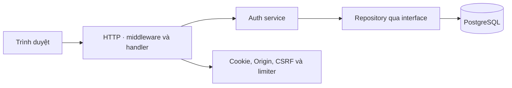
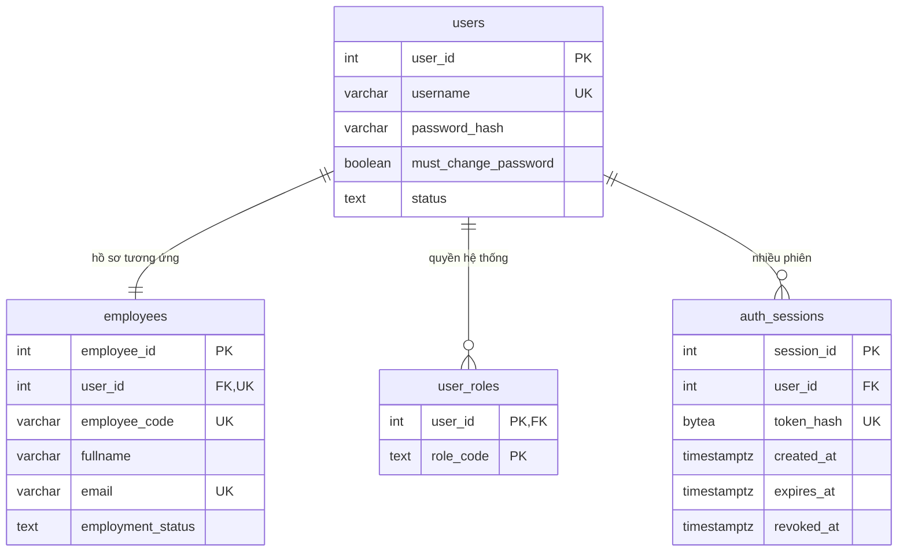
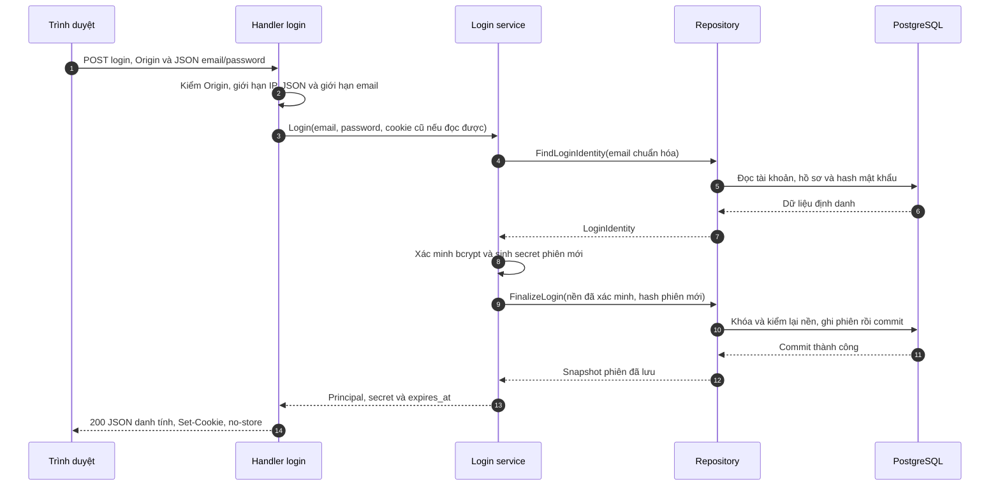
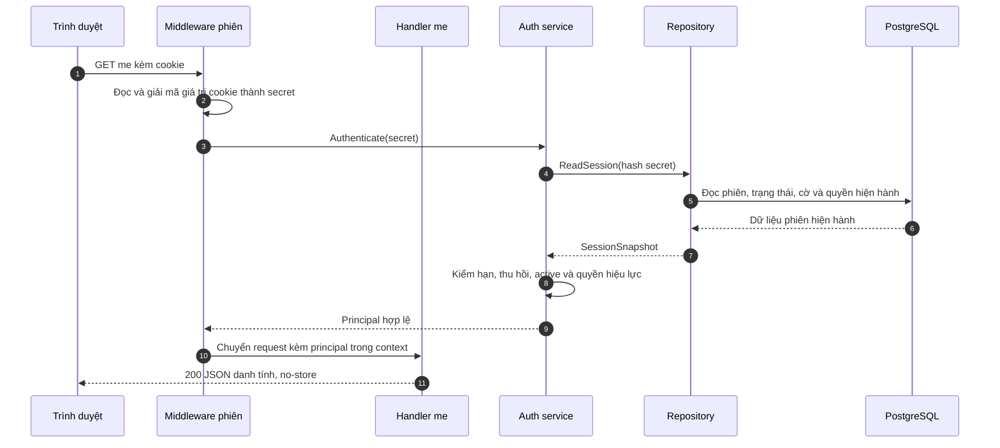
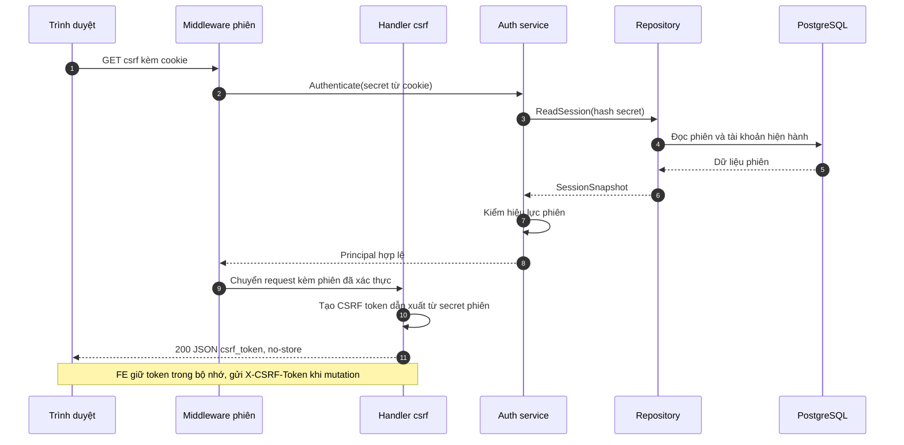
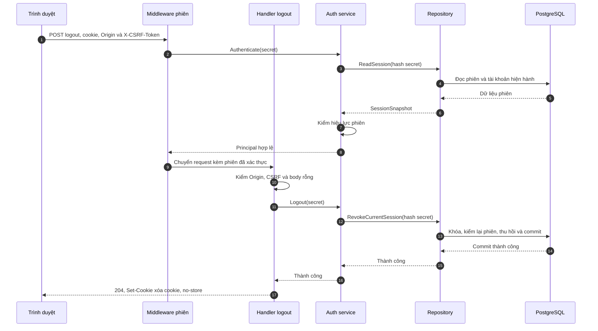
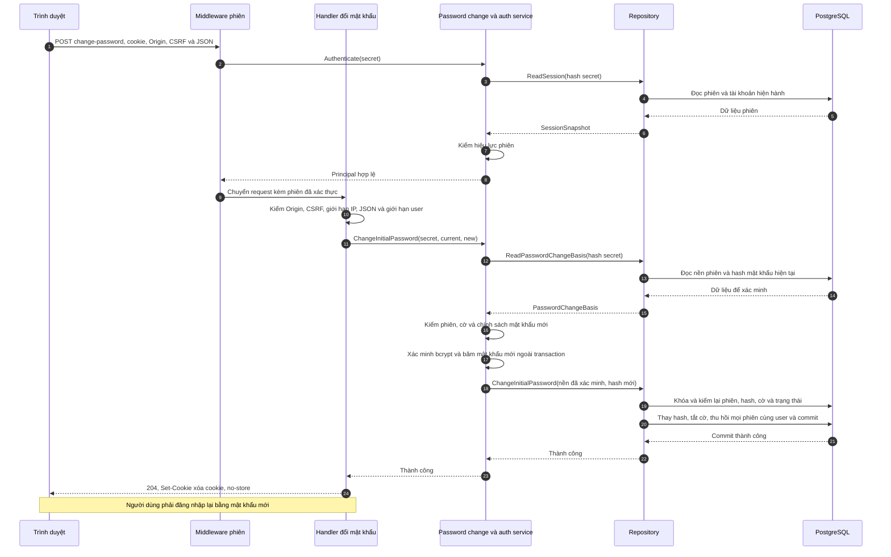

# Proposal — Đăng nhập và phiên truy cập backend

Ngày lập: **05/11/2026** · Thiết kế hiện hành: **12/11/2026**.

Tài liệu trình bày mục tiêu, cách hoạt động, dữ liệu và kế hoạch của feature auth. **Backend đã tích hợp đủ năm API và kiểm thử với PostgreSQL test tại DATN-18; FE nối API, browser/proxy và bàn giao xuyên FE–backend còn ở các ticket tiếp theo.** Không đồng nghĩa đã triển khai lên Neon hoặc hoàn thành quản trị tài khoản.

**Đường đọc khi báo cáo:** mục 2–3 → sơ đồ tổng thể mục 5.1 → năm sequence mục 6.2.3 → dữ liệu mục 6.1 → kiểm chứng và giới hạn mục 6.4. Khi cần tra cứu kỹ thuật, xem [OpenAPI](../api/auth.openapi.json), [chi tiết triển khai/bằng chứng](backend-auth-session-implementation.md) và [hướng dẫn Swagger](../api/README.md). Proposal mô tả thiết kế hiện hành; không dùng phần chính làm nhật ký thay đổi từng ticket.

## 1. Bối cảnh và nguồn

Feature thuộc miền tài khoản và quyền truy cập (D01), phối hợp hồ sơ nhân viên (D02). Nhân viên dùng email công ty để đăng nhập. Backend cần nhận biết đúng người, quyền hiện hành và trạng thái phiên trước khi cho truy cập chức năng.

Nguồn áp dụng:

- [FR-001–FR-004 và CR-002](../product/functional-requirements.md), [bản đồ miền D01/D02](../product/business-domains.md).
- [Baseline — đăng nhập email và mật khẩu tạm](../business-baseline-2026-10-20.md): các quyết định tiếp nối 05–06/11/2026.
- [Phân quyền](../../.claude/docs/roles_permissions.md), [bảo mật](../../.claude/docs/security.md), [kiến trúc](../../.claude/docs/architecture.md), [API design](../../.claude/docs/api_design.md).
- [DBML](../design/database-proposal-2026-10-14.dbml), [dictionary phiên](../design/database-step5b-supporting-dictionary-2026-10-14.md), [mapping DB](../design/database-step5c-migration-map-2026-10-14.md).
- [Frontend và tiến độ](../../web/README.md), [contract màn hình](../design/figma-make/screen-contracts.md).

Proposal diễn giải các quyết định đã chốt, không tạo quyền hoặc quy tắc nghiệp vụ mới.

## 2. Mục tiêu — Objective

Cho nhân viên đăng nhập, khôi phục danh tính từ phiên, đổi mật khẩu tạm lần đầu và đăng xuất. Server giữ quyền quyết định phiên còn hợp lệ và người dùng được làm gì; lựa chọn trên giao diện không tự cấp quyền.

## 3. Mục tiêu cụ thể và ngoài phạm vi — Goals / Non-goals

| Goal | Kết quả cần đạt | Truy vết |
|---|---|---|
| G1 — Đăng nhập | Email/mật khẩu hợp lệ mở phiên; thông tin sai báo lỗi chung | FR-001 |
| G2 — Khôi phục danh tính | Tải lại trang lấy danh tính và quyền từ server qua `me` | FR-001 |
| G3 — Đăng xuất | Thu hồi đúng phiên hiện tại; cookie cũ không dùng lại được | FR-002 |
| G4 — Kiểm tra hiện hành | Phiên hết hạn/thu hồi hoặc tài khoản/hồ sơ ngừng hoạt động bị từ chối | Phần nền FR-003 |
| G5 — Bảo vệ thao tác thay đổi | Kiểm nguồn yêu cầu và CSRF; không lộ bí mật xác thực | CR-002 |
| G6 — Đổi mật khẩu tạm | Chưa đổi chỉ dùng nhóm API auth cho phép; đổi xong đăng nhập lại | FR-001/004 |

**Trong phạm vi:** năm API tại mục 6.2, dữ liệu phiên/quyền, cổng phiên hạn chế, kiểm thử backend và nối FE auth theo WBS.

**Ngoài phạm vi:** tạo tài khoản/hồ sơ, sinh/gửi mật khẩu tạm qua email, reset/quên mật khẩu, đổi mật khẩu tự nguyện, API quản trị khóa/đổi quyền, MFA/SSO, JWT/refresh token, API dự án/CV và chuyển toàn bộ FE mock sang API. PM/PTCM là trách nhiệm theo dự án, không phải role hệ thống của auth.

FR-003 mới có nền kiểm tra hiện hành và thu hồi phiên. API quản trị chưa có nên không coi toàn FR-003 hoàn tất. Fixture chỉ phục vụ kiểm thử, không thay chức năng cấp tài khoản/gửi thư.

## 4. Các lựa chọn đã chốt và điểm còn mở

| ID | Lựa chọn hiện hành |
|---|---|
| A01 | Đăng nhập bằng email công ty; username vẫn là dữ liệu riêng |
| A02 | Email bỏ khoảng trắng đầu/cuối, so không phân biệt hoa thường; trùng sau chuẩn hóa là lỗi dữ liệu, không chọn tùy ý |
| A03 | Phiên có hạn tuyệt đối 8 giờ; hoạt động không tự kéo dài hạn |
| A04 | Chưa xóa vật lý phiên hết hạn/thu hồi trong feature này |
| A05 | Kiểm thử trên PostgreSQL 18 local riêng, dữ liệu giả, có guard xác minh DB test |
| A06 | Migration tiến thêm, giữ 000001 và dữ liệu cũ; không reset DB thật |
| A07 | Cookie giữ secret phiên; DB giữ hash; mutation kiểm Origin và CSRF; login thay secret, chỉ thu hồi phiên cũ hợp lệ cùng user nếu có |
| A08 | Cùng cơ chế phiên cho trạng thái buộc đổi; đổi mật khẩu, tắt cờ và thu hồi mọi phiên cùng user trong một transaction; đăng nhập lại |
| A09 | Mật khẩu mới khác hiện tại, ≥15 code point Unicode và ≤72 byte UTF-8; giữ nguyên khoảng trắng, không ép nhóm ký tự; limiter đổi riêng |

A01–A09 đã được duyệt; body JSON login/đổi mật khẩu giới hạn **8192 byte**. Không áp chính sách tạo mật khẩu mới ngược lên mật khẩu đăng nhập cũ.

**Còn hoãn:** quy tắc cấp username thực tế, sinh/gửi lại mật khẩu tạm, reset, lịch dọn phiên và triển khai production. Không tự bổ sung các phần này khi nối FE.

### 4.1. Mật khẩu tạm và phiên hạn chế

Tài khoản được cấp mật khẩu tạm có `must_change_password=true`. Mật khẩu tạm hiện chưa có hạn riêng; **phiên đăng nhập vẫn hết hạn sau 8 giờ**.

Người dùng này chỉ gọi được `me`, `csrf`, `logout`, `change-password`; API nghiệp vụ bị chặn kể cả có quyền ADMIN. DTO trả quyền hiệu lực rỗng, không xóa quyền trong DB. Sau đổi thành công, server đặt cờ false, thu hồi mọi phiên của user và yêu cầu đăng nhập bằng mật khẩu mới. Việc sinh/gửi email sẽ triển khai ở feature cấp tài khoản.

## 5. Thiết kế tổng thể — High-level design

Trình duyệt gửi yêu cầu; tầng HTTP kiểm định dạng và các điều kiện bảo vệ. Service xử lý xác thực; repository đọc/ghi PostgreSQL. Middleware kiểm phiên trước khi chuyển yêu cầu tới handler cần đăng nhập.

### 5.1. Thành phần và đường đi runtime



| Thành phần | Trách nhiệm |
|---|---|
| Trình duyệt | Gửi input, tự lưu/gửi cookie; FE giữ CSRF token trong bộ nhớ |
| Middleware phiên | Đọc cookie, gọi xác thực, đặt danh tính đã kiểm vào request context; chặn phiên lỗi |
| Handler | Kiểm input/header, gọi use case khi cần, ánh xạ DTO/lỗi và ghi HTTP response |
| Service | Kiểm phiên/chính sách, xác minh mật khẩu và điều phối repository; không phụ thuộc HTTP/pgx |
| Repository | Đọc dữ liệu hiện hành, khóa và ghi transaction; chỉ báo thành công sau commit |
| Composition root | `cmd/server` lắp config, repository, service và router trước khi mở server |

**Principal** là danh tính đã được server xác thực, gồm ID tài khoản/nhân viên, tên, mã nhân viên, quyền hiệu lực và cờ buộc đổi. Handler `me` dùng principal middleware đã lấy; không cần truy vấn DB lần thứ hai. Handler `csrf` cũng dùng phiên đã xác thực để tạo token. Login và đổi mật khẩu cần gọi service riêng vì có công việc bổ sung.

### 5.2. Phương án đã cân nhắc

Chọn cookie + phiên phía server để kiểm trạng thái/quyền hiện hành và thu hồi phiên. Không chọn JWT/refresh token, lưu secret trong localStorage hoặc tách auth thành microservice vì khác kiến trúc hiện hành và tăng phạm vi cho đồ án solo.

### 5.3. Contract service/repository

| Use case | Công việc của service | Port repository chính |
|---|---|---|
| Login | Chuẩn hóa email, kiểm mật khẩu, sinh secret | `FindLoginIdentity`, `FinalizeLogin` |
| Authenticate | Đọc phiên và đánh giá hiệu lực/quyền | `ReadSession` |
| Logout | Yêu cầu thu hồi đúng phiên hiện tại | `RevokeCurrentSession` |
| ChangeInitialPassword | Kiểm nền/cờ, chính sách và mật khẩu; tạo hash mới | `ReadPasswordChangeBasis`, `ChangeInitialPassword` |

Service gọi qua interface; repository thực hiện SQL/transaction. Xác minh và băm mật khẩu nằm ngoài transaction để tránh giữ khóa lâu. Mutation đọc lại dữ liệu dưới khóa trước khi ghi, tránh dùng kết quả xác minh đã cũ. Clock được truyền vào để kiểm biên thời gian và cạnh tranh một cách chủ động.

Tra chữ ký thực tại [service auth](../../internal/service/auth/identity.go), [service phiên](../../internal/service/auth/session_service.go), [login](../../internal/service/auth/login.go), [đổi mật khẩu](../../internal/service/auth/password_change.go). Chữ ký minh họa ban đầu và bằng chứng từng task nằm trong tài liệu triển khai, không thay code hiện hành.

## 6. Thiết kế chi tiết — Detailed design

### 6.1. Database và transaction

#### 6.1.1. Quan hệ và phạm vi dữ liệu

Auth dùng bốn bảng trong thiết kế hiện hành, không thêm bốn bảng ngoài danh mục đã chốt. `users` giữ tài khoản/mật khẩu; `employees` cung cấp hồ sơ liên kết, email và trạng thái; `user_roles` giữ quyền đặc biệt; `auth_sessions` giữ các phiên. Mã user và employee không bắt buộc bằng nhau.



| Cột của `auth_sessions` | Kiểu / bắt buộc | Ý nghĩa và quy tắc |
|---|---|---|
| `session_id` | INT identity, PK | ID nội bộ, không dùng trong cookie |
| `user_id` | INT NOT NULL, FK users | Phiên của tài khoản; không lấy từ body login |
| `token_hash` | BYTEA NOT NULL, UNIQUE | SHA-256 của secret ngẫu nhiên; đúng 32 byte, không lưu secret rõ |
| `created_at` | TIMESTAMPTZ NOT NULL, default now() | Thời điểm cấp, không cập nhật theo mỗi request |
| `expires_at` | TIMESTAMPTZ NOT NULL | Hạn tuyệt đối, lớn hơn created_at, tính theo TTL đã duyệt |
| `revoked_at` | TIMESTAMPTZ NULL | NULL chưa thu hồi; có giá trị phải không trước created_at, không gỡ revoke để mở lại |

Ràng buộc/index giữ đúng dictionary: PK session_id; UNIQUE token_hash để tra một phiên; FK user_id mặc định NO ACTION; CHECK độ dài hash/hạn/revoke; index user_id để tìm các phiên của user. `user_roles` có PK(user_id, role_code), role_code thuộc ADMIN/HR/DIRECTOR theo thiết kế. `employees.user_id` và email có UNIQUE; không dùng `users.system_role` legacy song song làm nguồn quyền thứ hai.

Không thêm index `lower(email)`/unique không phân biệt hoa thường trong phạm vi auth: cách so email đã chốt, nhưng uniqueness hiện tại chưa bảo đảm không có va chạm chuẩn hóa. Theo A02 đã duyệt, lookup theo chuẩn hóa phải phát hiện hơn một kết quả và từ chối với lỗi hệ thống chung, không chọn `LIMIT 1`; việc thêm expression index/ràng buộc mới phải được duyệt trong P04. Chưa có cam kết hiệu năng tìm email hoặc tự cài citext.


#### 6.1.2. Truy vấn, ghi dữ liệu và concurrency

| Thao tác | Cách bảo đảm nhất quán |
|---|---|
| Login | Xác minh mật khẩu trước; trong transaction kiểm lại tài khoản/hồ sơ/hash/email, đọc quyền/cờ, thay phiên cũ hợp lệ cùng user nếu có và tạo phiên mới |
| Me/CSRF | Đọc phiên cùng trạng thái/quyền hiện hành; không tạo phiên hoặc gia hạn |
| Logout | Kiểm lại phiên dưới khóa, thu hồi đúng phiên rồi commit |
| Đổi lần đầu | Kiểm lại phiên/hash/cờ dưới khóa; thay hash, đặt cờ false và thu hồi mọi phiên cùng user trong cùng transaction |

Thứ tự khóa thống nhất: **user → employee → session**; khi khóa nhiều session thì theo ID tăng dần. Thời gian kiểm hiệu lực được lấy lại sau khi chờ khóa. Hai lần đổi đồng thời không được ghi đè kết quả của nhau; login đã xác minh mật khẩu cũ không được cấp phiên sau khi mật khẩu đổi.

Cookie chỉ được gửi sau kết quả commit thành công. Nếu mất phản hồi sau commit, dữ liệu có thể đã thay đổi dù client thấy lỗi; không tự gửi lại mutation hoặc hứa hoàn tác giao dịch đã commit.

#### 6.1.3. Migration và backfill

Đường nâng cấp DB test: **000001 → 000002 (cờ buộc đổi) → 000003 (quyền và phiên)**. Giữ nguyên migration gốc và liên kết user–employee, hash/username/email/status. Mapping legacy không suy HR/DIRECTOR từ tên hoặc vị trí; ADMIN có mapping theo kế hoạch đã duyệt. Cột role legacy không còn là nguồn quyền auth hiện hành.

Migration đã được kiểm ở DB test rỗng và legacy giả. Không áp dụng kết luận này cho Neon; khi triển khai DB thật phải kiểm kê và duyệt kế hoạch riêng. SQL, prerequisite, rollback và bằng chứng tại [tài liệu triển khai mục 6.1.5–6.1.11](backend-auth-session-implementation.md#615-kế-hoạch-sql-và-db-test--chuẩn-bị-p04-chưa-thực-thi) và [runbook DB test](../../scripts/authdb/README.md).

#### 6.1.4. Ranh giới trách nhiệm và toàn vẹn

Hash mật khẩu và hash phiên chỉ dùng nội bộ, không trả trong DTO. DB lưu SHA-256 của secret phiên, không lưu secret rõ. Quyền lấy từ `user_roles`, tư cách nhân viên từ hồ sơ liên kết; không suy PM/PTCM từ chức danh. Mutation nghiệp vụ sau này vẫn phải kiểm quyền trên tài nguyên của chính nó.

### 6.2. API và bảo vệ phiên

[OpenAPI](../api/auth.openapi.json) là contract HTTP chi tiết; bảng và sequence dưới đây giúp trình bày cách hoạt động.

| API | Mục đích | Đầu vào chính | Thành công |
|---|---|---|---|
| `POST /api/auth/login` | Xác minh tài khoản, mở phiên | Email, mật khẩu, Origin | 200 + danh tính + cookie |
| `GET /api/auth/me` | Lấy danh tính/quyền hiện hành | Cookie | 200 + danh tính |
| `GET /api/auth/csrf` | Lấy token bảo vệ mutation | Cookie | 200 + csrf_token |
| `POST /api/auth/logout` | Kết thúc phiên hiện tại | Cookie, Origin, CSRF; body rỗng | 204 + xóa cookie |
| `POST /api/auth/change-password` | Đổi mật khẩu lần đầu | Cookie, Origin, CSRF, current_password/new_password | 204 + xóa cookie; đăng nhập lại |

#### 6.2.1. Request và response cụ thể

Login nhận đúng `{email, password}`; đổi lần đầu nhận đúng `{current_password, new_password}`. Không nhận actor, role, ID người dùng hoặc cờ để cấp quyền. Email được chuẩn hóa; mật khẩu giữ nguyên, không trim/cắt. JSON login/đổi lần đầu dùng Content-Type `application/json`, giới hạn toàn body 8192 byte.

Login và me trả cùng dạng DTO:

```json
{
  "user_id": 12,
  "employee_id": 25,
  "employee_code": "E025",
  "fullname": "Nguyễn Văn An",
  "system_roles": [],
  "must_change_password": false
}
```

Không có quyền đặc biệt vẫn là nhân viên hợp lệ, nhận `system_roles: []`. Cờ true cũng trả quyền hiệu lực rỗng; cần đọc cờ để phân biệt. Secret phiên chỉ đi qua cookie HttpOnly, không có trong JSON. CSRF trả `{csrf_token}`; logout/đổi thành công trả 204 không JSON. Mọi phản hồi auth có `Cache-Control: no-store`.

#### 6.2.2. Lỗi, thứ tự kiểm tra và giới hạn

| HTTP / code | Ý nghĩa |
|---|---|
| 400 VALIDATION_ERROR | Dữ liệu sai định dạng/field/chính sách mật khẩu; logout có body |
| 400 INVALID_CURRENT_PASSWORD | Mật khẩu hiện tại nhập sai khi đổi lần đầu |
| 401 INVALID_CREDENTIALS | Login sai email/mật khẩu hoặc tài khoản/hồ sơ không hoạt động; cùng thông báo chung |
| 401 UNAUTHENTICATED | Thiếu/sai/hết hạn/thu hồi phiên, inactive hoặc nền đổi trong lúc xử lý |
| 403 FORBIDDEN | Origin hoặc CSRF không hợp lệ |
| 403 PASSWORD_CHANGE_REQUIRED | Phiên buộc đổi gọi API nghiệp vụ |
| 403 PASSWORD_CHANGE_NOT_REQUIRED | Gọi đổi lần đầu khi tài khoản không có cờ |
| 413 PAYLOAD_TOO_LARGE | Body JSON vượt 8192 byte |
| 415 UNSUPPORTED_MEDIA_TYPE | Hai API JSON dùng Content-Type không được chấp nhận |
| 429 RATE_LIMITED | Vượt giới hạn; đọc Retry-After trước thử lại |
| 503 SERVICE_UNAVAILABLE | Lỗi lưu trữ tạm thời; không coi là sai mật khẩu/hết phiên |
| 500 INTERNAL_ERROR | Lỗi hệ thống/dữ liệu; không lộ chi tiết nội bộ |

Lỗi có dạng `{code, message, request_id}`. Khi nhiều điều kiện cùng sai, lớp ngoài có thể từ chối trước; sequence mô tả thứ tự luồng hợp lệ, không quy định một mã lỗi chung cho mọi tổ hợp lỗi.

#### 6.2.3. Sequence cho từng API

Đọc từ trên xuống. Mũi tên liền là lời gọi/yêu cầu; nét đứt là kết quả trả lại. Năm sơ đồ dùng cùng thứ tự **trình duyệt → middleware (nếu cần) → handler → service → repository → PostgreSQL**. Các nhánh lỗi chính ghi sau mỗi sơ đồ để hình dễ theo dõi; bảng lỗi và OpenAPI vẫn đầy đủ.

**a. Đăng nhập — POST /api/auth/login**



Sai credential/locked/inactive cùng trả 401; không có user vẫn kiểm hash giả. Nếu nền đổi hoặc lưu/commit lỗi, không gửi cookie thành công. Mật khẩu được xác minh ngoài transaction; DB chỉ nhận hash secret phiên. Login không yêu cầu phiên có trước hoặc CSRF token.

**b. Danh tính hiện hành — GET /api/auth/me**



Phiên thiếu/sai/hết hạn/thu hồi hoặc inactive bị middleware từ chối 401 trước handler. DB lỗi trả 503/500. Handler không gọi repository lần nữa; me không Set-Cookie gia hạn.

**c. Token bảo vệ mutation — GET /api/auth/csrf**



Dùng được cả phiên hạn chế để người dùng đổi mật khẩu/đăng xuất. API chỉ đọc và tạo token dẫn xuất, không INSERT session hoặc ghi token CSRF vào DB. Secret cookie không được đưa vào JSON. Login mới thay secret nên token CSRF cũ không hợp lệ với phiên mới.

**d. Đăng xuất — POST /api/auth/logout**



Chỉ thu hồi phiên đang gọi, không logout mọi thiết bị. Origin/CSRF sai trả 403 trước ghi; DB lỗi không báo 204. Cookie đã thu hồi gọi lại bị 401.

**e. Đổi mật khẩu lần đầu — POST /api/auth/change-password**



Cột service gộp hai use case để hình gọn; code dùng service phiên để Authenticate và PasswordChangeService để đổi. Lần đọc của middleware xác thực request; lần đọc của service lấy thêm hash mật khẩu để xác minh. Transaction vẫn kiểm lại nền dưới khóa trước khi ghi. Cờ false trả 403 PASSWORD_CHANGE_NOT_REQUIRED; sai mật khẩu hiện tại trả 400, nền/phiên đã đổi trả 401; lỗi ghi phải bảo toàn transaction. Không cấp phiên mới sau đổi. Tài khoản khác giữ phiên.

“Giải mã cookie” trong các sơ đồ là **decode base64url**, không phải giải mã mật mã hoặc đọc role từ cookie. Cookie chứa secret ngẫu nhiên; principal được dựng từ dữ liệu hiện hành trong DB. “Thành công” tại lời gọi service chỉ là kết quả Go nội bộ; handler ghi HTTP status/header/JSON qua ResponseWriter.

#### 6.2.4. Cookie, CSRF, rate limit và retry

| Cơ chế | Thiết kế hiện hành |
|---|---|
| Cookie | `staffing_session`, host-only, HttpOnly, SameSite=Lax, Path=/api; Secure trừ HTTP loopback dev tường minh; hạn không vượt expires_at |
| Secret phiên | 32 byte ngẫu nhiên, cookie base64url; DB lưu SHA-256; không trong JSON/log/localStorage |
| CSRF | HMAC-SHA256 gắn phiên, thông điệp `csrf-v1`, so constant-time; gửi qua X-CSRF-Token cùng cookie |
| Origin | Kiểm scheme/host/port theo APP_ORIGIN; login kiểm Origin, mutation có phiên kiểm thêm CSRF |
| Login limiter | 30 request/5 phút/IP; 5 xác thực thất bại/5 phút/email chuẩn hóa |
| Đổi mật khẩu limiter | 30 request/5 phút/IP; 5 lần mật khẩu hiện tại sai/15 phút/user đã xác thực |
| Lưu trữ limiter | Một process, bộ nhớ có giới hạn và cleanup, an toàn đồng thời; ngưỡng hiện tại phục vụ thử nghiệm |
| Retry | Không retry mutation mù khi mất phản hồi; 429 có Retry-After; không hứa exactly-once |

Không tin forwarded IP chưa cấu hình proxy tin cậy. Validation/CSRF/DB lỗi không bị tính thành mật khẩu hiện tại sai. Không mở CORS rộng; browser/proxy thực tế phải được kiểm riêng.

#### 6.2.5. Đổi mật khẩu lần đầu và bootstrap phiên hạn chế

1. Login nhận cờ true → FE chuyển tới màn đổi mật khẩu, không mở workspace.
2. Reload gọi me; cờ vẫn true thì giữ màn đổi. Lấy csrf trước POST đổi.
3. Kiểm mật khẩu mới khác hiện tại, ≥15 code point và ≤72 byte UTF-8, giữ nguyên khoảng trắng/chữ có dấu.
4. Đổi thành công 204 → xóa trạng thái FE và trở về đăng nhập; mọi phiên cũ của đúng user mất hiệu lực.
5. Đăng nhập bằng mật khẩu mới để có phiên thường. Sai input/429 không làm đổi hash/cờ; 401 yêu cầu đăng nhập lại. Lỗi DB hoặc mất phản hồi không được báo thành công hoặc tự gửi lại POST.

### 6.3. Rollout, cấu hình và quan sát

Backend startup dùng LoadServer kiểm cấu hình trước mở pool và router. APP_ENV bắt buộc dev/prod; chỉ dev tường minh đọc dotenv. OS env ưu tiên file rồi default, không ghi ngược vào OS env. APP_ORIGIN bắt buộc; SESSION_TTL mặc định và chỉ nhận 8h; HTTP_PORT mặc định 8080. Không đưa credential hoặc cấu hình kết nối vào log.

Startup đã ghép adapter thật. Bước tiếp theo là FE auth adapter và thử cookie/CSRF qua browser/proxy. Chế độ demo và auth thật phải tách; lỗi API không tự rơi về người dùng mock. Chưa có API nghiệp vụ thì không lấy principal thật để mở dữ liệu mock như dữ liệu đã được backend cấp quyền.

Swagger chỉ phục vụ môi trường dev ở `/docs`; đọc cùng OpenAPI, không thay kiểm thử. [Runbook Swagger](../api/README.md) hướng dẫn chạy/demo; đóng gói FE cùng Go và triển khai production là bước riêng. Không reset/drop DB để rollback giao diện.

### 6.4. Chiến lược kiểm thử và giới hạn bằng chứng

| Tầng | Đã có bằng chứng | Giới hạn |
|---|---|---|
| Unit/service | Policy phiên, bcrypt, password, clock, limiter, lỗi | Fake repo không chứng minh SQL/transaction |
| HTTP | Method/path, input, DTO, cookie, Origin/CSRF, no-store và guard | httptest không thay browser/HTTPS |
| PostgreSQL test | Migration rỗng/legacy, projection, bảo toàn dữ liệu, transaction/rollback/race | Không là bằng chứng đã áp Neon |
| HTTP + PostgreSQL | Năm API ghép composition root thật; thường/hạn chế, login mới, nhiều phiên và cạnh tranh | Mất phản hồi được mô phỏng ở driver, chưa cắt mạng thật |
| FE/browser | Cần kiểm ở đợt nối FE và vận hành | Chưa nhận hoàn tất từ test backend hoặc Swagger render được |

Lệnh/kết quả theo từng lượt và ma trận tích hợp xem [bàn giao DATN-18](backend-auth-session-implementation.md#6213-tích-hợp-năm-api-với-postgresql--datn-18--auth-t17-12112026), [runbook DB test](../../scripts/authdb/README.md) và [hướng dẫn Swagger](../api/README.md). Việc chỉnh proposal không có nghĩa chạy lại các test runtime này.

#### 6.4.1. Bằng chứng bảo mật cần có khi triển khai

| Mã | Nội dung đối chiếu |
|---|---|
| AUTH-S01 | Credential sai/không tồn tại/locked/inactive cùng lỗi; kiểm hash giả |
| AUTH-S02 | Cookie sau commit, thuộc tính và hạn phiên/thu hồi |
| AUTH-S03 | Phiên hạn chế bị chặn nghiệp vụ kể cả ADMIN |
| AUTH-S04 | Origin/CSRF sai và token phiên cũ bị từ chối |
| AUTH-S05 | Role/active/cờ hiện hành; không nhận quyền từ client |
| AUTH-S06 | Đổi thu hồi mọi phiên; race không ghi bằng nền cũ |
| AUTH-S07 | DB/random/commit lỗi không success giả; không retry mù |
| AUTH-S08 | Biên mật khẩu/limiter/đồng thời/Retry-After |
| AUTH-S09 | Không lộ password/hash/cookie/CSRF/DSN trong response/log |
| AUTH-S10 | Route/DTO/header/security khớp contract và wiring thực |

Ma trận này là tiêu chí truy vết; trạng thái và giới hạn theo tầng xem bằng chứng DATN-18, không mặc định mọi ca browser/production đã pass.

## 7. Tác động tới thành phần liên quan — Impact

- FE nối năm API qua adapter, lấy danh tính từ server và tách điều khiển demo.
- Feature quản trị sau dùng cơ chế kiểm hiện hành/thu hồi; không coi API quản trị đã tồn tại.
- Feature dự án sau kiểm PM/PTCM theo tài nguyên; auth không tự cấp trách nhiệm dự án.
- Đổi email do HR về sau cần chốt ảnh hưởng tới phiên trong feature tương ứng.
- Cấp mật khẩu tạm/SMTP và triển khai DB production là phạm vi riêng.

## 8. Đánh giá thiết kế — Design evaluation

Dùng Go/chi/pgx/bcrypt hiện có, cùng origin và session DB giúp giữ kiến trúc phù hợp DATN solo. Đánh đổi là mỗi request bảo vệ cần đọc DB; limiter hiện tại dành một process; bcrypt giới hạn 72 byte cho mật khẩu. Không tuyên bố chống mọi timing attack hoặc đã hoàn tất đánh giá bảo mật production.

Rủi ro chính: mapping quyền sai, email trùng sau chuẩn hóa, dữ liệu đổi giữa xác minh và ghi, cấu hình cookie/proxy sai và trộn demo với auth thật. Biện pháp tương ứng là mapping được duyệt, từ chối dữ liệu mâu thuẫn, kiểm lại dưới khóa, kiểm browser và tách hai chế độ. Test cạnh tranh không thay việc các API nghiệp vụ mới tuân thủ giao thức khi triển khai sau.

## 9. WBS và phần học Go

Giữ **33 đơn vị WBS / 105 giờ cơ sở**, được gom thành **20 Task trong Epic DATN-1**. Ticket thật DATN-2–DATN-21 đã có trên [Jira DATN](https://datn-mingquanjp.atlassian.net/jira/software/projects/DATN/boards/1); bộ [nội dung ticket](backend-auth-session-tickets.md) giữ mapping. Mã Pnn.m không phải thứ tự thực hiện; Blocks và Rank quyết định khi đủ đầu vào. Estimate ban đầu không phải thời gian còn lại hoặc công sức thực tế.

<details>
<summary>Xem WBS chi tiết, phụ thuộc và phân công bằng chứng</summary>

### 9.1. Tổng hợp theo nhóm

| ID | Nhóm công việc | Layer / vị trí dự kiến | Tổng giờ từ task con | Phục vụ | Đề xuất thực hiện |
|---|---|---|---:|---|---|
| P01 | Contract và quyết định trước code | proposal, OpenAPI, service ports | 12 | G1–G6 | Cùng duyệt; agent soạn |
| P02 | Cấu hình server có thể kiểm thử | internal/config và test | 5 | G1–G6 | Agent hỗ trợ; bạn cùng hiểu/review, tự viết thêm nếu nhận trong brief |
| P03 | Sửa lỗi nền URL và startup log | config, postgres pool, cmd/server | 4 | G1–G6 | Agent hỗ trợ, bạn cùng review |
| P04 | Kế hoạch dữ liệu và môi trường thử nghiệm | migration plan, fixture contract | 7 | G1–G4/G6 | Agent soạn, bạn duyệt trước SQL |
| P05 | Persistence auth và giao thức transaction | migrations, postgres adapter/test | 16 | G1–G4/G6 | Agent hỗ trợ; bạn đọc SQL/transaction |
| P06 | Policy và service auth | domain/service, unit tests | 14 | G1–G4/G6 | Bạn tự viết phần được chọn; agent gỡ rối/review |
| P07 | HTTP, cookie và chống giả mạo request | transport/http, httptest | 20 | G1–G6 | Agent hỗ trợ; bạn có thể nhận một handler |
| P08 | Nối FE auth thật và tách demo | FE auth adapter/session/UI | 14 | G1–G6 | Agent hỗ trợ; bạn kiểm luồng |
| P09 | Tích hợp, demo và bàn giao | composition root, integration/browser/docs | 13 | G1–G6 | Cùng thực hiện; agent review, bạn demo |

### 9.2. Task con để nhận việc

Dùng phụ thuộc cụ thể ở từng task con, không đợi cả nhóm khi chỉ cần một đầu ra. Mã không là thứ tự chạy: P07.3/P07.5 phải xong trước P07.1; service P06 dùng fake có thể làm sau contract/port mà chưa chờ P05 SQL. A02–A09 đã được duyệt; các task kế tiếp hoàn thiện contract/kế hoạch cụ thể, không lặp lại việc hỏi chốt cùng lựa chọn hoặc coi tất cả task đã Done.

#### P01 — Contract và quyết định trước code

| ID | Đầu ra và kiểm tra hoàn thành | Phụ thuộc / điều kiện bắt đầu | Giờ |
|---|---|---|---:|
| P01.1 | Review việc ghi nhận A02–A04/A07, ngoại lệ localhost và phần hoãn trên tài liệu đã có; sửa sai khác nếu có và dẫn bằng chứng đối chiếu. Không hỏi duyệt lại quyết định hoặc ghi 2 giờ là thời gian đã làm. | Người dùng duyệt phạm vi proposal | 2 |
| P01.2 | Review/hoàn thiện OpenAPI hiện có: chịu trách nhiệm bốn route login/me/csrf/logout, DTO/lỗi/header/cookie/body limit và hợp nhất phần đổi lần đầu đã review ở P01.4. Đầu ra duy nhất là contract năm route khớp mục 6.2, kèm kiểm tĩnh; không viết lại từ đầu hoặc coi route đã chạy. | P01.1, P01.4 | 4 |
| P01.3 | Review/hoàn thiện ports đã soạn ở mục 5.3 cho cả Login/Authenticate/ChangeInitialPassword/Logout, principal/clock/random và giao thức khóa; đối chiếu ca fake/test. Chốt contract triển khai, không tạo interface lộ pgx/HTTP hoặc package rỗng. | P01.2; kiến trúc hiện hành | 3 |
| P01.4 | Review contract đổi mật khẩu lần đầu theo A08/A09 trên bản soạn mục 6.2.5: DTO cờ/allowlist, Unicode/byte/bcrypt, limiter riêng, lỗi/race/retry và bootstrap FE. Bàn giao kết quả review cho P01.2 hợp nhất, không giữ một OpenAPI riêng hoặc lặp việc review toàn bộ bốn route nền. | P01.1; áp quyết định A08/A09 đã duyệt | 3 |

#### P02 — Cấu hình server có thể kiểm thử

| ID | Đầu ra và kiểm tra hoàn thành | Phụ thuộc / điều kiện bắt đầu | Giờ |
|---|---|---|---:|
| P02.1 | Viết validation env/port/Origin/TTL thuần trên input cấu hình. Table-driven tests gồm thiếu/sai/biên, dev/prod và lỗi đã redaction; không đọc môi trường hoặc .env thật. | P01.2; chốt contract config trong task brief | 3 |
| P02.2 | Nối load config với validation, chỉ cho dotenv trong chế độ dev tường minh; test precedence/fallback bằng dữ liệu tạm. Giữ RequireDev và guard migrate/seed, không sửa để test xanh. | P02.1 | 2 |

#### P03 — Sửa lỗi nền URL và startup log

| ID | Đầu ra và kiểm tra hoàn thành | Phụ thuộc / điều kiện bắt đầu | Giờ |
|---|---|---|---:|
| P03.1 | Thay nhận diện/chuyển pooled endpoint bằng parse hostname theo định dạng được duyệt. Test marker xuất hiện trong password/path/query không bị thay nhầm; URL không hỗ trợ bị xử lý rõ. | P02.2; review contract URL trước code | 2 |
| P03.2 | Che lỗi startup có thể chứa DSN/credential; test log bằng lỗi giả có marker nhạy cảm, vẫn có mã/ngữ cảnh chẩn đoán phù hợp. Không kết nối DB thật để thử lỗi. | P03.1 | 2 |

#### P04 — Kế hoạch dữ liệu và môi trường thử nghiệm

| ID | Đầu ra và kiểm tra hoàn thành | Phụ thuộc / điều kiện bắt đầu | Giờ |
|---|---|---|---:|
| P04.1 | Review/hoàn thiện kế hoạch SQL đã soạn ở mục 6.1.5: mapping users/employee/role legacy, prerequisite/FK, thứ tự migration, tương thích/rollback và giá trị cần xác nhận. Done khi phạm vi SQL/mapping cho môi trường cụ thể được review; không soạn lại từ đầu, sửa 000001 hoặc tự áp Neon. | P01.3; mapping/SQL chi tiết cần review ở đầu ra task | 3 |
| P04.2 | Chuẩn bị môi trường PostgreSQL test riêng theo A05 (Docker, major 18): kiểm môi trường/quyền sở hữu, cấu hình TEST_DATABASE_URL và guard chạy/dọn; thiết kế fixture giả và cách cấp credential local. Chỉ dựng tài nguyên test trong phạm vi được phép. Chưa insert fixture cần bảng auth chưa tồn tại; thực thi fixture thuộc P05.1/P05.2 sau migration. | P04.1; A05 đã duyệt hướng, chưa dựng môi trường/fixture | 2 |
| P04.3 | Review tương thích cờ/000002; đặc tả fixture true/false, nhiều phiên và ca đổi cạnh tranh để P05 thực thi sau migration. Tận dụng bằng chứng diễn tập 000002, không lặp lần diễn tập hoặc tự áp production. Bàn giao ca kiểm đường DB test rỗng, chưa gọi kế hoạch fixture là dữ liệu/test đã chạy. | P04.2, P01.4 | 2 |

#### P05 — Persistence auth và giao thức transaction

| ID | Đầu ra và kiểm tra hoàn thành | Phụ thuộc / điều kiện bắt đầu | Giờ |
|---|---|---|---:|
| P05.1 | Viết migration auth đã duyệt và hiện thực runner/fixture tối thiểu cho kiểm migration theo P04: DB test rỗng và legacy giả qua đúng prerequisite. Fixture quyền/phiên mới chỉ nạp sau khi có bảng; kiểm PK/FK/unique/check/index, mapping và bảo toàn dữ liệu. Không reset DB thật hoặc migrate cả 33 bảng. | P04.1, P04.2, P04.3; môi trường DB test được phép | 4 |
| P05.2 | Viết projection tìm login và đọc principal/session/role; hiện thực fixture ca auth đã thiết kế ở P04 trên schema test đã migrate. Test không có/trùng email chuẩn hóa, active/locked, role kết hợp và projection tối thiểu. Không SELECT * đưa hash/dữ liệu riêng vào response; fixture dùng lại cho P05.3/P05.4. | P05.1, P01.3 | 3 |
| P05.3 | Viết adapter hoàn tất login/revoke/logout theo ports và thứ tự khóa. DB test chứng minh rollback khi lỗi, revoke đúng phiên và race với transaction khóa/reset giả lập có kiểm soát; chưa coi API quản trị đã có. | P05.2, P01.3 | 5 |
| P05.4 | Hiện thực transaction đổi mật khẩu lần đầu: đổi hash/cờ/revoke mọi phiên theo A08; persistence tests rollback từng write, hai lần đổi đồng thời và login hash cũ chờ khóa. Không thêm schema ngoài cờ đã chốt. | P05.3, P04.3, P01.4 | 4 |

#### P06 — Policy và service auth

| ID | Đầu ra và kiểm tra hoàn thành | Phụ thuộc / điều kiện bắt đầu | Giờ |
|---|---|---|---:|
| P06.1 | Viết session policy/principal với clock được truyền vào. Unit tests expiry đúng biên, revoked, user/employee inactive và role không suy từ vị trí; không import DB/HTTP. | P01.3; không chờ P05 | 3 |
| P06.2 | Viết Login với bcrypt thật và fake repository: sai/không có account chung lỗi, hash giả, nền đổi không cấp session, lỗi commit không trả secret thành công. Kiểm entropy/hash qua biên sinh secret, không log credential. | P06.1; fake theo P01.3, không chờ DB adapter | 4 |
| P06.3 | Viết Authenticate/Logout với fake: quyền đọc lại hiện hành, logout chỉ phiên hiện tại, phiên khác giữ nguyên; DB lỗi khác 401. Có unit tests, không hứa chặn ngược request đã commit. | P06.1; fake theo P01.3 | 3 |
| P06.4 | Hiện thực service đổi mật khẩu lần đầu, xác minh current password/hash mới ngoài transaction, xử lý nền thay đổi và guard cờ. Fake tests allowlist/roles hiệu lực, đổi thất bại không ghi, thành công không tự cấp phiên. | P06.1, P01.3, P01.4 | 4 |

#### P07 — HTTP, cookie và chống giả mạo request

| ID | Đầu ra và kiểm tra hoàn thành | Phụ thuộc / điều kiện bắt đầu | Giờ |
|---|---|---|---:|
| P07.1 | Viết handler login: JSON allowlist/body limit/content type, map lỗi và chỉ Set-Cookie sau service thành công. httptest kiểm status/header/DTO theo OpenAPI, không trả session secret trong JSON. | P06.2, P07.3, P07.5, P01.2 | 3 |
| P07.2 | Viết middleware phiên và GET me; endpoint được bảo vệ deny-by-default, fake actor/role body không cấp quyền. Tests thiếu/hết hạn/revoked/inactive và lỗi DB, health vẫn công khai theo contract. | P06.3, P07.3, P01.2 | 3 |
| P07.3 | Viết helper cookie/Origin/CSRF và handler GET csrf; test token gắn phiên, rotation, constant-time compare, Secure/path/no-store và origin đầy đủ scheme/host/port. Không mở CORS rộng. | P01.1, P01.2, P02.2, P06.1, P06.3 | 4 |
| P07.4 | Viết POST logout có kiểm Origin/CSRF; test 204/xóa cookie chỉ sau revoke, 401/403/503 đúng contract và không thu hồi phiên khác. | P07.2, P07.3, P06.3 | 2 |
| P07.5 | Hiện thực limiter dùng chung và hai chính sách riêng theo mục 6.2.4–6.2.5: login theo IP/email chuẩn hóa, đổi lần đầu theo IP/user đã xác thực; kiểm trước bcrypt, chỉ xác minh sai mới tăng bộ đếm sai tương ứng. Unit tests ngưỡng/cửa sổ/đồng thời/Retry-After, cleanup và giới hạn bộ nhớ; không tin forwarded IP hoặc thêm khóa account. P07.1/P07.6 tích hợp, không viết lại limiter. | P01.2, P02.2 | 4 |
| P07.6 | Viết handler change-password, tích hợp limiter đã kiểm ở P07.5 và guard cờ vào middleware/me/login. httptest kiểm lỗi/CSRF/204/cookie; route thử trong test chứng minh cổng nghiệp vụ, không thêm endpoint production giả. Không nhầm 401 với PASSWORD_CHANGE_REQUIRED hoặc lặp unit test nội bộ limiter. | P06.4, P07.2, P07.3, P07.5 | 4 |

#### P08 — Nối FE auth thật và tách demo

| ID | Đầu ra và kiểm tra hoàn thành | Phụ thuộc / điều kiện bắt đầu | Giờ |
|---|---|---|---:|
| P08.1 | Viết adapter bốn route/DTO/error và cấu hình proxy dev đã chốt; test bằng HTTP giả các 401/403/429/503 và không lưu credential/token ở localStorage. Chưa nối nghiệp vụ khác. | P01.2; đọc web/AGENTS và web/README | 3 |
| P08.2 | Nối login/bootstrap me từ server; UI loading/validation/hết phiên, không cấp quyền bằng selector hoặc role client. Trước code chốt đích sau login và ranh giới mock trong task brief theo mục 9.2.2; chưa chốt đích thì chưa Done. Browser trên backend test; không ánh xạ principal thật sang nhân viên fixture theo tên/email/ID để mở dữ liệu mẫu. | P08.1, P09.1 | 4 |
| P08.3 | Nối csrf/logout và lỗi phiên; kiểm back/reload, DB lỗi không giả logout thành công. Tách demo/auth bằng cấu hình tường minh, không đổi qua URL/selector để vượt bảo vệ. Ở chế độ auth không mở workspace mock như dữ liệu/quyền thật; giữ nguyên prototype ở chế độ demo riêng. | P08.2, P07.4 | 3 |
| P08.4 | Nối API và màn đổi mật khẩu lần đầu: adapter route và màn nhập current/new/nhập lại; bootstrap cờ true, lỗi/429, xóa dữ liệu nhạy cảm, success quay login, mất phản hồi không retry mù. Không mở luồng đổi tự nguyện. | P08.2, P09.4 | 4 |

#### P09 — Tích hợp, demo và bàn giao

| ID | Đầu ra và kiểm tra hoàn thành | Phụ thuộc / điều kiện bắt đầu | Giờ |
|---|---|---|---:|
| P09.1 | Wire config/repo/service/router; chạy integration bốn route trên DB test được phép. Kiểm cookie cũ, expiry, hai phiên độc lập, lỗi commit và concurrency bằng transaction kiểm soát; lưu kết quả, nêu rõ API quản trị chưa có. | P03.2, P05.3, P06.2, P06.3, P07.1, P07.2, P07.4 | 4 |
| P09.2 | Review browser login thường và login hạn chế → đổi lần đầu → login mới → reload → csrf/logout và lỗi nguồn/phiên/DB; kiểm cookie/proxy, phân biệt demo/thật và rà log redaction. Ghi bước tái hiện/bằng chứng; lỗi mới có task riêng. | P08.3, P08.4; môi trường test sẵn sàng | 3 |
| P09.3 | Hoàn thiện runbook cấu hình/test DB/migration/rollback và giới hạn; chạy cổng Go/FE/harness theo thay đổi, review diff và hướng dẫn demo. Chỉ Done khi có bằng chứng, không tự commit/push. | P09.2; có thể soạn runbook từ P04 | 3 |
| P09.4 | Tích hợp đổi mật khẩu lần đầu: ghép route thứ năm và guard với DB test; kiểm login hạn chế → đổi → mọi phiên cũ vô hiệu → login mới, race/rollback và mất phản hồi. Kiểm thử đơn vị/persistence đã tính ở task trước không tính lại ở đây. | P09.1, P05.4, P07.6 | 3 |

#### 9.2.2. Ranh giới nghiệm thu FE và bằng chứng kiểm tra

P08 chỉ nối auth thật. Trước P08.2, task brief phải chỉ rõ màn/đích sau login, hành vi mở URL nghiệp vụ chưa nối API và cách báo giới hạn. Đích cụ thể chưa được chọn trong WBS này; nếu cần màn mới hoặc thay nghiệp vụ phải trao đổi trước. Không mặc định chọn một workspace từ fixture. P08.2 có thể ghép login thường sau P09.1, nhưng toàn P08 chỉ bàn giao khi P08.4/P09.4 hoàn tất cổng buộc đổi.

- Chế độ demo giữ danh tính/dữ liệu mô phỏng riêng, có nhãn rõ; không dùng làm đường dự phòng khi API auth lỗi.
- Chế độ auth dùng principal từ server. Không ghép người dùng thật với nhân viên mẫu theo tên/email/ID, không mở dữ liệu mock như dữ liệu đã được server cho phép.
- Nghiệp vụ chưa có API được ghi rõ chưa nối, không lấy kết quả UI mock để chứng nhận ABAC dự án hoặc toàn FR-003. Không triển khai API nghiệp vụ mới để lấp chỗ trống trong đợt auth.

Bảng dưới phân công bằng chứng cho ca đã định nghĩa tại mục 6.4.1, không tạo bộ quy tắc bảo mật thứ hai. Task đầu chịu trách nhiệm bằng chứng gần chức năng; task tích hợp xác nhận khi ghép thật, không tính lại toàn bộ unit tests.

| Ca hiện hành | Task tạo bằng chứng gần chức năng | Task xác nhận tích hợp/bàn giao |
|---|---|---|
| AUTH-S01 | P05.2, P06.2, P07.1 | P09.1 |
| AUTH-S02 | P05.3, P06.1, P07.3/P07.4 | P09.1/P09.2; HTTPS trước vận hành vẫn phải kiểm riêng |
| AUTH-S03 | P06.4, P07.6 | P09.4, P08.4/P09.2 |
| AUTH-S04 | P07.3, P07.1/P07.4/P07.6 | P09.1/P09.4, P09.2 |
| AUTH-S05 | P05.2, P06.3/P06.4, P07.1/P07.2/P07.6 | P09.1/P09.4 |
| AUTH-S06 | P05.4 | P09.4 |
| AUTH-S07 | P05.3/P05.4, P06.2/P06.4, P07.1/P07.6 | P09.1/P09.4 |
| AUTH-S08 | P06.4, P07.5, P07.1/P07.6 | P09.4, P08.4/P09.2 |
| AUTH-S09 | P02.1, P03.2 và P07.1/P07.3/P07.4/P07.6 | P09.1/P09.4, P09.2/P09.3 |
| AUTH-S10 | P01.2, P07.1–P07.4/P07.6 | P09.1/P09.4 |

Ticket phải dẫn FR/AC cụ thể theo phạm vi: FR-001 cho login/phiên, FR-002 cho logout, FR-004.AC1–AC4 chỉ phần đổi lần đầu; FR-003 chỉ phần nền hiện hành/thu hồi đã giới hạn ở mục 3. Các task cấu hình/migration/contract hỗ trợ goal/AC liên quan, không tự biến thành một FR mới. Bằng chứng backend hiện có được đối chiếu tại [bàn giao DATN-18](backend-auth-session-implementation.md#6213-tích-hợp-năm-api-với-postgresql--datn-18--auth-t17-12112026); phần FE/browser vẫn cần kiểm ở ticket tương ứng.


</details>

### 9.3. Cách học Go và cập nhật tiến độ

Đi theo request → middleware/handler → service → repository → SQL/transaction → response và test. Quân đọc, hiểu và review; phần tự viết chỉ giao khi chốt checkpoint, agent không viết thay phần đã nhận nếu chưa được yêu cầu. Không dùng test fake thay DB/browser; không chờ cuối feature mới kiểm lỗi từng tầng.

### 9.4. Quản lý trên Jira

Theo [workflow solo](../ai/workflow.md): To Do → In Progress → In Review → Done; review nằm trong tiêu chí hoàn thành từng ticket. Không tự nhận Done từ việc có proposal hoặc code chưa merge; trạng thái thực xem Jira. Không nhập lại ticket để cập nhật tiến độ. Commit/PR theo mã Jira thật, do người dùng yêu cầu; không giả có người review thứ hai phê duyệt.

## 10. Ước lượng — Estimation

Tổng cơ sở **105 giờ** cho 33 đơn vị WBS, đã gồm viết/test/review thông thường: P01 12h, P02 5h, P03 4h, P04 7h, P05 16h, P06 14h, P07 20h, P08 14h, P09 13h. Dự phòng đề xuất **21 giờ**, tổng 126 giờ nếu được duyệt; không phải cam kết ngày lịch hoặc số giờ còn lại. Không bao gồm cấp tài khoản/SMTP/reset.

Đây là estimate ban đầu, không timesheet. Cập nhật phần còn lại khi nhận ticket theo thực tế và thời gian học; không thêm effort chỉ để soạn lại quyết định đã chốt. Lịch sử phân tách phạm vi không cần xuất hiện trong phần trình bày thiết kế hiện hành.

## Phụ lục — Tra cứu kỹ thuật và liên kết cũ

Chi tiết SQL/fixture/ports, handoff từng task và bằng chứng được giữ tại [tài liệu triển khai](backend-auth-session-implementation.md). WBS và các mục thiết kế 5.3/6.1–6.4 vẫn giữ số để ticket tham chiếu. Các anchor bàn giao cũ dưới đây dẫn tới đúng nội dung đã tách; không phải các phần thiết kế bổ sung cần đọc khi báo cáo.

<details>
<summary>Liên kết bàn giao theo số mục cũ</summary>

<a id="531-bàn-giao-policy-phiên--datn-11--auth-t10-09112026"></a>

- [5.3.1. Bàn giao policy phiên — DATN-11 / AUTH-T10, 09/11/2026](backend-auth-session-implementation.md#531-bàn-giao-policy-phiên--datn-11--auth-t10-09112026).

<a id="532-bàn-giao-service-xác-thực-và-đăng-xuất--datn-12--auth-t11-10112026"></a>

- [5.3.2. Bàn giao service xác thực và đăng xuất — DATN-12 / AUTH-T11, 10/11/2026](backend-auth-session-implementation.md#532-bàn-giao-service-xác-thực-và-đăng-xuất--datn-12--auth-t11-10112026).

<a id="615-kế-hoạch-sql-và-db-test--chuẩn-bị-p04-chưa-thực-thi"></a>

- [6.1.5. Kế hoạch SQL và DB test — chuẩn bị P04, chưa thực thi](backend-auth-session-implementation.md#615-kế-hoạch-sql-và-db-test--chuẩn-bị-p04-chưa-thực-thi).

<a id="616-thiết-kế-môi-trường-và-fixture-test"></a>

- [6.1.6. Thiết kế môi trường và fixture test](backend-auth-session-implementation.md#616-thiết-kế-môi-trường-và-fixture-test).

<a id="617-bàn-giao-môi-trường-và-kế-hoạch-dữ-liệu--datn-6--auth-t05-08112026"></a>

- [6.1.7. Bàn giao môi trường và kế hoạch dữ liệu — DATN-6 / AUTH-T05, 08/11/2026](backend-auth-session-implementation.md#617-bàn-giao-môi-trường-và-kế-hoạch-dữ-liệu--datn-6--auth-t05-08112026).

<a id="618-migration-auth-và-bảo-toàn-dữ-liệu--datn-7--auth-t06-08112026"></a>

- [6.1.8. Migration auth và bảo toàn dữ liệu — DATN-7 / AUTH-T06, 08/11/2026](backend-auth-session-implementation.md#618-migration-auth-và-bảo-toàn-dữ-liệu--datn-7--auth-t06-08112026).

<a id="619-truy-vấn-định-danh-và-quyền-hiện-hành--datn-8--auth-t07-08112026"></a>

- [6.1.9. Truy vấn định danh và quyền hiện hành — DATN-8 / AUTH-T07, 08/11/2026](backend-auth-session-implementation.md#619-truy-vấn-định-danh-và-quyền-hiện-hành--datn-8--auth-t07-08112026).

<a id="6110-transaction-tạo-và-thu-hồi-phiên--datn-9--auth-t08-09112026"></a>

- [6.1.10. Transaction tạo và thu hồi phiên — DATN-9 / AUTH-T08, 09/11/2026](backend-auth-session-implementation.md#6110-transaction-tạo-và-thu-hồi-phiên--datn-9--auth-t08-09112026).

<a id="6111-transaction-đổi-mật-khẩu-lần-đầu--datn-10--auth-t09-09112026"></a>

- [6.1.11. Transaction đổi mật khẩu lần đầu — DATN-10 / AUTH-T09, 09/11/2026](backend-auth-session-implementation.md#6111-transaction-đổi-mật-khẩu-lần-đầu--datn-10--auth-t09-09112026).

<a id="626-review-contract-trước-sqltest--06112026"></a>

- [6.2.6. Review contract trước SQL/test — 06/11/2026](backend-auth-session-implementation.md#626-review-contract-trước-sqltest--06112026).

<a id="627-bàn-giao-contract-datn-2--auth-t01--07112026"></a>

- [6.2.7. Bàn giao contract DATN-2 / AUTH-T01 — 07/11/2026](backend-auth-session-implementation.md#627-bàn-giao-contract-datn-2--auth-t01--07112026).

<a id="628-bàn-giao-cookie-origin-và-csrf--datn-13--auth-t12-10112026"></a>

- [6.2.8. Bàn giao cookie, Origin và CSRF — DATN-13 / AUTH-T12, 10/11/2026](backend-auth-session-implementation.md#628-bàn-giao-cookie-origin-và-csrf--datn-13--auth-t12-10112026).

<a id="629-bàn-giao-limiter--datn-14--auth-t13-10112026"></a>

- [6.2.9. Bàn giao limiter — DATN-14 / AUTH-T13, 10/11/2026](backend-auth-session-implementation.md#629-bàn-giao-limiter--datn-14--auth-t13-10112026).

<a id="6210-bàn-giao-danh-tính-và-đăng-xuất--datn-15--auth-t15-11112026"></a>

- [6.2.10. Bàn giao danh tính và đăng xuất — DATN-15 / AUTH-T15, 11/11/2026](backend-auth-session-implementation.md#6210-bàn-giao-danh-tính-và-đăng-xuất--datn-15--auth-t15-11112026).

<a id="6211-bàn-giao-đăng-nhập-bằng-email--datn-16--auth-t14-11112026"></a>

- [6.2.11. Bàn giao đăng nhập bằng email — DATN-16 / AUTH-T14, 11/11/2026](backend-auth-session-implementation.md#6211-bàn-giao-đăng-nhập-bằng-email--datn-16--auth-t14-11112026).

<a id="6212-bàn-giao-đổi-mật-khẩu-lần-đầu--datn-17--auth-t16"></a>

- [6.2.12. Bàn giao đổi mật khẩu lần đầu — DATN-17 / AUTH-T16](backend-auth-session-implementation.md#6212-bàn-giao-đổi-mật-khẩu-lần-đầu--datn-17--auth-t16).

<a id="6213-tích-hợp-năm-api-với-postgresql--datn-18--auth-t17-12112026"></a>

- [6.2.13. Tích hợp năm API với PostgreSQL — DATN-18 / AUTH-T17, 12/11/2026](backend-auth-session-implementation.md#6213-tích-hợp-năm-api-với-postgresql--datn-18--auth-t17-12112026).

<a id="631-bàn-giao-validation-cấu-hình--datn-3--auth-t02-07112026"></a>

- [6.3.1. Bàn giao validation cấu hình — DATN-3 / AUTH-T02, 07/11/2026](backend-auth-session-implementation.md#631-bàn-giao-validation-cấu-hình--datn-3--auth-t02-07112026).

<a id="632-tích-hợp-loaderstartup--datn-4--auth-t03-08112026"></a>

- [6.3.2. Tích hợp loader/startup — DATN-4 / AUTH-T03, 08/11/2026](backend-auth-session-implementation.md#632-tích-hợp-loaderstartup--datn-4--auth-t03-08112026).

<a id="633-url-postgresql-và-lỗi-startup--datn-5--auth-t04-08112026"></a>

- [6.3.3. URL PostgreSQL và lỗi startup — DATN-5 / AUTH-T04, 08/11/2026](backend-auth-session-implementation.md#633-url-postgresql-và-lỗi-startup--datn-5--auth-t04-08112026).

<a id="921-trạng-thái-đầu-vào-khi-chuyển-sang-ticket--07112026"></a>

- [9.2.1. Trạng thái đầu vào khi chuyển sang ticket — 07/11/2026](backend-auth-session-implementation.md#921-trạng-thái-đầu-vào-khi-chuyển-sang-ticket--07112026).

</details>
