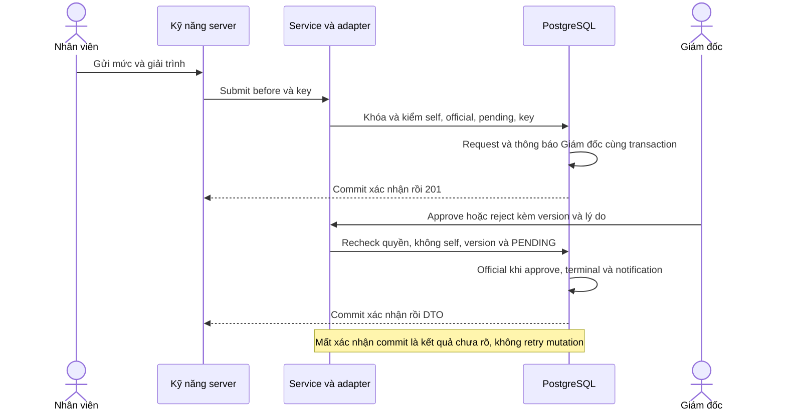

# Danh mục kỹ năng, đề nghị thủ công và Giám đốc xét duyệt

Ngày 27/11/2026. Đợt D03 cho báo cáo 03/12; mã nguồn thiết kế **MSK**, chưa có Jira key. Đây là thiết kế để triển khai, không là kết quả DB/HTTP/browser đã đạt. Base đối chiếu `main 8fc3ebd` sau merge PR63–65.

## 1. Nguồn và hiện trạng

- [Delivery-plan](../ai/delivery-plan.md) mục3–6: D03 đi trước dự án; 15–20 giờ Quân/tuần có Codex hỗ trợ, dành thời gian review/kiểm chứng. Không cam kết số task tương đương số giờ.
- [FR](../product/functional-requirements.md) FR-016/017/023/024/026/027, phần sự kiện FR-059/060; [bản đồ miền](../product/business-domains.md) D03/H01.
- [Workflow kỹ năng](../../.claude/docs/skill_approval_workflow.md), [domain rules](../../.claude/docs/domain_rules.md) mục năng lực, [quyền](../../.claude/docs/roles_permissions.md), [chốt hiện hành](../design/database-review-decisions-2026-10-14.md), [dictionary](../design/database-step5b-supporting-dictionary-2026-10-14.md) mục6–9. Chốt 27/10 ưu tiên ADD/UPDATE, không gỡ kỹ năng.
- [Kiến trúc](../../.claude/docs/architecture.md), [API](../../.claude/docs/api_design.md), [bảo mật](../../.claude/docs/security.md), [screen contracts](../design/figma-make/screen-contracts.md) UI06/07/09, [web instructions](../../web/AGENTS.md), [web README](../../web/README.md), [workflow Git](../ai/workflow.md), [comment](../ai/code-comments.md).
- Tái sử dụng auth/session/cổng limited, PG runner, audit/idempotency/notification PCA, primitives và màn kỹ năng demo. Main có migration000001–000006; skills.status, employee_skills.source/approved_by_employee_id vẫn legacy. Chưa có service/API kỹ năng thật. Notification service/DTO hiện chỉ chấp nhận PROFILE_CHANGE_*: phải mở rộng cả validator, HTTP contract và UI, không chỉ INSERT loại mới.

## 2. Mục tiêu và phạm vi

F1 Giám đốc quản trị nhóm/kỹ năng. F2 chủ hồ sơ xem official, gửi ADD/UPDATE và đọc lịch sử/chi tiết. F3 Giám đốc đối chiếu, quyết định cùng official/thông báo; owner thấy kết quả sau reload. Request giữ lịch sử quyết định, không sao chép sang audit_events. Bốn mức BASIC/INTERMEDIATE/ADVANCED/EXPERT; số năm không suy mức. Năng lực được dùng tiếp cho D04/D06, chưa làm engine.

**Giới hạn được Quân xác nhận qua chat 27/11:** giải trình/căn cứ và ý kiến chuyên môn dạng văn bản; chưa CV/tệp/task evidence, bổ sung/rút pending. Đây là cắt đợt, không xóa quyền/chức năng đã chốt cho đợt sau. FR-024/026 Partial; FR-025/028 tiếp nối. Không tự nhận toàn notifications hoặc cả D03 Done.

Ngoài phạm vi: CV/upload/storage/model, task/project, công thức, tự ghi official ngoài quyết định, REMOVE/tự duyệt, đổi role/lock/reset, mail/push/polling, áp Neon/deploy. Không metadata file giả, fetch link ngoài, tự tạo issue/Jira/Git hoặc scaffold nghiệp vụ.

## 3. Luồng demo và kết quả

1. Giám đốc tạo nhóm và kỹ năng; sửa tên giữ ID, xóa còn tham chiếu bị chặn.
2. Nhân viên mở /skills: official rỗng là dữ liệu GET đã xác minh, khác lỗi tải. Chọn kỹ năng và gửi mức/năm/note, giải trình; chỉ tạo PENDING.
3. Giám đốc mở thông báo/hàng chờ, xem before/proposed/current, hướng dẫn mức, giải trình và lịch sử cùng kỹ năng. Nếu cần ý kiến ngoài, nhập nguồn/nội dung vào quyết định; không giả chuyên gia đăng nhập.
4. Approve có lý do → official + terminal request + owner notification cùng commit. Reject có lý do → official không đổi. Request giữ before/proposed/người/thời điểm/lý do, theo dictionary mục20 không ghi thêm audit trùng lịch sử miền. Kết quả chỉ sau commit xác nhận.
5. Owner mở kết quả → GET kiểm quyền → read notification, tải lại official/history; reload giữ DB. Hai tab xử lý chỉ một kết luận; stale không ghi đè, không tự POST lại.



## 4. Lựa chọn và brief đã chốt

| Mã | Quyết định / nguồn |
|---|---|
| MSK-A01 | Quản trị và quyết định là DIRECTOR; HR/Admin không bypass. Theo workflow hiện hành, không phải quyền mới. |
| MSK-A02 | Chỉ MANUAL ADD/UPDATE; server suy operation từ before/official. Không endpoint gỡ, không direct edit official. Chốt27/10. |
| MSK-A03 | Một PENDING/người/kỹ năng, dùng chung nguồn khi nối CV sau; giữ request.version. Theo dictionary/workflow. |
| MSK-A04 | Mức/năm/note là giá trị official; before null nghĩa chưa có, years null khác0. Theo dictionary; contract validation mục6. |
| MSK-A05 | /skills; /skill-reviews; /skill-catalogs/categories và /skill-catalogs/skills; ?request_id mở chi tiết. Quân xác nhận27/11. Giữ home/login hiện hành. |
| MSK-A06 | Chỉ văn bản trong đợt; không CV/tệp/task hoặc supplement/withdraw. Quân xác nhận27/11, không giả các AC đó Done. |
| MSK-A07 | Tái sử dụng cookie/CSRF/Origin, JSON strict, 64KiB cho request; danh mục8KiB. Idempotency submit24h theo cơ chế PCA, không áp cho quyết định. Đây là thiết kế kỹ thuật đợt này. |
| MSK-A08 | Migration tiến thêm từ head000006; guard legacy/mapping, không sửa lịch sử hoặc áp Neon. Không ép dựng đủ33 bảng. |

Các giá trị kỹ thuật dưới đây là đề xuất triển khai của bộ thiết kế, không gán thành quyết định sản phẩm cũ. Đầu vào legacy thực tế chỉ xác minh tại ticket migration trên PG sở hữu; nguồn quyền và semantics đã chốt không chọn lại.

## 5. Kiến trúc và dữ liệu

Transport → service/ports → adapter PostgreSQL; service không import HTTP/pgx. Dùng package theo trách nhiệm skill catalog/skill request, không dựng framework tổng quát cho vài field. Composition root giữ năm auth +16OAP +10PCA. Canonical HTTP mới ở [OpenAPI](../api/manual-skills.openapi.json); SQL/transaction/DB tests ở [SQL plan](backend-manual-skills-sql-plan.md). Spec mới ghi planned; Swagger chỉ xuất operation khi dependency runtime thực sự có.

Khi code, dùng thư viện chuẩn Go/Browser và công cụ sẵn có: cookie/CSRF/gate, kiểm JSON strict và byte thực trong transport hiện hữu, transaction/rollback của PG adapter, resource abort/generation và primitives dialog/bảng/phân trang. Tách phần dùng chung nhỏ chỉ khi MSK thật sự dùng cùng contract; không dựng bộ CRUD/parser/validator/state framework hoặc ép catalog OAP đổi DTO để dùng chung. Typed payload chuẩn hóa một lần ở service rồi dùng cho hash/persist; adapter vẫn kiểm dữ liệu và quyền hiện hành dưới khóa. Comment giải thích lý do/ràng buộc theo quy ước chung. Reuse màn demo ở phần visual/primitives, không giữ demo store, Number(years) hoặc guard chặn cả reject khi target inactive.

Schema tiến thêm: danh mục giữ ID và normalize tên; official bỏ source và map approved_by_employee_id qua employees.user_id sang approved_by; không fake request để hợp thức hóa legacy. Request MANUAL lưu before/proposed typed JSON, explanation/external_evidence, expert_opinion từ quyết định, actor/time/status/version; chưa thêm FK đến CV/task chưa tồn tại. Migration tương lai mở source CV và FK thật; không lưu ID vào JSON hoặc cột vô ràng buộc cho feature chưa nối. Official không source/version/is_effective. Bảo toàn provenance legacy theo SQL plan; thiếu approval/time/mapping thì dừng phần upgrade đó.

## 6. Contract hành vi

### 6.1. Quyền và projection

Phiên thường: cả user/employee ACTIVE và không must_change_password. Roles là tập server hiện hành; title không cấp quyền. Tất cả actor_id từ session, user_id khác employee_id. Mọi mutation recheck dưới khóa.

- Catalog GET cho mọi phiên thường để chọn kỹ năng; mutation chỉ DIRECTOR. Không tự mở danh mục tổ chức HR cho Director.
- Official GET self (kể cả Admin/Director self); ID khác cùng404. Director xem current người khác chỉ từ chi tiết request có quyền, không API read-all official/profile.
- Requests scope=self cho mọi phiên thường; scope=review chỉ DIRECTOR. Không tự duyệt khi actor.user_id=request.requested_by, kể cả role tổ hợp. List chỉ nhận diện/code/vị trí/kỹ năng/status/ngày; detail gồm giải trình/before/proposed/current/decision và lịch sử cùng skill đọc qua list filter. Không email/phone/address/hash/token, raw audit hay raw JSONB. Tên/mã là hiện hành, không gọi snapshot lịch sử.
- Actor inactive/phiên lỗi401; limited403 PASSWORD_CHANGE_REQUIRED; thiếu role403 FORBIDDEN; resource ngoài quyền/missing404; lỗi DB503/500 đúng nguồn. Target employee inactive: approve409 TARGET_INACTIVE, reject vẫn được; target user locked/cờ limited không là điều kiện phiên của người duyệt và không tự activate target. Cùng nguyên tắc PCA, workflow CV cho kết thúc inactive không ghi official.

### 6.2. Input và cạnh tranh

Tên danh mục sau Go TrimSpace1..100code point Unicode; unique lower(trim) toàn cục mỗi loại, không bỏ dấu/NFC. Skill thuộc nhóm bắt buộc. Rename không đổi nghĩa kỹ năng đã dùng; UI nói rõ chỉ sửa cách viết/tổ chức, không có thao tác thay bản chất. expected_before={name,category_id} cho skill; category chỉ name. So raw before đọc từ server, không trim before; no-op200 không audit. Delete nhận cùng before,204 không JSON; FK còn official/request/skill chặn409 CATALOG_IN_USE. Không cascade/set null.

Submit: skill_id, expected_before_values (null hoặc đầy đủ proficiency_level/years_experience/note), proposed_values đầy đủ ba field, explanation bắt buộc, external_evidence optional text. Không nhận source/operation/status/employee_id/actor/version/schema_version/tệp. Với ADD hoặc note thực sự đổi, normalize note bằng Go TrimSpace, rỗng về null, tối đa2000 code point. Với UPDATE có proposed.note bằng chính xác before.note, giữ nguyên note đó, kể cả padding hoặc dài hơn2000; không biến việc đổi mức/năm thành sửa note. Before vẫn phải khớp official dưới khóa, nên client không thể dùng ngoại lệ này để chèn note dài khác. external_evidence/expert_opinion optional trim, trắng về null, tối đa2000; explanation và decision reason trim1..2000, reason bắt buộc cả approve/reject. UTF-8/NUL/duplicate JSON key/khóa lạ sai400. Before giữ nguyên legacy, chỉ validate shape/type; quá body thì dừng để review dữ liệu, không cắt before/note. Quy tắc note không đổi áp dụng cả validate, hash, JSONB và DTO/replay sau terminal; không validate lại theo official mới trước tra key.

years_experience nhận chuỗi decimal canonical **0..999.9 tối đa một chữ số lẻ hoặc null**, không float nhị phân; response cũng chuỗi một chữ số thập phân (0.0), before dùng đúng response. Đây là giới hạn NUMERIC(4,1), không tiêu chí xét mức. FE giữ text từ input, kiểm đúng mẫu/scale rồi thêm .0 khi cần; không qua Number/toFixed hoặc làm tròn để dữ liệu hợp lệ. Mức enum bốn tên; không enum số demo. proposed=before sau normalize →400 NO_CHANGES, không tạo NO_CHANGE giả; NO_CHANGE của luồng CV/terminal cũ không là approve thủ công. Client giữ before lúc mở form.

Submit key UUIDv4 lowercase, actor+SKILL_CHANGE_SUBMIT+key unique24h; SHA256 canonical typed payload sau validate, phân biệt null/0, không lệ thuộc thứ tự JSON. Khóa/tra key trước stale/pending: replay hợp lệ trả201 cùngrequest_id cùng projection hiện hành, không nhân notification; khác payload409 IDEMPOTENCY_CONFLICT; hết hạn409 IDEMPOTENCY_KEY_EXPIRED, không âm thầm tạo lại. Không cleanup records trong đợt này. Different key nhưng đang pending409 PENDING_REQUEST_EXISTS; cùng actor/skill/official serialize dưới employee lock, unique partial là hàng rào cuối.

Approve/reject nhận expected_request_version integer1..MaxInt32, reason và expert_opinion optional (nguồn/nội dung ngoài). Không sửa proposed/căn cứ bằng decision; lưu opinion một lần cùng terminal. Request luôn version1 trong đường mới của đợt này, vẫn kiểm version để tương thích bổ sung về sau và dữ liệu race có kiểm soát; không giả đã có API supplement. Recheck PENDING trước version; resolved409 REQUEST_ALREADY_RESOLVED, màn version cũ409 STALE_REQUEST, approve official khác before409 STALE_DATA, vẫn PENDING. Reject không cần before khớp, nhưng phải kiểm version/không self. No-op submit400; không approve để tự sửa trước/proposed. Commit unknown503 COMMIT_OUTCOME_UNKNOWN, không trả success/auto retry.

Mutation Origin/CSRF/strict JSON/Content-Type/application/json/body byte thực, không Content-Length vẫn kiểm. GET query allowlist, không duplicate param; page default1/size20 max100, IDs1..MaxInt32; q trim tối đa100 Unicode tìm literal %/_; count/items cùng REPEATABLE READ snapshot (kể cả page rỗng); sort requested_at/request_id DESC cho request, name/id ASC cho danh mục/official. Mọi response no-store, không Set-Cookie nghiệp vụ; giữ giới hạn auth/OAP hiện có và hạn đọc15s của server.

### 6.3. Thông báo

Reuse GET /api/notifications và POST /api/notifications/{id}/read hiện có, không endpoint mới: mở thêm SKILL_CHANGE_SUBMITTED/APPROVED/REJECTED, resource SKILL_CHANGE_REQUEST trong service validator, DTO enum canonical PCA và UI allowlist. Submit snapshot DIRECTOR đủ điều kiện, bỏ chính actor/loại trùng multiple roles; không có recipient vẫn lưu request để queue dùng được. Approve/reject một owner notification, recipient user_id; bị locked/limited không xóa lịch sử hoặc giả có phiên, quyền đọc sau vẫn do auth.

Snapshot recipient có recheck dưới cùng user/employee locks; role mới sau snapshot không hứa nhận thông báo cũ. Message chung không PII/level/note/reason; link allowlist/self hoặc review theo quyền hiện hành. Chỉ mở panel không read; GET tài nguyên thành công rồi mark own read; mất quyền vẫn cho read riêng, không đọc nội dung request. Không polling hoặc email.

### 6.4. Lỗi và luồng FE

401 xóa form/cache/PII. Khi403 mất DIRECTOR hoặc chuyển limited, xóa ngay list/detail/draft đặc quyền, abort GET và bỏ phản hồi cũ, kể cả me tiếp theo503; refresh me chỉ cập nhật navigation, không trì hoãn xóa. Chỉ tải lại tài nguyên sau xác thực/quyền hiện hành và GET mới thành công; own notification-read vẫn độc lập. Không replay POST;503/network không giả hết phiên. Sau submit/decision mất response: khóa gửi lại, GET list/detail đối soát; không suy failed chắc chắn. Refresh cùng phiên không remount draft. Logout/Back/đổi user bỏ phản hồi cũ, không mock fallback. Không lưu payload/key/PII vào localStorage hoặc URL.

## 7. Brief UI và URL

Reuse PersonalSkills/SkillRequestForm/SkillRequestDetails, SkillRequests/SkillReviewDialog và SkillCatalogs/SkillEntryForm; adapter server async riêng, không tra người thật vào demo fixture. Không thiết kế dashboard mới.

- /skills: official + lịch sử self, query request_id/page/page_size/status; default status=all. request_id ID chỉ sau GETself. Chọn skill bằng catalog picker tải đủ các trang, không chỉ20 mục. Trước mở form, GET official self với skill_id, page1: total0/1 là snapshot để dựng before, không suy absence từ trang official đang hiển thị. Pagination official riêng trong màn, page/page_size URL của /skills dùng cho lịch sử; null years hiển thị Chưa cung cấp.
- /skill-reviews: DIRECTOR, default PENDING; status=all/APPROVED/REJECTED; query employee_id/skill_id cho lịch sử cùng người/kỹ năng. request_id cùng GET review. Giữ filter/page khi đóng detail, lịch sử không mở dữ liệu ngoài quyền.
- /skill-catalogs/categories và /skill-catalogs/skills: DIRECTOR menu; q/page/page_size, skill thêm category_id filter. GET dùng cho self picker qua adapter, không vì có GET mà mở menu mutation.
- Menu: mọi phiên thường Kỹ năng của tôi; DIRECTOR thêm Xét duyệt kỹ năng/Danh mục kỹ năng; tổ hợp cộng mục theo server. Home HR vẫn /organization/departments, các user khác /profile; limited luôn /change-password. URL chưa nối báo giới hạn, không prototype.
- Biểu mẫu có labels/hints/hướng dẫn bốn mức, error focus; dialog Escape/outside/đóng/dirty confirm theo convention. Không hiển thị action supplement/withdraw/upload chưa có. Responsive375px, bảng cuộn vùng riêng, focus trả đúng trigger/heading. Browser phải kiểm thật, không lấy parser thay visual.

## 8. Kiểm chứng và rủi ro

[SQL plan](backend-manual-skills-sql-plan.md) MSK-DB01–12 nối tới task; [tickets](backend-manual-skills-tickets.md) ghi check đúng tầng. Go/PG/FE/contract/browser khi triển khai, không chạy từ đợt thiết kế. Rủi ro: legacy thiếu actor/time hoặc inactive skill; ABA official chỉ so business values theo quyết định bỏ version; recipient snapshot không hứa phantom; nguồn CV/task chưa nối; deadline sát03/12. Không bỏ khóa/quyền để kịp lịch.

FR-016/017/023/027 là mục tiêu nghiệm thu theo AC, không ghi Done trước runtime/merge; FR-024/026 Partial do chưa tệp/task; FR-059/060 chỉ sự kiện kỹ năng và phần đã nối. FR-025/028/CV tiếp nối. Nếu chậm, bàn giao catalog + official read đã kiểm và ghi phần submit/decision chưa đạt, không demo success giả. Không thu nhỏ mẫu số62FR.

## 9. WBS và kế hoạch nhận việc

| WBS | Đầu ra | Consumer |
|---|---|---|
| MSK-01 | Bàn giao contract, SQL plan và brief kỹ năng thủ công | MSK-02 |
| MSK-02 | Triển khai migration kỹ năng và guard legacy trên PostgreSQL test | MSK-03, MSK-05 |
| MSK-03 | Triển khai CRUD API nhóm kỹ năng và kỹ năng theo quyền Giám đốc | MSK-04, MSK-06 |
| MSK-04 | Nối UI Giám đốc quản trị danh mục kỹ năng | MSK-10, MSK-12 |
| MSK-05 | Mở rộng thông báo server cho sự kiện kỹ năng và giữ tương thích PCA | MSK-06, MSK-11 |
| MSK-06 | Triển khai đọc năng lực, gửi và tra cứu đề nghị kỹ năng chính chủ | MSK-07, MSK-08 |
| MSK-07 | Triển khai transaction Giám đốc chấp thuận hoặc từ chối kỹ năng | MSK-08 |
| MSK-08 | Tích hợp sáu API năng lực và đề nghị kỹ năng với PostgreSQL | MSK-09, MSK-10 |
| MSK-09 | Nối UI năng lực chính thức, gửi đề nghị và lịch sử cá nhân | MSK-11, MSK-12 |
| MSK-10 | Nối UI Giám đốc đối chiếu và quyết định kỹ năng | MSK-11, MSK-12 |
| MSK-11 | Nối thông báo kỹ năng tới đúng màn cá nhân hoặc Giám đốc | MSK-12 |
| MSK-12 | Kiểm xuyên luồng kỹ năng và bàn giao demo ngày 03/12 | Bàn giao D04 |

Rank không thay dependency; chi tiết tại tickets. Không đặt estimate/remaining/actual hoặc đếm lại công sức thiết kế. Dự kiến27–28/11 thiết kế,29/11–01/12 triển khai,02/12 regression/rehearsal,03/12demo; đây là lịch mục tiêu, không nghiệm thu/đo effort. Quân đọc hiểu/review phần quan trọng; checkpoint tự viết chỉ giao khi đã chốt brief riêng.

## 10. Bàn giao và review

### 10.1. Quyền và nguồn quyết định

Quân giao trọn bộ chuẩn bị bằng skill trong chat27/11; xác nhận cùng ngày URL/phạm vi văn bản ở MSK-A05/A06. Các lựa chọn kỹ thuật trong contract/SQL là thiết kế đề xuất của đợt, không gán thành chốt cũ hoặc runtime đã sẵn sàng. Bộ này chưa cấp quyền chạy migration, DB thật, viết nghiệp vụ, Jira hoặc Git. Môi trường đọc nguồn: main8fc3ebd trong worktree `/private/tmp/ai-staffing-skill-planning`, giữ nguyên checkout gốc đang có thay đổi.

### 10.2. Hai lượt review

- Lượt proposal: tự đối chiếu nguồn + sub-agent chỉ đọc độc lập. P2 về403 rồi me503 có thể giữ dữ liệu đặc quyền đã sửa mục6.4; reviewer kiểm lại xác nhận khép.
- Lượt bộ bàn giao: hai sub-agent độc lập rà backend/SQL/contract và UI/tickets/FR/dependencies. P2 lookup official ngoài trang đã sửa: GET skill_id riêng trước dựng before, không suy absence từ page. P3 giao sai consumer DB05/09 đã sửa T03/T06 và T06/T07; P3 số khóa JSON đã tách HTTP3 khóa, persisted4 khóa gồm schema_version. Các reviewer đã kiểm lại phần sửa và chưa còn P1/P2/P3 chặn đã nêu.
- Tự review thêm: sửa method own notification-read về POST hiện hữu,403 theo middlewareFORBIDDEN; ghép resource/type notification đúng cặp. Import audit dùng actor vận hành được xác minh riêng với approver lịch sử. Không mở thêm role/quy trình hoặc tự bịa mapping legacy.
- Phạm vi thực đọc: proposal/SQL/tickets/OpenAPI MSK và notification PCA, workflow kỹ năng/FR016–028/dictionary6–9/roles/domain rules, migrations000001/000004/000006 và ports/transport PCA–notification, UI instructions/screen contracts/delivery-plan. Review nguồn không thay runtime hoặc phê duyệt GitHub; không khẳng định không thể còn lỗi.
- Review bổ sung theo yêu cầu Quân27/11: ba sub-agent chỉ đọc, chia nghiệp vụ/FR, HTTP–SQL và UI–tickets, sau đó kiểm lại phần sửa. Đã khép1P2 note legacy và4P3: audit quyết định trùng bảng miền, years phải giữ text, mô tả replay áp sai route, sort sai tên cột. Đã đồng bộ proposal/canonical/SQL/T06–T09/ma trận kiểm; không thêm dependency, framework, endpoint hoặc audit trùng. Quy tắc code đơn giản/reuse tại mục5 và quy ước tickets; migration vẫn giữ guard/mapping chưa xác minh. Không còn finding đã nêu đang mở sau kiểm lại, không xem đây là bảo đảm runtime không lỗi.

- Review nội dung Jira ngày 27/11: biên tập Epic/12 task với đầu vào, AC, ca kiểm và nguồn riêng; tách nhật ký/lời nhắc điều phối khỏi description. Hai sub-agent kiểm lại nghiệp vụ/khả năng đọc và HTTP–SQL/phụ thuộc; không còn finding P1/P2/P3. Rank/12 WBS/19 Blocks và phạm vi đã duyệt giữ nguyên.

### 10.3. Lệnh kiểm tĩnh và giới hạn

Từ gốc worktree:

```sh
node scripts/check-feature-plan.mjs --proposal docs/proposals/backend-manual-skills.md --tickets docs/proposals/backend-manual-skills-tickets.md --openapi docs/api/manual-skills.openapi.json --sql-plan docs/proposals/backend-manual-skills-sql-plan.md --source .claude/docs/skill_approval_workflow.md --source docs/product/functional-requirements.md
node --test scripts/check-manual-skills-contract.test.mjs scripts/check-profile-contract.test.mjs scripts/check-organization-contract.test.mjs scripts/check-auth-contract.test.mjs scripts/check-harness.test.mjs scripts/check-feature-plan.test.mjs
node scripts/check-harness.mjs
git diff --check
```

Đã chạy lại27/11 sau review bổ sung:61 tests PASS không skip; feature-plan kiểm14 operation planned,12 WBS/12 task/19 cạnh và một sequence Mermaid. Parser ban đầu bắt dấu chấm phẩy trong Note làm lỗi cú pháp, đã sửa và kiểm lại đạt. Sơ đồ đã render bằng bundle Mermaid VS Code local và xem trực quan qua in-app browser, kiểm lại sau bỏ audit trùng; đây là preview tài liệu tĩnh, không UI nghiệp vụ. Preview local đã dừng/dọn, không cài dependency hoặc gửi dữ liệu ra ngoài. Harness kiểm nguồn và diff đạt; hash cuối lấy từ đầu ra feature-plan sau sửa, không chèn hash tự tham chiếu proposal.

Kiểm mở rộng thêm toàn bộ liên kết dictionary5B bằng `--source` dừng ở tham chiếu lịch sử `database-step3b-effort-profile-skills-cv-2026-10-13.md` không có trong snapshot main; đây là liên kết cũ tại dictionary dòng14, không phải nguồn MSK mới. Chưa sửa tài liệu lịch sử ngoài đợt và không nhận lượt kiểm mở rộng đó PASS. Nội dung dictionary áp dụng đã đọc trực tiếp; hash trong bảng dưới chỉ nhận diện nội dung.

OpenAPI checker chỉ kiểm inventory/ref và các invariant trong tests, không là OAS/JSON Schema validator tổng quát. SQL plan là thiết kế/pseudocode có guard, chưa DDL chạy; MSK-DB01–12 đều là ca phải thu bằng chứng khi code. Không chạy Go/PG/FE app hoặc browser nghiệp vụ từ đợt này. Không có API/migration/UI MSK được nhận PASS, không tự nâng FR Done. Chưa nhập Jira/commit/push.

Snapshot SHA-256 sau xử lý findings (chỉ nhận diện nội dung, không thay review/approval):

| Nguồn | SHA-256 |
|---|---|
| `docs/api/manual-skills.openapi.json` | `d6551d0dd5426a0601222895cfa8b695acd4e754a82a4d26d66e30c859cec62e` |
| `docs/proposals/backend-manual-skills-sql-plan.md` | `9604c8682308af9d761b228f746e982f866e1801c0b72d8d91589a80e1371459` |
| `docs/proposals/backend-manual-skills-tickets.md` | `bc1a84e6aafe3b1aedb2cf40885fb41050c62e0b146529984b1e0c054520e081` |
| `docs/api/profile-change-approval.openapi.json` | `1d9436e734e7c7b9599e7373c4cbee2c4fb4805eb6055050fa7bad1aa3e1bcaf` |
| `.claude/docs/skill_approval_workflow.md` | `a0c098c3d3983ae9f38129d0ee5ef295a9f526f8c12242eb7d6cc9b913583e1b` |
| `docs/product/functional-requirements.md` | `9cf93d1e23a9fbdaf67de2173bfe3a8e390a53345da812fd449ddcfcdd1a1235` |
| `AGENTS.md` | `f735a944e9898839fb296f18c213ffdaf0967e400ca68066feea3089f5f62a91` |
| `docs/design/database-step5b-supporting-dictionary-2026-10-14.md` | `972122972fefbe84c5a8359f92a2bd193522f113ba61416d56d928aae61ec49f` |

### 10.4. Đầu vào tiếp nhận và bước kế

T02 nhận quyền môi trường test/head/drift, mapping legacy approver/source/status/names và actor import có xác minh; thiếu thì dừng đúng đường nâng đó, không chặn việc thiết kế phần độc lập. T09/T10 giữ semantics input/official/version và clear403; T12 thu bằng chứng thật/race hai adapter, cập nhật FR/runbook. Tệp/CV/task/supplement/withdraw và công thức tiếp tục ở đợt riêng; không yêu cầu chọn provider ngay để làm MANUAL.

Importer MSK đã được chuẩn bị27/11 theo bước tiếp Quân đồng ý: [hướng dẫn chạy](../../scripts/jira/README-msk.md), [script](../../scripts/jira/msk_import.py) và [tests offline](../../scripts/jira/test_msk_import.py). Dùng engine/transport/ADF hiện có, prompt token và export có sẵn, journal riêng .local/jira-msk; không đổi engine hoặc importer đợt cũ. Đã chạy `PYTHONDONTWRITEBYTECODE=1 python3 scripts/jira/msk_import.py --mode plan --offline` đạt1 Epic/12 Task/12 WBS/19 Blocks; toàn bộ `PYTHONDONTWRITEBYTECODE=1 python3 -m unittest discover -s scripts/jira -p 'test_*.py' -v` đạt86 tests (10 MSK mới), 61 tests contract/harness đạt, kiểm kê492 nguồn và diff đạt. Đây là offline/Jira giả, không là kết quả site thật. Chưa dùng token, gọi API Jira, ghi journal thật, commit hoặc push.

Bước tiếp là Quân chạy plan trên Jira để đọc/đối soát trước apply có chủ ý theo hướng dẫn; nếu cần link remote thì bàn giao nguồn qua GitHub trước, dùng cùng source-base suốt lượt. Sau khi check Jira thật mới ghi mapping DATN thực và nhận task theo Rank/đầu vào. Không tạo task review hoặc scaffold để ghi công sức thiết kế đã có; không đoán mã DATN.
