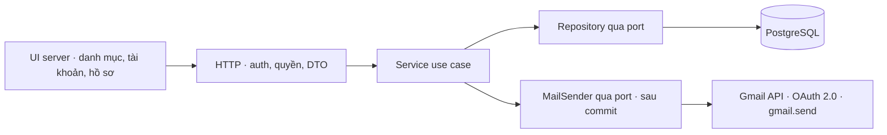
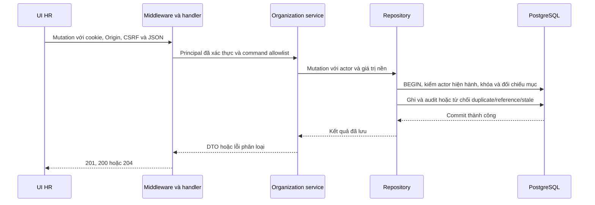
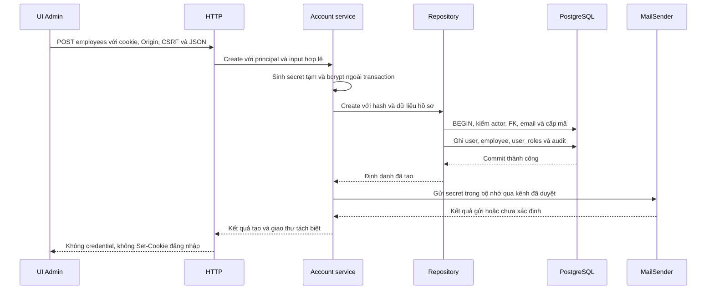
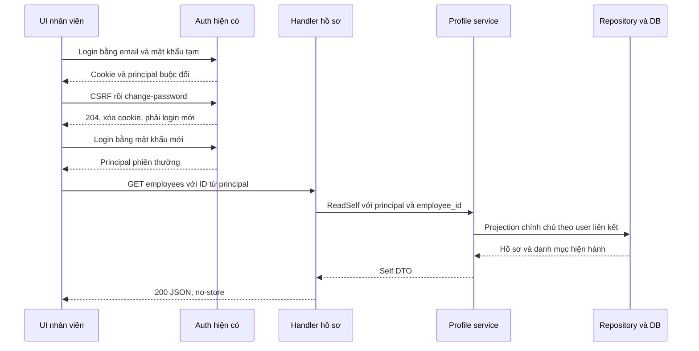

# Proposal — Danh mục tổ chức, cấp tài khoản và hồ sơ cá nhân

Ngày lập: **14/11/2026**. Cập nhật: **15/11/2026**. Trạng thái: **đã duyệt phạm vi và các lựa chọn OAP-A01–A08; chuẩn bị contract API và kế hoạch SQL**. Gmail API + OAuth 2.0 đã được chọn, cấp lại/gửi lại mật khẩu tạm được hoãn. Đã soạn OpenAPI và SQL plan để review; chưa có Jira key mới, code hoặc migration cho ba feature này. Phê duyệt proposal không thay review contract/SQL cụ thể, cấu hình Google hoặc quyền thực thi DB/gửi thư thật.

**Luồng demo:** HR chuẩn bị danh mục → Admin tạo tài khoản kèm hồ sơ → nhân viên nhận mật khẩu tạm → đăng nhập/đổi mật khẩu → xem hồ sơ từ DB. Tận dụng năm API auth đã có, không viết lại chúng.

**Đường đọc để trình bày:** mục 2–3 → kiến trúc mục 5 → sequence mục 6.4 → kế hoạch mục 9. API/DB chi tiết dành cho review triển khai; bằng chứng thực chạy sẽ được ghi khi có, không coi sơ đồ là chức năng đã hoàn thành.

## 1. Nguồn và đầu vào

- [FR/AC](../product/functional-requirements.md): FR-005/006/007/015; phần đọc hồ sơ của FR-009; BR-001, CR-001/002.
- [Bản đồ miền](../product/business-domains.md): D02 quản lý cơ cấu/hồ sơ; D01 chủ trì tạo tài khoản và cấp mã, phối hợp D02 cùng transaction.
- [Baseline](../business-baseline-2026-10-20.md): tạo user–employee cùng lần lưu; mã mới EMP000001… tự cấp, không username sản phẩm theo chốt 15/11; các quyết định 05–06/11 về email/mật khẩu tạm.
- [Hồ sơ và cơ cấu](../../.claude/docs/employee_profile_workflow.md), [phân quyền](../../.claude/docs/roles_permissions.md), [API design](../../.claude/docs/api_design.md), [bảo mật](../../.claude/docs/security.md), [kiến trúc](../../.claude/docs/architecture.md).
- [Dictionary 5B](../design/database-step5b-supporting-dictionary-2026-10-14.md) mục 1–5.1/20; [mapping legacy](../design/database-step5c-migration-map-2026-10-14.md); migration 000001–000003 hiện có trong repo.
- [Auth hiện hành](backend-auth-session.md), [runbook auth](../api/auth-runbook.md), [FE](../../web/README.md), [kế hoạch báo cáo](../ai/delivery-plan.md).

Một số nguồn kiến trúc/API còn ghi nhận skeleton cũ; dùng code và bàn giao auth hiện hành để xác định phần đã triển khai, không dùng câu cũ để làm lại auth. Kiểm kê Neon 06/11 không phải kiểm kê mới hoặc quyền áp migration.

## 2. Objective

Chuyển ba phần UI đang mô phỏng thành một luồng dùng dữ liệu thật, có quyền server và có thể demo trực tiếp. Không tạo user mồ côi, cấp trùng mã hoặc công khai credential để chạy kịp lịch.

## 3. Goals / Non-goals

| Feature | Đầu ra | Truy vết và giới hạn |
|---|---|---|
| F1 — Danh mục tổ chức | HR CRUD phòng ban/vị trí/cấp bậc; Admin đọc danh mục để tạo hồ sơ | FR-015; không suy role/kỹ năng từ tên danh mục |
| F2 — Tạo tài khoản kèm hồ sơ | Admin tạo nguyên tử, mã duy nhất, role ban đầu, mật khẩu tạm; danh sách tài khoản để đối soát | FR-005/006/007; gửi thư thật và báo lỗi sau commit theo mục 6.5; cấp lại/gửi lại đã hoãn, ghi rõ giới hạn khi bàn giao |
| F3 — Hồ sơ cá nhân thật | Chính chủ đọc thông tin hành chính/công tác, dùng tài khoản vừa tạo để login/đổi/xem/reload/logout | Phần đọc FR-009 và BR-001; chưa hoàn thành FR-009 khi chưa có lịch sử đề nghị |

**Ngoài phạm vi:** HR sửa/vô hiệu hóa hồ sơ; đề nghị/duyệt cập nhật; thay quyền/khóa tài khoản đã có; Admin reset; cấp lại/gửi lại mật khẩu tạm; đổi tự nguyện; CV/kỹ năng; dự án/phân công; công thức gợi ý; gửi hàng loạt; workspace nghiệp vụ chưa nối; migration toàn 33 bảng/Neon; deploy. Role ban đầu chỉ là đầu vào tạo mới, không mở API chỉnh quyền hiện hữu.

## 4. Các lựa chọn đã duyệt — 15/11/2026

Các quyết định nghiệp vụ nguồn vẫn giữ: chỉ HR mutation danh mục; Admin tạo tài khoản; không Admin superset HR; email là định danh đăng nhập duy nhất, không username sản phẩm; mật khẩu tạm ngẫu nhiên gửi mail, chưa hết hạn riêng, buộc đổi; không password trong admin JSON/log; address nullable khi tạo; employee_code tự cấp không trùng/tái dùng.

| ID | Lựa chọn đã duyệt | Tác động/điều kiện triển khai |
|---|---|---|
| OAP-A01 | **Đã chốt format 15/11:** EMP000001, EMP000002…; phần số tối thiểu sáu chữ số, không cắt/quay vòng | Giữ mã cũ, preview không giữ chỗ, không COUNT+1/tái dùng. Chọn PostgreSQL sequence; chấp nhận khoảng trống do rollback, không reset để lấp số. Khởi tạo dải theo preflight cần review. Xem mục 4.1 |
| OAP-A02 | **Chốt cuối 15/11:** bỏ hẳn cột users.username khỏi thiết kế đích; chỉ email đăng nhập | Migration tiến thêm, rà code/seed/fixture/test/runner/UI còn dùng; không giữ nullable hoặc sinh alias. Drop mất giá trị cũ, rollback không tự khôi phục; xem mục 6.1 |
| OAP-A03 | Trim tên danh mục và từ chối trùng không phân biệt hoa/thường; không bỏ dấu hoặc chuẩn hóa Unicode ngầm | So FE/demo hiện có, SQL uniqueness phải khớp. Nếu dữ liệu legacy va chạm thì dừng để đối chiếu, không tự gộp/xóa |
| OAP-A04 | PATCH/DELETE danh mục mang expected_before_name; đối chiếu giá trị cũ dưới khóa, không dùng updated_at làm version | Chống màn cũ ghi đè/xóa mục đã đổi; không thêm cột version |
| OAP-A05 | Body JSON giới hạn 8 KiB, pagination 20/max 100; email/name theo giới hạn dictionary, lỗi có mã chung và request_id | Đây là contract mới của feature, không mặc định suy từ auth dù có thể tái sử dụng helper |
| OAP-A06 | Secret tạm 32 byte ngẫu nhiên, mã hóa base64url; bcrypt cùng cấu hình dự án; chỉ ở memory/mail TLS và hash DB | Không lưu plaintext vào outbox/log/audit/response. Tham số đã duyệt; kiểm nguồn random và lỗi bcrypt trước transaction |
| OAP-A07 | Gmail API + OAuth 2.0, scope gmail.send, qua port riêng; DB commit trước gửi | Đã chốt 15/11: báo lỗi gửi riêng sau commit, hoãn cấp lại/gửi lại. Không giữ transaction chờ mail. Cấu hình Google và contract cụ thể theo mục 6.5; chưa có quyền gửi mail thật |
| OAP-A08 | Read hồ sơ dùng GET /api/employees/{id}, chính chủ lấy ID từ principal; Admin không được dùng quyền tạo để đọc hồ sơ riêng tư về sau | Không thêm profile endpoint vào /auth/me; người không có quyền/ID không tồn tại cùng404 sau xác thực, không lộ PII |

**Kênh email đã chốt:** Gmail API qua HTTPS, OAuth 2.0 với quyền `https://www.googleapis.com/auth/gmail.send`; một hộp thư gửi do Quân quản lý. Không dùng SMTP/App Password trong phương án này, không thêm đăng nhập Google cho nhân viên. Cấu hình Google Cloud/OAuth client, thư viện Go, nơi giữ credential và cấp quyền hộp thư được cụ thể hóa ở task mail trước khi tích hợp; không xin secret trong chat hoặc tự bật billing/dịch vụ trả phí.

Các lựa chọn trên đã được người dùng duyệt; không còn cần chọn lại A03–A08. Các việc chưa có phương án cụ thể như SQL bỏ cột username, mapping legacy, thứ tự khóa và schema/DTO chi tiết là đầu ra thiết kế tiếp theo, không được coi là đã duyệt SQL chỉ từ chấp thuận hướng triển khai.

### 4.1. Định danh đã chốt và căn cứ thiết kế — 15/11/2026

Người dùng đã duyệt không có username sản phẩm và mã mới EMP000001; nguồn quyết định tại [baseline 15/11](../business-baseline-2026-10-20.md#quyết-định-tiếp-nối-15112026--email-đăng-nhập-và-mã-nhân-viên). Phân biệt bốn khái niệm:

| Trường | Vai trò trong app | Hướng đề xuất |
|---|---|---|
| user_id | Khóa nội bộ của tài khoản, liên kết session/role/audit | Không đổi theo email/mã nhân viên |
| employee_id | Khóa nội bộ hồ sơ, có thể khác user_id | FK liên kết user–employee, không đồng nhất hai ID |
| employee_code | Mã nghiệp vụ để con người tra cứu/đối chiếu | Tự cấp, duy nhất, ổn định; mã mới EMP000001… |
| company_email | Định danh đăng nhập đã chốt | UI/mail hướng dẫn dùng email, không giới thiệu e001 là cách login |

**Đối chiếu nguồn chính thức:**

- [Microsoft Entra](https://learn.microsoft.com/en-us/entra/identity/hybrid/connect/howto-troubleshoot-upn-changes) phân biệt UPN/email có thể thay đổi với objectID làm định danh ổn định; không suy email là khóa nội bộ.
- [SAP SuccessFactors](https://help.sap.com/docs/successfactors-employee-central/implementing-employee-central-core/differentiating-between-person-id-user-id-and-user-name-in-employee-central) tách Person ID/User ID/Username, đồng thời có cấu hình ban đầu dùng cùng giá trị. Vì vậy không có cơ sở nói username dạng mã số luôn sai; vấn đề là nó có vai trò thực sự trong sản phẩm hay không.
- [Oracle HCM](https://docs.oracle.com/en/cloud/saas/human-resources/faigh/person-number-generation-methods.html) hỗ trợ nhập mã thủ công hoặc tự cấp theo enterprise sequence và giữ mã legacy. Đây là ví dụ hệ thống thực hỗ trợ cấp số, không là chuẩn bắt mọi công ty dùng một tiền tố.
- [PostgreSQL 18](https://www.postgresql.org/docs/18/functions-sequence.html): nextval cấp giá trị khác nhau khi đồng thời, có thể có khoảng trống sau abort. Sequence không thay UNIQUE/mapping dữ liệu/quyền server.

**Áp dụng cho DATN theo quyết định đã duyệt, không phải chuẩn áp đặt từ các sản phẩm trên:**

1. Người dùng chỉ cần email để login; bỏ ý tưởng hiển thị hoặc gửi thêm username e001 như định danh đăng nhập thứ hai. Không tự dùng phần trước @ làm username vì có thể trùng giữa các domain và đổi khi email đổi.
2. Chốt cuối 15/11 bỏ hẳn users.username khỏi schema đích, thay hướng giữ cột/cho NULL. Schema legacy còn cột tới khi chạy migration được giao; phải rà và cập nhật các nơi đọc/ghi username trước khi nâng cấp. Không sửa migration lịch sử hoặc tự áp Neon. Không cam kết giữ username cũ sau DROP; kế hoạch backup/rollback tại mục 6.1.
3. Mã nhân viên mới dùng EMP000001, EMP000002…; phần số tối thiểu sáu chữ số, đệm 0 và tăng tiếp khi vượt sáu chữ số, không cắt/quay vòng. Mã không mang nghĩa login/phòng ban/chức danh/role; giữ nguyên mã đã cấp. Đây là lựa chọn sản phẩm đã duyệt, không là chuẩn quốc tế.
4. Không mã hóa phòng ban/năm vào mã nếu không có nhu cầu nghiệp vụ tương ứng; chuyển công tác không nên buộc đổi mã. Mã không là số đếm nhân sự hoặc bí mật cấp quyền; ID/code đoán được vẫn phải kiểm quyền tài nguyên.
5. Không để collision username làm bỏ số nhân viên như đề xuất trao đổi trước. Hai định danh có trách nhiệm khác nhau; migration bỏ username độc lập với dải mã nhân sự.
6. Repo thực tế có seed dùng EMP001, trong khi baseline/UI dùng E001; đây là dữ liệu ở nguồn khác nhau, không chứng minh Neon hiện có format nào. Preflight trước migration phải kiểm kê đích được phép và review mapping; không tự suy max trên một prefix rồi cấp trùng dải cũ.

Các ví dụ Microsoft/SAP/Oracle là tham khảo cách phân biệt định danh và cấp số; không khẳng định công ty mục tiêu dùng chính sách của một nhà cung cấp cụ thể. Đợt này cập nhật quyết định sản phẩm; chưa duyệt SQL/migration mới hoặc xác nhận code/DB đã đổi.

## 5. High-level design



Chiều gọi runtime, không vòng import: HTTP gọi service; service khai báo port; adapter PostgreSQL/mail hiện thực; composition root lắp. Không interface cho mọi hàm thuần, không ORM/query builder hoặc session library mới. Các domain dùng cùng backend/DB, không microservice.

Middleware hiện có xác thực principal và chặn must_change_password trước route nghiệp vụ. Thêm kiểm quyền use case; mutation kiểm Origin/CSRF. Service không nhận role/actor_id từ request để tự cấp quyền; system_roles trong create là dữ liệu mục tiêu do Admin có quyền chỉ định, không thay principal người gọi.

Service/repository cần kiểm lại actor và quyền/trạng thái cùng transaction quan trọng; middleware đọc trước không đủ chống thay quyền đồng thời. Giao thức khóa phải tương thích user→employee của auth, có test barrier cho race actor mất quyền/danh mục bị xóa; thứ tự cụ thể được chốt trong SQL plan, không thêm khóa ngược gây deadlock.

## 6. Detailed design

Chi tiết để triển khai: [OpenAPI OAP](../api/organization-accounts-profile.openapi.json) là contract HTTP dự thảo duy nhất cho 16 thao tác trong đợt này; [SQL/migration/test plan](backend-organization-accounts-profile-sql-plan.md) định nghĩa preflight, M1/M2, mapping đề xuất, lock và rollback. Chưa có route mới trong Swagger/runtime. Các bảng dưới là tóm tắt để trình bày, không bản contract thứ hai.

### 6.1. Database/migration và bảo toàn

| Hiện có sau 000003 | Đích trong đợt này | Cách chuyển đề xuất |
|---|---|---|
| departments/positions | Dùng lại ID/tên/timestamps và liên kết employee | Preflight tên trắng/trùng theo quy tắc được duyệt; thêm ràng buộc/index đúng phạm vi |
| employees.seniority_level tự do | job_levels + employees.job_level_id nullable | Mapping giá trị legacy cần duyệt; chưa rõ thì dừng, không suy từ vị trí. Giữ dữ liệu cũ tới khi xác minh chuyển đổi, không drop sớm |
| Chưa có employees.address | TEXT nullable/default NULL | Không tự thêm địa chỉ mẫu; có giá trị thì phải có nội dung |
| employee_code unique hiện hữu | Mã mới EMP000001…; PostgreSQL sequence cùng unique hiện hữu | Khởi tạo theo tập mã và giới hạn varchar30, không reset sequence làm tái dùng mã |
| users.username NOT NULL/UNIQUE trong legacy | Bỏ hẳn cột khỏi schema đích theo A02 | Migration tiến thêm; cập nhật code/seed/fixture/test/runner/UI liên quan; không nullable/alias hoặc DROP CASCADE; backup/rollback nêu rõ mất dữ liệu cột |
| employees.email UNIQUE phân biệt hoa/thường | Kiểm email chuẩn hóa theo auth và ràng buộc nhất quán | Preflight lower/trim va chạm; proposal index expression cần review. Không tự viết lại email legacy |
| users.system_role legacy bắt buộc | Vẫn tương thích, quyền hiệu lực từ user_roles | Chốt giá trị legacy cho user mới để old constraints không lỗi; không suy quyền từ cột legacy |
| user_roles/auth_sessions | Dùng lại | Mới true+ACTIVE; không cấp session khi tạo, session chỉ sau login |
| Chưa có audit_events trong schema test hiện tại | Dùng thiết kế bảng chung khi mutation cần ghi audit | Chỉ tạo đúng dictionary, allowlist actor/ID/operation/fields; không credential; không dựng framework audit toàn app |

Chưa đặt số migration cố định: kiểm head khi bắt đầu. Không sửa000001–000003, export DBML làm SQL, force version hoặc áp toàn thiết kế. DDL thêm cấu trúc/mapping/constraints chia theo rủi ro; quyết định cuối sau SQL/preflight review.

Kiểm đường DB rỗng và legacy giả trên PostgreSQL 18 test sở hữu. Snapshot trước–sau đối chiếu user_id/employee_id/liên kết/code/hash/email/status/role, dữ liệu cấp bậc và auth sessions. Fixture phải có ID user khác employee. Audit/mapping không được bịa actor/thời điểm cho dữ liệu cũ.

**Bỏ username — phạm vi chuyển đổi:** rà `cmd/seed`, `cmd/localdev`, `internal/testutil/authdb`, fixture/integration migration, `scripts/authdb/manage.py` và model/form/demo tài khoản FE; không sửa tài nguyên Swagger vendor chỉ vì trùng từ username. Đây là kiểm kê từ repo, không chứng minh DB đích đã đổi. Gỡ đọc/ghi ở đường chạy schema mới; fixture dựng schema lịch sử và test bảo toàn trước nâng cấp vẫn được giữ tham chiếu rõ ràng.

Migration chỉ drop cột/ràng buộc thuộc username sau khi kiểm phụ thuộc, không CASCADE tùy tiện. Cần backup được phép trước môi trường cần bảo toàn; không xuất dữ liệu username vào log/evidence. Test chứng minh cột biến mất, không ảnh hưởng dữ liệu còn lại, tạo mới không cần username và auth/seed/runner chạy trên schema đích. Down có thể tái tạo cấu trúc theo kế hoạch riêng, nhưng không phục hồi giá trị đã drop nếu không restore backup; không sinh giá trị giả để gọi rollback bảo toàn. SQL cụ thể phải review trước thực thi; không đổi code/runtime trong đợt tài liệu này.

Down chỉ trên DB case hy sinh, nêu mất cấp bậc/address/audit và sequence không đảo ngược cấp mã; down/up không phải backup dữ liệu. Đường rollback/dirty phải kiểm thực driver. Deploy và migration Neon là đợt được giao riêng, có kiểm kê mới/backup/rehearsal.

### 6.2. API dự kiến và quyền

Đường dẫn kế thừa API design, danh mục `job-levels` dùng dấu gạch ngang. Các lựa chọn ở mục 4 đã duyệt; OpenAPI riêng của feature đã soạn và đang review; không sửa contract năm API auth.

| Method/path | Ai được dùng | Input chính | Thành công |
|---|---|---|---|
| GET /api/departments, /api/positions, /api/job-levels | HR hoặc Admin có phiên thường | page, page_size, q | 200 danh sách id/name + pagination; đọc chỉ phục vụ quản trị/tạo mới |
| POST các collection danh mục trên | HR | name | 201 mục mới; Location tương ứng |
| PATCH /api/{collection}/{id} | HR | name, expected_before_name | 200 cùng ID/tên hiện hành |
| DELETE /api/{collection}/{id} | HR | expected_before_name, truyền JSON theo contract được duyệt | 204 không body; item còn tham chiếu 409 |
| GET /api/employees/next-code | Admin | Không cấp số hoặc giữ chỗ | 200 employee_code dự kiến; code thực nhận khi tạo |
| POST /api/employees | Admin | Allowlist mục 6.3 | 201 chỉ sau commit; trạng thái mail theo thiết kế mục 6.5, không password |
| GET /api/users | Admin | page/page_size/q | 200 account-list projection không phone/address/hash; phần FR-007 |
| GET /api/employees/{id} | Chính chủ phiên thường | ID số nguyên dương | 200 hồ sơ self projection; không mở HR sửa/đọc người khác trong feature này |

Route next-code phải đăng ký tĩnh không bị /{id} nhận nhầm. Query lạ/giá trị không hợp lệ 400. URI ID integer phải validate trước SQL, không nhận string ID của fixture FE làm khóa DB. List order ổn định (id tăng dần), q chỉ tìm theo trường được phép; không raw SQL/table-name từ client. `collection` trong bảng chỉ là ký hiệu tài liệu, router đăng ký ba tập route cụ thể qua allowlist.

**Lỗi dự kiến:** 400 VALIDATION_ERROR;401 UNAUTHENTICATED;403 FORBIDDEN hoặc PASSWORD_CHANGE_REQUIRED;404 NOT_FOUND;409 DUPLICATE_NAME/EMAIL_CONFLICT/STALE_DATA/CATALOG_IN_USE;413 PAYLOAD_TOO_LARGE;415 UNSUPPORTED_MEDIA_TYPE;429 nếu endpoint đã có policy riêng được duyệt;503 SERVICE_UNAVAILABLE/500 INTERNAL_ERROR theo nguồn. Không suy auth limiter30/IP áp cho toàn API mới. Lỗi SQL/PII không trả body thô; các response chứa danh tính/tài khoản no-store, bảo vệ auth không bị nới.

### 6.3. DTO và quy tắc input

Đầu vào POST /api/employees theo hướng đã duyệt (schema chi tiết theo OpenAPI OAP):

```json
{
  "fullname": "Nhân viên thử nghiệm",
  "company_email": "employee@example.invalid",
  "position_id": 12,
  "department_id": null,
  "job_level_id": null,
  "phone": null,
  "address": null,
  "system_roles": []
}
```

- Bắt buộc fullname/email/position; giới hạn dictionary 100/100/20. Optional department/job_level/phone/address có thể bỏ hoặcNULL theo schema mới; address có giá trị không được trắng. Không nhận password/username/employee_code/status/user_id/actor_id/must_change_password.
- Role ban đầu chỉ ADMIN/HR/DIRECTOR, không PM/PTCM/EMPLOYEE; [] vẫn là nhân viên hợp lệ. Chức danh không tự sinh role. Service cấp ACTIVE và must_change_password=true, legacy column theo mapping đã duyệt.
- Secret tạm/bcrypt sinh ngoài transaction; validate cấu trúc sớm, recheck FK/email/actor trong transaction. Không giữ khóa chờ network/bcrypt.
- Profile DTO self chỉ user_id/employee_id/employee_code/fullname/company_email/phone/address, position id+name bắt buộc, department/job_level id+name nullable và employment_status; timestamps nếu có phải RFC3339. Không password/hash/username nội bộ/session/role riêng vào profile để cấp quyền. Quyền UI dùng principal, server vẫn kiểm mỗi request.
- Account-list DTO chỉ user_id/employee_id/employee_code/fullname/company_email/status/system_roles/must_change_password và không thông tin giao thư đã lưu (kết quả chỉ có ở response create trong đợt này); không phone/address/credential.
- Catalog mutation đối chiếu expected_before_name; tên danh mục được trim và kiểm trùng theo A03, SQL phải cùng quy tắc, không chỉ kiểm trước INSERT. Quy tắc duy nhất này không áp cho fullname nhân viên; nhiều nhân viên có thể trùng họ tên.

### 6.4. Sequence chính

#### F1 — HR tạo/sửa/xóa danh mục



GET danh mục chỉ đọc projection sau kiểm quyền, không transaction mutation/audit giả. Xóa còn tham chiếu phải bảo vệ cả race với tạo employee bằng FK NO ACTION; không chỉ SELECT count rồi DELETE.

#### F2 — Admin tạo tài khoản kèm hồ sơ



Nhánh lỗi trước commit không gửi mail, không user/employee nửa chừng. Nếu commit trả lỗi/mất phản hồi: không gửi thư dựa vào giả định chưa commit và không tự tạo lại, phải đối soát. Nhánh mail lỗi sau commit không được rollback giả tài khoản đã lưu hoặc trả thông báo khiến Admin tưởng chưa tạo. Cấp lại/gửi lại đã hoãn theo mục 6.5; không có đường phục hồi trên UI trong đợt này.

#### F3 — Nhân viên nhận tài khoản và xem hồ sơ



Reload bootstrap me rồi đọc lại profile; không map nhân viên theo tên/email vào fixture. Đổi ID không đọc được người khác; limited gọi profile vẫn bị 403 trước handler. Các API auth được reuse, không thêm auto login sau đổi.

### 6.5. Gửi email — Gmail API + OAuth 2.0

**Phạm vi đã duyệt:** một hộp thư Gmail gửi cho ứng dụng, người nhận do Quân kiểm soát khi test/demo (Gmail hoặc email trường theo baseline). Chỉ xin quyền gửi `gmail.send`; không đọc/sửa/xóa hộp thư, không xin scope toàn bộ `mail.google.com`. Nhân viên không phải cấp quyền Google; email/mật khẩu và session TaskAssign giữ nguyên.

**Luồng cấu hình và runtime:**

1. Tạo Google Cloud project, bật Gmail API, cấu hình consent screen/test user và OAuth client phù hợp công cụ cấp quyền; xác định redirect URI chính xác trong brief kỹ thuật. Chủ hộp thư tự đăng nhập Google và đồng ý quyền gửi. Không dựng màn kết nối Google cho mọi nhân viên.
2. Xin offline access để nhận refresh token khi Google cấp; backend dùng token đó lấy access token và gọi `users.messages.send` qua HTTPS. Dùng thư viện OAuth phù hợp sau review dependency, không tự viết giao thức hoặc đưa credential lên FE. OAuth token gửi thư không liên quan token CSRF/session TaskAssign.
3. Client secret/refresh token là bí mật cấu hình backend, ngoài Git/log/response/evidence; access token chỉ dùng trong adapter. Không lưu chúng trong bảng auth_sessions hoặc gộp với password nhân viên. Cách lưu local có quyền hạn chế, cấu hình deploy, timeout và xử lý token lỗi được chốt cụ thể ở task mail, không tạo kho secret mới trong đợt tài liệu.
4. Access token hết hạn được refresh; refresh token bị thu hồi/hết hạn thì báo lỗi kết nối gửi thư và yêu cầu chủ hộp thư cấp quyền lại. Đây là khôi phục kết nối provider, **không** là gửi lại email/cấp lại mật khẩu. Không retry mù `messages.send` sau lỗi mạng hoặc mất phản hồi.

**DB và kết quả gửi:**

- DB và Gmail không có giao dịch nguyên tử chung. Commit DB trước, gửi có timeout sau commit, không giữ transaction chờ Google; lỗi trước commit không gửi email.
- Đã duyệt hướng trả **201 khi tài khoản commit thành công**, tách kết quả tạo tài khoản với kết quả gửi. OpenAPI đã định nghĩa account_created=true, account và mail.status=accepted/failed/unknown tương ứng Google nhận gửi, lỗi xác định, hoặc kết quả chưa xác định. Google nhận yêu cầu không chứng minh tới inbox; không gọi là delivered. Không thêm pending/queue khi chưa có cơ chế chạy nền.
- Gửi lỗi sau commit: UI báo **“Tài khoản đã tạo, gửi email thất bại”**; giữ tài khoản, không rollback giả/báo thành công toàn bộ. Timeout/mất phản hồi gửi phải diễn đạt chưa xác định, không khẳng định thư chưa gửi.
- **Hoãn cấp lại/gửi lại mật khẩu tạm**, không nút/endpoint reset, hàng đợi hoặc tự gửi lại. Không thể lấy password từ hash; không lưu plaintext/outbox/đưa password cho Admin. Người không nhận được thư chưa có đường khôi phục trên UI; đây là giới hạn cần bổ sung trước dùng thực tế.
- Mất phản hồi create: đối soát tài khoản qua danh sách có quyền, không replay POST. Không hứa exactly-once. Danh sách tài khoản không được suy trạng thái gửi từ việc account tồn tại; nếu chưa có lưu delivery status thì reload phải coi kết quả gửi là không có thông tin. Contract hiện chọn không persist metadata giao thư, không thêm bảng/cột. UI giữ thông báo của response hiện tại; reload không hiển thị trạng thái gửi cũ như đã xác minh.

**Vận hành thử và chi phí:**

- External OAuth ở trạng thái Testing với scope Gmail có refresh token hết hạn sau **7 ngày**; runbook phải có bước kiểm kết nối/cấp quyền lại trước demo, không hứa kết nối lâu dài hoặc bỏ qua yêu cầu Google khi chuyển production.
- Gmail API sử dụng thông thường hiện không tính thêm phí, vẫn chịu quota API và giới hạn gửi Gmail. Giữ đợt demo trong phạm vi miễn phí; không tự bật billing, nâng quota, mua Workspace/tên miền hoặc dịch vụ trả phí. Kiểm lại chính sách khi cấu hình/vận hành.
- Test giả chỉ chứng minh adapter/xử lý lỗi; F2 nghiệm thu cần thư thật tới mailbox được phép và kiểm nhánh lỗi sau commit. Không dùng example.invalid cho gửi thật; không collect nội dung password/token vào bằng chứng. Chuẩn bị/check thư demo trước buổi báo cáo.

Nguồn kỹ thuật: [scope Gmail](https://developers.google.com/workspace/gmail/api/auth/scopes), [API gửi thư](https://developers.google.com/workspace/gmail/api/reference/rest/v1/users.messages/send), [OAuth offline access](https://developers.google.com/identity/protocols/oauth2/web-server), [hạn refresh token](https://developers.google.com/identity/protocols/oauth2/#expiration), [quota/chi phí](https://developers.google.com/workspace/gmail/api/reference/quota). Đây là căn cứ cấu hình, không bằng chứng project Google đã được thiết lập.

F1/F3 với tài khoản local tổng hợp có thể triển khai độc lập trong khi hoàn thiện cấu hình mail. Các bước cấu hình còn lại là điều kiện kỹ thuật để chạy F2, không phải yêu cầu chọn lại provider hoặc mở lại chức năng gửi lại đã hoãn.

### 6.6. FE và điều hướng

Tái sử dụng `features/organization/OrganizationCatalogs`, `features/accounts/AccountCreateForm`/`AccountManagement`, `features/profiles/PersonalProfile` và primitives hiện có; chúng đang phụ thuộc state/demo nên tách data callbacks/adapter đúng phạm vi, không import demo vào server mode.

- Sau login thường: mở vùng server có navigation tối thiểu theo quyền: Hồ sơ của tôi; HR Danh mục tổ chức; Admin Tài khoản/Tạo tài khoản. Đây là mở các màn được nối, không workspace nghiệp vụ mock hoặc thiết kế dashboard mới.
- Màn chưa có API tiếp tục báo chưa kết nối/ẩn action chưa hỗ trợ; không tự fallback demo, không cho HR edit/duyệt profile từ phần UI cũ chưa nối.
- Form create: bỏ username demo khỏi vai trò thông tin đăng nhập, mã dự kiến chỉ đọc; giữ code thực do server trả nếu khác preview. Không chọn principal/role của người gọi từ client.
- New profile tải server: addressNULL nhắc bổ sung, không mở form cập nhật khi chưa có feature; lịch sử đề nghị chưa có thì ghi rõ chưa nối, không hiển thị [] như đã chứng minh không có lịch sử.
- GET có thể đối soát sau lỗi, POST không auto retry. Khi403 do mất quyền/reload me thì navigation cập nhật theo server; không cấp quyền bằng URL. Không giữ password tạm/token trong localStorage/URL/form quản trị.

## 7. Kiểm thử và bảo mật

| Nhóm | Ca bắt buộc | Bằng chứng |
|---|---|---|
| Migration | DB rỗng/legacy, dữ liệu cấp bậc/role/email xung đột, rollback/dirty, auth không hồi quy | PG18 test sở hữu, guard runner, snapshot không in PII |
| Catalog | Trim/độ dài/duplicate/case, stale edit/delete, ID sai, xóa có FK; race delete với create profile | Unit + DB hai connection/barrier, không sleep ngẫu nhiên |
| Create | User/employee/roles/audit cùng commit; lỗi write/commit không nửa chừng; không mail trước commit | DB integration + fake mail port; kiểm row/count/secret không lộ |
| Cấp mã | Nhiều create đồng thời code duy nhất; preview không giữ chỗ; không reuse; legacy collision | PG sequence/unique thật, fixture có code khoảng trống/tài khoản locked |
| Quyền | Employee/Admin-only không CRUD danh mục; HR-only không tạo; limited kể cảADMIN không vào nghiệp vụ | HTTP+DB, middleware và kiểm quyền hiện hành trong transaction |
| Profile | Chính chủ đọc, ID user khác employee; đổiID không lộ; addressNULL đúng; đổi tên danh mục giữ liên kết | HTTP+DB và browser |
| Mail | Gmail OAuth token refresh/hết hạn/thu hồi, timeout/failed/unknown, accepted chưa đồng nghĩa delivered; không tự gửi lại hoặc lộ password/token | Unit adapter và thử mailbox thật khi được phép; chưa fake thành pass mail thật |
| FE | Loading/validation/409/401/403/503/mất phản hồi, no auto POST retry, server/demo tách biệt | Adapter test + browser với backend test, mobile/focus phù hợp |
| E2E | HR catalog→Admin create→nhận mail→login hạn chế→đổi→login mới→profile→reload/logout | Browser + DB thật và người dùng tự thay credential; từng phần chưa đạt ghi rõ |

Go vet/test/build khi có Go changes; pnpm check khi đổi FE; harness/contract và diff check đúng snapshot. DB/race tuần tự trên cluster test đã xác minh. Không dùng seed/Neon để thay môi trường test. Redaction dùng marker giả, không collect mail body/credential vào evidence. Review các transaction/quyền/migration và self-review UI; review agent không thay test runtime.

## 8. Definition of Done và bàn giao

- Proposal/API/SQL cùng lựa chọn liên quan đã duyệt, không blocker bị coi ngầm là đã chốt.
- DB migration/test và API/FE thực phù hợp từng feature, regression auth đạt; cổng không giảm để xanh.
- F2 chưa Done nếu chỉ tạo DB hoặc chưa kiểm mail thật/nhánh lỗi sau commit. Cấp lại/gửi lại đã hoãn không là AC ngầm; giới hạn thiếu khôi phục phải bàn giao rõ, FR partial ghi đúng.
- Runbook tiếp tục mở rộng điểm vào hiện có: cấu hình tên biến/mail redaction, chạy/dừng/demo và dữ liệu test; không chép secret hoặc đưa đồng thời hai nguồn contract.
- Có review diff, lệnh/kết quả/bằng chứng, giới hạn và đầu vào cho feature sau. Commit/push/Jira/merge chỉ khi người dùng giao; Done theo workflow sau merge, không từ bản proposal này.

## 9. WBS đề xuất — chia theo đầu ra, chưa nhập Jira

[Bộ ticket OAP](backend-organization-accounts-profile-tickets.md) gom 15 dòng dưới thành 13 Task dưới một Epic: OAP-01/02/03 là một task bàn giao thiết kế đã có; OAP-04–15 là 12 task triển khai. Bộ ticket giữ Rank/17 Blocks và description/AC; mã nội bộ không thay Jira key. Không tạo task review lặp hoặc tự ghi nhận giờ còn lại cho phần đã làm.

Mỗi dòng là một đầu ra review được, không mặc định một package/một API/một ticket. Jira key thật gắn sau khi chốt brief; review/test nằm trong từng dòng, không tạo task review cho từng hàm. Ước lượng sẽ bổ sung sau review contract/SQL và cấu hình mail; số dòng dưới không phải giờ đã làm hoặc cam kết lịch 19/11.

| WBS | Đầu ra cụ thể và tiêu chí | Phụ thuộc |
|---|---|---|
| OAP-01 | Chốt contract danh mục/profile, quyền đọc/Admin/HR, stale input, lỗi và DTO | Review proposal |
| OAP-02 | Thiết kế cấp mã theo format đã chốt, migration bỏ username/giá trị legacy role và create/commit; hoàn thiện mail/error contract theo phạm vi đã chốt | A01/A02/A06/A07 và mục 6.5 |
| OAP-03 | SQL/preflight/mapping cho F1/F3 và kế hoạch rollback, review trước thực thi | OAP-01 |
| OAP-04 | Migration F1/F3 + fixture rỗng/legacy bảo toàn, audit khi cần, PG tests | OAP-03 |
| OAP-05 | Repository/service read danh mục + HR CRUD, before_name/FK/duplicate; DB race tests | OAP-04 |
| OAP-06 | API danh mục dùng guard auth/CSRF, quyền/DTO/error; wiring/HTTP tests | OAP-01, OAP-05 |
| OAP-07 | Nối UI danh mục server và navigation quyền tối thiểu; browser CRUD/reload/delete blocked | OAP-06 |
| OAP-08 | Repository/service/API read self profile chính chủ, ID và PII allowlist; DB/HTTP tests | OAP-01, OAP-04 |
| OAP-09 | Nối màn profile thật + auth bootstrap/deep link/limited gate; browser reload | OAP-08, navigation server |
| OAP-10 | Migration bỏ username, cập nhật code/seed/fixture/test/runner/UI liên quan và cấp sequence/unique; kiểm schema đích, đồng thời/bảo toàn dữ liệu còn lại và giới hạn rollback | OAP-02, OAP-04 |
| OAP-11 | Service/transaction create user–employee–roles/audit; recheck actor, FK/email, rollback/commit | OAP-10 |
| OAP-12 | Gmail API adapter/OAuth, cấu hình hộp thư và runbook token Testing 7 ngày; kiểm token refresh/hết hạn/thu hồi, kết quả accepted/failed/unknown và không lộ credential; không cấp lại/gửi lại | OAP-02, kênh gửi được cấp |
| OAP-13 | API create/preview/account-list và HTTP integration; chứng minh chỉ gửi sau commit, không gửi khi transaction lỗi, tách kết quả tạo/gửi khi mail lỗi hoặc chưa xác định; error mapping và không POST retry | OAP-11, OAP-12 |
| OAP-14 | Nối UI Admin create/list, mã dự kiến/thực; kiểm thông báo tài khoản đã tạo tách khỏi mail accepted/failed/unknown, không báo delivered hoặc tự gửi lại; adapter tests và browser với backend test | OAP-13 |
| OAP-15 | E2E xuyên ba feature, regression auth, DB/race, dữ liệu demo và runbook | OAP-07, OAP-09, OAP-14 |

Thứ tự chủ động: F1/F3 độc lập làm trước trong khi cấu hình Gmail/OAuth chưa sẵn sàng; khi F1 được review có thể chuẩn bị F2/SQL độc lập, không mở hai feature dirty chung rồi khó bàn giao. Mục tiêu tuần vẫn toàn luồng nếu đầu vào đủ, tối thiểu demo 19/11 là danh mục/profile thật theo kế hoạch.

Quân đã chọn agent hỗ trợ triển khai và bản thân đọc hiểu phần quan trọng; không giao bài tự viết lớn mặc định. Các checkpoint học: create transaction vì sao nguyên tử; sequence khác COUNT+1; FK chống race; role server so với UI; boundary DB/mail. Khi Quân nhận phần tự viết cụ thể, agent chỉ hướng dẫn/review phần đó.

## 10. Trạng thái đợt soạn proposal

Đã đối chiếu nguồn/code hiện có; chưa chạy test nghiệp vụ, browser/DB/mail, không dùng bảng test dự kiến làm pass. Đã soạn OpenAPI và SQL plan dự thảo; chưa có file migration mới hoặc Jira key. Mục 4/6.5 đã duyệt hướng triển khai ngày 15/11; contract/SQL plan đã review và bộ ticket đã soạn để duyệt trước nhập Jira. Mapping legacy cụ thể và brief cấu hình OAuth là đầu ra của task tương ứng trước thực thi. SQL bỏ username/phụ thuộc/rollback và các chi tiết chưa có phương án vẫn cần review trước code; không tự áp DB hoặc gửi thư. Công thức gợi ý nằm ngoài đợt này và vẫn chờ thảo luận riêng.

Review tài liệu 14/11: sub-agent read-only không phát hiện lệch nguồn/overclaim đáng kể; đã đối chiếu phạm vi FR, quyền HR/Admin/chính chủ, boundary DB–mail, blocker và phụ thuộc WBS. 14 test harness đạt, kiểm kê 307 nguồn và diff check đạt. Các kiểm này chỉ xác minh tài liệu/nguồn, không phải bằng chứng runtime hoặc phê duyệt OpenAPI/SQL chưa có.


**Bàn giao thiết kế 15/11:** đã soạn contract 16 thao tác và SQL/test plan, chưa thực thi. OpenAPI chọn JSON strict, mã lỗi Origin/CSRF tái dùng FORBIDDEN, role/status theo nguồn hiện hành; tạo trả 201 với account_created/account/mail, không lưu delivery status. SQL plan đề xuất users.system_role=EMPLOYEE cho user mới chỉ để tương thích, không cấp quyền; mapping cấp bậc/dải mã đích còn cần preflight cụ thể. Các lựa chọn kỹ thuật chi tiết này cần review cùng contract trước implementation; không tự thay dữ liệu legacy hoặc gọi plan là DB test pass.


**Review và kiểm tĩnh sau khi soạn 15/11:** self-review + sub-agent read-only đã xử lý hai điểm: khóa DELETE catalog tránh vòng chờ FK/actor và schema raw input không kiểm maxLength/format trước bước trim. Đã chạy `node --test scripts/check-organization-contract.test.mjs scripts/check-auth-contract.test.mjs scripts/check-harness.test.mjs`: 32/32 đạt (7 OAP, 11 auth, 14 harness); `node scripts/check-harness.mjs`: 310 nguồn đạt; `git diff --check`: đạt. Review bổ sung đã làm rõ UNIQUE/CHECK cho cả ba danh mục, email legacy được chuẩn hóa ở projection nhưng giữ nguyên trong DB, count/items cùng snapshot bằng một SQL hoặc REPEATABLE READ READ ONLY, và mã 409 riêng từng thao tác. Đã đồng bộ các câu cũ về username/gửi lại trong API design và security. Self-review và sub-agent không còn finding chặn bước soạn ticket; mapping dữ liệu đích, brief OAuth và SQL thực thi vẫn cần hoàn thiện tại task tương ứng. Test OAP kiểm ref/phạm vi/security/DTO/response/giới hạn chuẩn hóa/mã 409 theo thao tác, không phải validator OpenAPI đầy đủ hoặc bằng chứng SQL/HTTP/runtime. Không có thư viện validator OpenAPI được cài trong môi trường; không thêm dependency để gọi kiểm tĩnh này là chứng nhận chuẩn. Chưa chạy DB/browser/mail/migration, chưa đưa contract mới vào Swagger, chưa commit hoặc nhập Jira.
