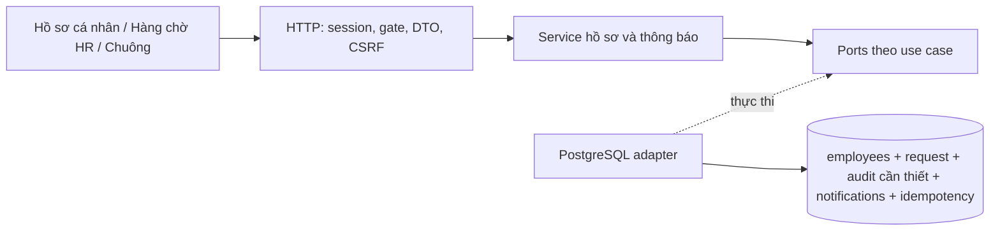
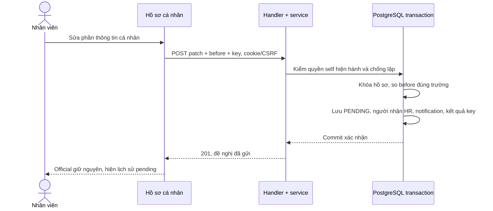
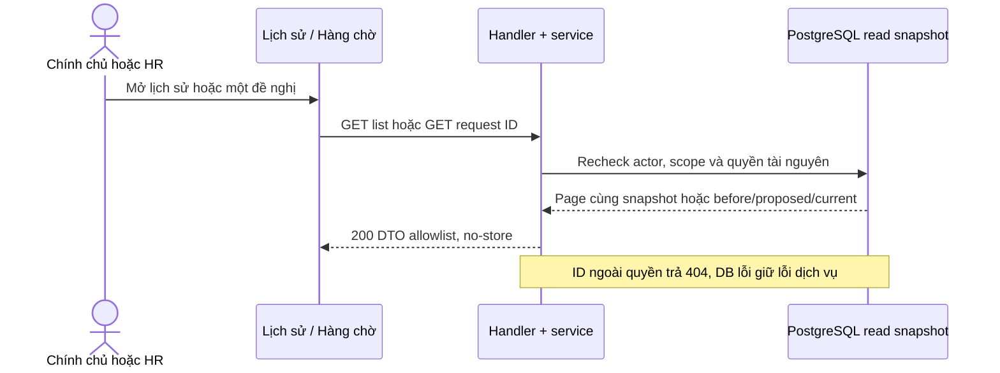
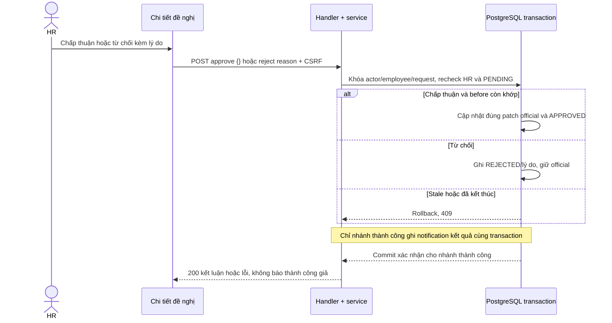
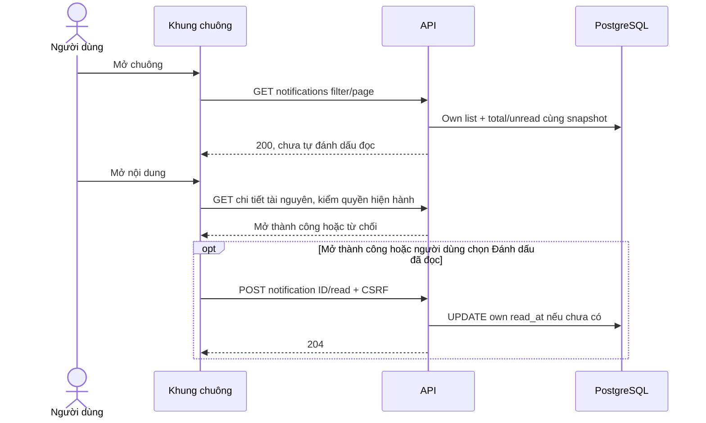
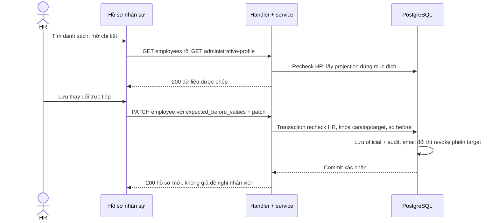

# Proposal — Đề nghị cập nhật hồ sơ và HR xét duyệt

Ngày lập: **21/11/2026**. Trạng thái: **đã được người dùng đồng ý sau review21/11; đang bàn giao contract/SQL/ticket**. PCA-A01–A09 và cách áp dụng quyền HR ở mục4 là phương án triển khai đã chốt cho đợt này, không phải chức năng đã chạy. Chưa có mã Jira cho đợt này; không dùng lại DATN-35.

**Luồng báo cáo 26/11:** nhân viên xem hồ sơ → gửi đề nghị → HR so sánh và duyệt/từ chối → nhân viên xem kết quả, thông báo và hồ sơ chính thức sau reload.

**Đường đọc trình bày:** mục 2–3 → sơ đồ mục 5 → luồng mục 6.4 → kế hoạch mục 9. Chi tiết chuyển đổi DB nằm ở [SQL/test plan](backend-profile-change-approval-sql-plan.md). Không cần trình bày toàn bộ chi tiết HTTP khi demo UI.

## 1. Nguồn và đầu vào

- [FR/AC](../product/functional-requirements.md): FR-009–FR-012, phần sự kiện hồ sơ FR-059/060, BR-001 và CR-001/002.
- [Miền D02/H01](../product/business-domains.md); [workflow hồ sơ](../../.claude/docs/employee_profile_workflow.md) mục 1–3; [phân quyền](../../.claude/docs/roles_permissions.md); [API](../../.claude/docs/api_design.md), [bảo mật](../../.claude/docs/security.md), [kiến trúc](../../.claude/docs/architecture.md).
- [Dictionary 5B](../design/database-step5b-supporting-dictionary-2026-10-14.md) mục 10/19–21; [DBML](../design/database-proposal-2026-10-14.dbml); [mapping legacy](../design/database-step5c-migration-map-2026-10-14.md).
- [UI-02/03/04 và khung thông báo](../design/figma-make/screen-contracts.md), [web README](../../web/README.md), [web AGENTS](../../web/AGENTS.md).
- [OAP đã bàn giao](backend-organization-accounts-profile.md), [runbook](../api/auth-runbook.md), [kế hoạch thứ Năm](../ai/delivery-plan.md).

Hiện trạng đọc từ repo: head migration `000005_oap_m2`; đã có auth, catalog, tạo tài khoản, self profile và audit. Form đề nghị/hàng chờ HR/thông báo còn dùng demo. `notifications` trong migration 000001 dùng employee_id/is_read/ref_task_id, khác dictionary recipient_id/read_at/resource_type/resource_id. Chưa có bảng profile request hoặc idempotency ở head. Đây là đối chiếu file, chưa kiểm kê DB đang chạy hoặc Neon.

## 2. Objective

Hoàn thành một luồng thay đổi hồ sơ có người xét duyệt, chạy xuyên UI–HTTP–PostgreSQL và giữ lịch sử. Người dùng thấy rõ dữ liệu chính thức, dữ liệu đang đề nghị và kết luận; HR không ghi đè thay đổi mới bằng đề nghị cũ.

## 3. Goals / Non-goals

| Đầu ra | Phạm vi nghiệm thu |
|---|---|
| F1 — Nhân viên gửi và theo dõi | FR-010; khép phần lịch sử FR-009, giữ self profile đã có |
| F2 — HR xử lý | FR-011: hàng chờ/lịch sử/chi tiết, approve hoặc reject có lý do |
| F3 — Thông báo hồ sơ | Phần FR-059/060: đề nghị tới HR có quyền, kết quả tới chính chủ; khung chung đúng quyền |
| F4 — HR đọc/sửa trực tiếp | FR-012, đầu ra riêng sau F1–F3; không là điều kiện để gọi F1–F3 chạy được |

**Ưu tiên buổi 26/11:** F1–F3 và regression OAP/auth. F4 triển khai nếu còn đủ thời gian review và kiểm chứng; nếu chưa đạt thì FR-012 tiếp tục Partial/chưa triển khai, không chuyển gấp sang code để kịp số màn.

**Ngoài phạm vi:** vô hiệu hóa nhân viên, khóa/reset/đổi role tài khoản, CV/kỹ năng, dự án/công thức phân công, email/push/realtime, mọi sự kiện thông báo của miền chưa nối, trang audit riêng, rút/bổ sung đề nghị pending, sửa migration lịch sử, áp Neon/deploy. Không mở dashboard mock.

## 4. Lựa chọn triển khai đã chốt sau review21/11

Nghiệp vụ đã có ở nguồn không cần chọn lại: chỉ fullname/phone/address trong đề nghị; nhiều pending được phép; chỉ HR duyệt; từ chối cần lý do; address theo BR-001; role cộng quyền nhưng không superset.

| ID | Phương án đã chốt | Điều kiện/giới hạn |
|---|---|---|
| PCA-A01 | Giữ `/profile`; HR có `/personnel/profile-requests` và chi tiết `/{id}`; F4 thêm `/personnel/employees` và `/{id}` | Giữ đích login hiện có: HR về danh mục, người khác về profile; limited luôn change-password. Không tự đổi đích sang dashboard |
| PCA-A02 | API mới của PCA dùng JSON strict tối đa 64 KiB thực đọc, page 20/max 100, sort cố định | Đủ chỗ cho before + proposed + explanation Unicode; giữ nguyên giới hạn 8 KiB của auth/OAP. Byte truyền và code point là hai giới hạn độc lập |
| PCA-A03 | POST gửi đề nghị có Idempotency-Key UUID; cửa sổ replay 24 giờ, không tự xóa record trong feature | Cùng actor/operation/key khác payload →409; key hết cửa sổ →409, không chạy lại. FE không tự replay POST sau mất phản hồi; xem mục 6.3 |
| PCA-A04 | Chống stale bằng before theo đúng trường, không thêm version hồ sơ/request | Before client phải khớp khi gửi; server chụp before canonical; approve dùng before đã lưu. Toàn bộ patch được duyệt hoặc từ chối, không duyệt từng phần |
| PCA-A05 | Notification recipient là user_id; chuyển bảng legacy theo SQL plan, không DROP dữ liệu để dựng lại | Dữ liệu không map an toàn thì dừng migration. Không đọc mailbox hoặc gửi email trong feature |
| PCA-A06 | Fullname 1–100, phone nullable hoặc 1–20, address 1–2000; explanation/reason tối đa2000 code point sau trim | Phone null là xóa SĐT; address null/rỗng luôn từ chối khi xuất hiện. Không regex số điện thoại theo quốc gia, không NFC ngầm; dữ liệu legacy dài hơn không bị tự cắt |
| PCA-A07 | F4: HR cập nhật fullname/company_email/phone/address/position_id/department_id/job_level_id với expected_before_values | Email dùng chuẩn M2 và unique hiện hành; email thay đổi thu hồi phiên target cùng transaction và yêu cầu login lại. Kiểm update/audit/revoke nguyên tử khi triển khai F4 |
| PCA-A08 | Không thêm dependency; Go/chi/pgx, React/primitives/adapter hiện có; không broker/job/polling nền | Thông báo tải khi mở khung, chuyển bộ lọc và sau mutation; không hứa realtime hoặc mọi sự kiện toàn app |
| PCA-A09 | Hồ sơ đích inactive: chặn approve bằng409 EMPLOYEE_INACTIVE, HR vẫn được reject và đọc lịch sử | Đã chốt trong đợt PCA; nguồn tiếp nối workflow hồ sơ. User đích bị khóa riêng không tự làm HR mất quyền quản lý hành chính; actor luôn phải có phiên thường và quyền hiện hành |

Áp dụng quyền đã chốt cho đợt này: HR có thể xử lý đề nghị hồ sơ của mình nếu còn quyền và phiên thường; không sao chép quy tắc cấm tự duyệt kỹ năng sang hồ sơ. Employee target inactive không approve nhưng HR vẫn reject/đọc lịch sử được; user target bị khóa riêng không làm mất quyền quản lý hành chính của HR. Nguồn tiếp nối tại workflow hồ sơ; kiểm actor khác kiểm target.

## 5. High-level design



Service không import HTTP/pgx. Handler không query DB. Composition root nối adapter như OAP; DTO theo mục đích, không trả entity hoặc audit thô. GET self hiện tại giữ nguyên projection và quyền self; F4 dùng projection/route HR riêng để không mở rộng ngầm `GET /api/employees/{id}` cho Admin.

## 6. Detailed design

### 6.1. Database

Migration tiến thêm theo [SQL plan](backend-profile-change-approval-sql-plan.md) mục 2–5: profile requests, idempotency records và chuyển notification legacy. Tái sử dụng employees/users/user_roles/auth_sessions/audit_events; không tạo bản sao hồ sơ chính thức.

Request lưu patch JSONB có schema_version, cùng tập khóa before/proposed, actor/thời điểm và trạng thái PENDING/APPROVED/REJECTED. Không sửa nội dung request sau gửi hoặc mở lại terminal. Profile request tự giữ lịch sử gửi/quyết định; audit bổ sung cho HR sửa trực tiếp, không nhân bản mọi request sang audit.

### 6.2. API và projection

[OpenAPI PCA](../api/profile-change-approval.openapi.json) là nguồn HTTP canonical cho10 thao tác; bảng dưới chỉ kiểm kê quyền/phạm vi, schema/query/lỗi chi tiết đọc spec. Các operation còn planned, chưa nhúng hoặc publish Swagger. Không chép contract vào từng ticket; task HTTP chỉ publish operation đã wire/test.

| Method/path | Quyền | Kết quả |
|---|---|---|
| POST `/api/employees/{id}/profile-change-requests` | Self, phiên thường | 201 chi tiết đề nghị; Idempotency-Key bắt buộc |
| GET `/api/profile-change-requests` | Self scope mặc định; HR dùng `scope=review` | 200 page; status tùy chọn PENDING/APPROVED/REJECTED |
| GET `/api/profile-change-requests/{id}` | Self hoặc HR | 200 before/proposed/current, kết quả xử lý |
| POST `/api/profile-change-requests/{id}/approve` | HR | 200 chi tiết kết luận sau commit |
| POST `/api/profile-change-requests/{id}/reject` | HR | 200 chi tiết kết luận sau commit |
| GET `/api/notifications` | Own | 200 page + unread_count cùng snapshot; `filter=all|unread` |
| POST `/api/notifications/{id}/read` | Own | 204; gọi lại không đổi read_at đầu tiên |
| GET `/api/employees` — F4 | HR | 200 page hành chính tối thiểu, q literal theo mã/tên/email |
| GET `/api/employees/{id}/administrative-profile` — F4 | HR | 200 chi tiết hành chính, không CV/role/skill/history toàn app |
| PATCH `/api/employees/{id}` — F4 | HR | 200 chi tiết sau commit; no-op không audit giả |

F1–F3 có **7 thao tác mới**; F4 thêm 3. Giữ 16 OAP + năm auth đang chạy. Không thêm tham số employee_id để self tùy chọn đọc người khác. List mặc định self kể cả HR; review scope đòi HR hiện hành. List request chỉ mã nhân viên/tên/ID/trạng thái/thời gian và tên trường thay đổi, không phone/address/giải trình; chi tiết chỉ self/HR. Danh sách HR F4 chỉ ID/mã/tên/email/công tác/trạng thái, phone/address ở chi tiết theo quyền.

Query request list chỉ nhận scope=self|review (mặc định self), status, page, page_size; notification chỉ filter=all|unread (mặc định all), page, page_size. F4 list thêm q tối đa100 code point, tìm literal mã/tên/email. Query lạ/lặp/enum sai trả400; ID và pagination là số nguyên dương INT32, OFFSET tính int64. Request/notification xếp thời gian DESC rồi ID DESC; F4 list employee_id ASC. total là tổng sau filter; unread_count là số own chưa đọc trên toàn bộ thông báo, không phụ thuộc page/filter.

Chi tiết request gồm `request_id, employee_id, employee_code, fullname, status, before_values, proposed_values, current_values, explanation, requested_by, requested_at, resolved_by, resolved_at, decision_reason`; current_values chỉ các trường đề nghị, là giá trị lúc đọc, không snapshot lịch sử mới. before/proposed/resolver terminal bất biến. Notification DTO chỉ `notification_id, notification_type, resource_type, resource_id, message, created_at, read_at`; message chung không có giá trị hồ sơ hoặc lý do từ chối. Tên/mã nhận diện lấy hiện hành, không mô tả là snapshot lúc gửi. JSONB phải qua validator/DTO allowlist, schema lạ hoặc dữ liệu hỏng trả500 chung, không trả JSON thô.

401 phiên hết/revoke/actor inactive; 403 limited hoặc thiếu role; ID không có/không được đọc cùng404 sau auth. HR mất quyền review trả403; DB lỗi503/500 theo nguồn, không giả404/401. Lỗi input400, body413, media415, stale409 `STALE_DATA`, request đã kết thúc409 `REQUEST_ALREADY_RESOLVED`; tất cả no-store. Mutation kiểm Origin+CSRF, không nhận actor/status/resolved_at từ client, không Set-Cookie thành công nghiệp vụ.

### 6.3. Input, stale và chống lặp

Body PCA tối đa65536 byte JSON thực đọc, kể cả không Content-Length; không nhận nén body trong đợt này. Kiểm biên65536/65537, UTF-8 nhiều byte và JSON escape; body vượt giới hạn trả413 dù từng trường đủ code point. Với address/explanation tối đa2000 code point, cách gửi UTF-8 thông thường có đủ chỗ cho before/proposed/explanation. Address legacy dài hơn không bị cắt hoặc sửa khi đọc; nếu before vượt giới hạn body thì báo rõ và dừng thao tác đó để review chuyển đổi, không bỏ before để vượt kiểm stale.

F4 PATCH nhận `{expected_before_values, changes}` với cùng tập khóa được sửa. position_id phải có ID hợp lệ; department_id/job_level_id được null; company_email theo chuẩn M2, chỉ có ở F4. Fullname/phone/address theo A06; before giữ đúng giá trị đã đọc, không áp giới hạn độ dài mới lên dữ liệu nền legacy. Riêng company_email so với canonical email hiện hành như response M2, không so raw padding trong DB; canonical không đổi thì không update/audit/revoke giả. Không nhận actor/code/status/role/password.

POST gửi nhận `{expected_before_values, proposed_values, explanation?}`. Ví dụ dữ liệu tổng hợp: `expected_before_values:{address:null}`, `proposed_values:{address:"Địa chỉ demo mới"}`. Client không gửi schema_version; server thêm1 vào JSONB. Hai object cùng tập trường allowlist, ít nhất một thay đổi thực sau normalize; không nhận khóa lạ/trùng/null sai kiểu, Unicode lỗi/NUL. Không trim/normalize before: so đúng dữ liệu đã đọc, gồm null khác chuỗi rỗng. Chỉ normalize proposed. FE bỏ trường không đổi khỏi patch trước khi gửi. Server yêu cầu ít nhất một thay đổi thực, giữ cùng tập khóa đã nhận để hash/so stale/lưu before–proposed; không tự bỏ khóa theo dữ liệu mới khi replay. Patch toàn no-op trả400, không tạo history/notification.

Approve body `{}`; reject `{reason}` bắt buộc có nội dung sau trim. HR không được thay proposed trong quyết định. Reject không cần before còn khớp vì không sửa official; giữ lý do/actor/time, không đổi status terminal lần nữa. Stale approve giữ PENDING, HR có thể từ chối kèm giải thích; nhân viên có thể gửi đề nghị mới trên dữ liệu mới, không có thao tác bổ sung/withdraw.

Idempotency chỉ POST gửi: actor+operation PROFILE_CHANGE_SUBMIT+key unique, employee_id nằm trong hash payload; hash SHA-256 canonical typed payload sau validate, không hash JSON theo thứ tự key hoặc nhận hash từ client. Record result chỉ schema_version/request_id/result_code, không PII. Khóa actor serialize cùng actor; tra record trước so stale, insert record đầy đủ sau request/notification trong cùng transaction, không cần placeholder. Explanation bỏ qua/null/trim rỗng canonical thành null. Replay phải qua session/quyền self hiện hành và đọc request có quyền, trả201 với cùng request_id và dữ liệu hiện hành (có thể đã được xử lý), không sinh request/notification nữa; không hứa response byte-for-byte. Cùng key khác payload → 409; quá 24h → 409 `IDEMPOTENCY_KEY_EXPIRED`, kể cả record chưa dọn; không cho key hết hạn tạo lại âm thầm. FE giữ key/payload trong bộ nhớ tới khi kết quả chắc chắn; mất response báo chưa rõ, tải lịch sử đối soát, không tự POST. Không localStorage hoặc URL chứa patch/credential. Sau reload không hứa nhận diện chắc chắn lần gửi mất phản hồi.

Approve/reject dùng khóa request và kiểm PENDING chống tác động lần hai, không thêm Idempotency-Key. Lần gọi sau trả409, UI tải lại chi tiết để đối soát. Lỗi/mất xác nhận commit không được tự retry mutation hoặc tuyên bố chắc chắn chưa ghi.

### 6.4. Sequence theo thao tác

**Gửi đề nghị — nhân viên**



**Danh sách và chi tiết đề nghị — GET collection/item**



**Chấp thuận/từ chối — hai POST quyết định**



**Đọc thông báo/đánh dấu — GET và POST read**



**HR đọc/sửa trực tiếp — F4, ba thao tác**



### 6.5. UI, navigation và lỗi

- `/profile` giữ hồ sơ official; thêm modal đề nghị và lịch sử phân trang. Query `request_id` chọn chi tiết chính chủ sau GET có quyền; không dùng query làm quyền. Hủy form không POST; pending/reject không đổi dòng official. Reuse `PersonalProfile`, `ProfileChangeForm`, `ProfileRequests`, `ProfileRequestDetails` qua callback async; không đem demo vào server.
- HR menu thêm “Đề nghị hồ sơ”; F4 thêm “Hồ sơ nhân sự”. HR/Admin kết hợp thấy cả menu theo quyền; Admin/Director/employee không HR không được mở review hoặc hành chính. HR có thể đọc lịch sử của mình ở profile và review qua scope riêng, không đổi selector role client.
- Thông báo gửi mới tới tập user HR chụp ở đầu transaction, còn user ACTIVE, employee ACTIVE, must_change_password=false sau khóa và recheck; mỗi recipient một dòng dù có nhiều role. Không hứa bao phủ HR vừa được cấp quyền sau snapshot hoặc backfill về sau. Quyết định gửi owner kể cả owner chưa đủ điều kiện login; đọc thông báo vẫn qua auth hiện hành. Hàng chờ vẫn là nguồn công việc nếu không có HR đủ điều kiện lúc gửi; không báo lỗi gửi đề nghị chỉ vì recipient rỗng. Message chung, chi tiết tải lại theo quyền.
- Khung chuông theo screen contract: không trang mới, đóng/focus/Escape đúng convention, mở không tự đọc; click mở tài nguyên thành công mới read; mất quyền vẫn cho tự đánh dấu own notification. Không lưu URL tùy ý trong DB; FE map resource_type/ID allowlist.
- 401 xóa PII/form/CSRF và về login; limited về cổng đổi;403 kiểm me, cập nhật quyền và gỡ dữ liệu không còn được phép.503/mạng hiển thị lỗi dịch vụ, không fallback demo. Mutation mất phản hồi hiển thị “Chưa xác định kết quả”, GET đối soát; form không báo gửi lại tự động. Background refresh không remount form nếu actor/phiên chưa đổi.
- Đọc list/profile/request cùng snapshot theo từng response; không hứa hai request HTTP là cùng snapshot. Sau xử lý tải lại official/lịch sử/counter; lỗi tải lại không biến commit thành thất bại hoặc đảo kết luận.

## 7. Kiểm thử và bảo mật

Ma trận PCA-DB01–12 và giao thức khóa ở SQL plan; không lấy fake làm bằng chứng transaction. Go checks, FE `pnpm check`, contract/router inventory, harness/diff, HTTP+PG thật, browser bắt buộc cho luồng demo. Môi trường PG18 phải qua authdb guard, không fallback `.env`/Neon; không chạy DB trong đợt soạn tài liệu này.

Browser: nhân viên gửi địa chỉ từ NULL → official chưa đổi → HR duyệt → thông báo → official mới sau reload; thêm ca reject/lý do; approve hai lần; hai pending xung đột cùng trường; hai pending khác trường; role mất/limited/đổi ID; logout/Back/đổi user không giữ PII; khung thông báo quyền/mở/read; desktop/mobile/focus. F4 nếu triển khai thêm stale direct edit, email collision/relogin, catalog bị xóa và audit rollback.

Request body/key/header nhạy cảm không ghi log; lỗi không trả raw SQL/entity. Audit hành chính giữ đúng quyền; không đưa địa chỉ/email/phone người thật vào screenshot/Jira/evidence. Demo dùng dữ liệu tổng hợp và mailbox đã được phép; luồng này không cần gửi Gmail mới.

## 8. Definition of Done và bàn giao

- Trước code: bàn giao snapshot contract/SQL/brief URL đã review; giữ đầu vào mapping notification có dữ liệu tại task migration. PCA-A01–A09 và quyền HR đã được xác nhận; không coi đây là quyền thực thi DB hoặc proof runtime.
- Từng feature: migration/ports/API/UI, review diff và kiểm đúng tầng; report lệnh thực/kết quả/môi trường/giới hạn. Route chưa chạy không publish như đã có.
- F1–F3 xong mới có thể khép FR-009/010/011 theo toàn AC đã kiểm; phần notification chỉ sự kiện hồ sơ, FR-059/060 còn Partial nếu chưa đủ các miền. FR-012 riêng F4; không nhận FR-013/064 hoặc toàn app.
- Runbook mở rộng hiện hữu: cấu hình, cách chạy/dọn, fixture, rollback/backup, kịch bản báo cáo và phần chưa kiểm. Jira Done sau merge/bàn giao theo workflow; không tự commit/push/merge/Done.

## 9. WBS — đầu ra và thứ tự thực hiện

[Bộ ticket PCA](backend-profile-change-approval-tickets.md) ánh xạ1:1 WBS này thành12 Task dưới1 Epic. Chưa nhập Jira, mã PCA chỉ là mã thiết kế, không mã DATN. Không tính lại công sức soạn đã làm thành estimate còn lại. Thời gian tham gia Quân vẫn 15–20h/tuần; Codex tăng tốc code, các cổng kiểm chứng vẫn giữ.

| WBS | Đầu ra có thể review | Phụ thuộc |
|---|---|---|
| PCA-01 | Chốt proposal/URL/quyền/đầu vào legacy, OpenAPI canonical và SQL đã review | Review bản này |
| PCA-02 | Migration tiến thêm/fixture/preflight/down-up/idempotency và notification mapping | 01 |
| PCA-03 | Service/repository self gửi/list/detail + idempotency, DB tests | 02 |
| PCA-04 | Service/repository HR approve/reject, khóa/stale/atomic notification, DB races | 03 |
| PCA-05 | HTTP cho năm thao tác request, gate/CSRF/DTO + Swagger/PG regression | 03,04 |
| PCA-06 | API own notification list/count/read, quyền và snapshot | 02 |
| PCA-07 | UI self form/lịch sử/chi tiết nối thật, lỗi/mất response | 05 |
| PCA-08 | UI HR hàng chờ/so sánh/quyết định, navigation và stale | 05 |
| PCA-09 | Khung thông báo server, deep link/current permission/read/focus | 06,07,08 |
| PCA-10 | E2E F1–F3, regression OAP/auth, runbook/bằng chứng/demo 26/11 | 07,08,09 |
| PCA-11 | F4 service/DB/API HR list/detail/edit, audit và email/session | 02 |
| PCA-12 | UI HR đọc/sửa, E2E và bàn giao FR-012 | 11,08 |

PCA-11/12 là phần tiếp nối có thể xếp sau buổi báo cáo; không chặn PCA-10. Làm một feature chính mỗi thời điểm, ghép backend rồi UI và kiểm sớm, không đợi đến PCA-10 mới chạy luồng. Mục tiêu chốt flow trước thứ Tư 25/11, thứ Năm 26/11 demo bản đã kiểm; nếu gặp blocker migration/quyền thì báo đúng và giảm phạm vi công bố, không bỏ transaction/CSRF/history.

## 10. Trạng thái và phần bàn giao tiếp

**Hiện hành — bàn giao DATN-37 ngày22/11/2026:** thiết kế PCA-A01–A09 đã chốt, contract/SQL/brief và tickets có sẵn để triển khai. Người dùng đã chạy importer và gửi kết quả CHECK đủ13 issue/17 Blocks, mapping tại mục10.1. Chưa có endpoint/migration hoặc bằng chứng runtime PCA. Nguồn local chưa commit/push; task này chỉ hoàn thiện bàn giao, không chạy DB hoặc thay Jira.

**Lịch sử chuẩn bị 21/11:** đợt đầu chỉ soạn thiết kế/SQL test plan và nối mục lục/kế hoạch; tại thời điểm đó chưa thêm endpoint, migration, dependency, DB/browser test hoặc Jira. Đã bổ sung OpenAPI canonical, SQL cụ thể tại SQL plan mục9 và bộ ticket12 Task; chưa có bằng chứng runtime mới. SQL là thiết kế trong tài liệu, chưa tạo/chạy migration.

Kiểm tĩnh bàn giao21/11: `node --test scripts/check-profile-contract.test.mjs scripts/check-organization-contract.test.mjs scripts/check-auth-contract.test.mjs scripts/check-harness.test.mjs scripts/check-swagger.test.mjs` đạt46 tests (9 PCA mới); `node scripts/check-harness.mjs` đạt402 nguồn; `git diff --check` đạt. Đã kiểm link file nội bộ của bộ tài liệu, không kiểm mọi anchor. Đã tự review nguồn/contract/SQL; lượt sub-agent review bổ sung được ghi bên dưới. Chưa chạy SQL/DB/Go/FE/browser hoặc gửi API Jira; chưa commit/push. Node chỉ kiểm subset schema/ref/fixtures/metadata/ticket DAG, không là OpenAPI validator tổng quát hoặc proof runtime.

**Review bổ sung 21/11:** đã xử lý các điểm thiết kế có thể gây lỗi triển khai: body quá nhỏ cho before/proposed Unicode; recipient snapshot chưa rõ và có nguy cơ nhân dòng theo role; down mô tả khả năng khôi phục quá rộng; thiếu query/default/count semantics; target inactive đã tách thành lựa chọn để xác nhận, sau đó được chốt tại A09; dependency PCA-06 không cần đợi service quyết định. Đã đối chiếu giao thức user → employee → catalog với OAP, giữ phân biệt commit chưa rõ và lỗi trước commit.

Sau người dùng đồng ý review21/11, đã bàn giao bộ contract/SQL/ticket để nhận task triển khai. Phần thiếu thực tế: mapping notification có dữ liệu chưa có, nên up tự động chỉ nhận bảng rỗng, gặp dữ liệu phải dừng; chưa có SQL/DB/browser/runtime proof mới. Tại thời điểm ghi nhận21/11 chưa có Jira key/commit/PR mới; mapping Jira hiện hành xem mục10.1, không tạo ticket scaffold để ghi nhận công sức đã làm.

**Review sâu bộ bàn giao 21/11:** đã sửa ma trận idempotency theo record kết quả đầy đủ (không placeholder); phân biệt rollback DDL với metadata dirty của runner; làm rõ guard notification rỗng và mapping chưa có; tách kiểm race F4 bằng writer có kiểm soát tại T11 với kiểm lại adapter approve thật tại T12. OpenAPI phân biệt proposed chuẩn hóa với before/current giữ nguyên; test bổ sung kiểm metadata quyền self/HR/own. Các sửa này làm rõ cách thực thi và bằng chứng, không mở rộng nghiệp vụ. Kiểm tĩnh đạt không xác nhận SQL/transaction hoặc UI đã chạy.

**Sub-agent review độc lập 21/11:** đã rà proposal/OpenAPI/SQL/12 tickets/tests và đối chiếu nguồn FR/quyền/workflow/DDL/runner hiện có; không phát hiện P1/P2. Góp ý P3 về thiếu lệnh Go/PG cho race hai adapter thật tại PCA-T12 đã được bổ sung vào mục kiểm tra và bằng chứng. Đây là review thiết kế, không phải phê duyệt độc lập trên GitHub hoặc bằng chứng runtime.

**Kiểm cú pháp sequence sau phản hồi preview21/11:** đã thay dấu chấm phẩy trong nhãn message/note để tránh Mermaid tách thành câu lệnh mới. Cả5 sequence được parse bằng parser Mermaid đi kèm VS Code trên máy local; chưa kiểm ảnh render trong Markdown Preview. Contract/harness23 tests và diff check đạt sau sửa.

### 10.1. Bàn giao DATN-37 — 22/11/2026

**Nguồn và quyết định:** đối chiếu lại mục4–9 của proposal, OpenAPI10 operation, SQL plan mục1–9, bộ12 tickets; workflow hồ sơ mục1–3 và phần tiếp nối21/11, FR-009–012/059–060 và BR-001. Giữ PCA-A01–A09 theo xác nhận trong hội thoại21/11; Quân xác nhận brief DATN-37 và giao thực hiện22/11. Đã đối chiếu chiều phụ thuộc tại architecture mục1, security phần phiên/quyền/CSRF và mapping sau login DATN-29 trong web README. Không mở lại nghiệp vụ/URL/dependency hoặc tạo lại review thiết kế đã có; lượt này tự đối chiếu phần bàn giao, không chạy thêm sub-agent và không nhận review21/11 là runtime proof.

**Nguồn chuẩn cho consumer:** schema/query/DTO/lỗi HTTP chỉ ở [OpenAPI](../api/profile-change-approval.openapi.json); SQL/preflight/khóa/ma trận PG chỉ ở [SQL plan](backend-profile-change-approval-sql-plan.md); URL/navigation/phiên/lỗi UI ở mục4 A01 và6.5; WBS/phụ thuộc/phạm vi/AC ở mục9 và [tickets](backend-profile-change-approval-tickets.md). Giữ `/profile`, HR `/personnel/profile-requests` và `/{id}`, F4 `/personnel/employees` và `/{id}`. Giữ đích login hiện hành, limited luôn về `/change-password`; không mở dashboard mock. Đây là brief đích, chưa phải route/UI PCA đã chạy.

**Mapping Jira đã được người dùng đối soát:** Epic [DATN-36](https://datn-mingquanjp.atlassian.net/browse/DATN-36). Bảng chỉ bổ sung key thật cho mã nguồn; mapping WBS giữ một nguồn ở mục9 và tickets, không chép lại description hoặc phụ thuộc.

| Mã nguồn | Jira |
|---|---|
| PCA-T01 | DATN-37 |
| PCA-T02 | DATN-38 |
| PCA-T03 | DATN-39 |
| PCA-T04 | DATN-40 |
| PCA-T05 | DATN-41 |
| PCA-T06 | DATN-42 |
| PCA-T07 | DATN-43 |
| PCA-T08 | DATN-44 |
| PCA-T09 | DATN-45 |
| PCA-T10 | DATN-46 |
| PCA-T11 | DATN-47 |
| PCA-T12 | DATN-48 |

Kết quả CHECK người dùng cung cấp:13/13 issue,17/17 Blocks; nội dung/parent/assignee/labels/link/Rank đạt. Agent không gọi lại Jira trong DATN-37, không xác nhận trạng thái Done hoặc runtime từ kết quả import. Chưa có commit/PR chứa nguồn PCA; HEAD trước bàn giao là `e317fec` của DATN-35, không dùng làm link nguồn PCA. Giữ nhánh hiện có `feature/profile-change-proposal` và toàn bộ thay đổi chưa commit; không tự chuyển chúng sang nhánh mới.

**Đầu vào còn thiếu giao DATN-38:** head nguồn hiện có đến `000005_oap_m2`, chưa xác minh head/drift/owner/dirty của DB thực. DATN-38 kiểm bằng runner trên PG18 test sở hữu trước mọi thực thi, không fallback `.env`/DATABASE_URL/Neon. SQL plan9.1 chỉ cho nâng tự động khi notifications rỗng và dependency hợp lệ; có row/dependency lạ phải dừng trước dirty khi preflight phát hiện, giữ guard dưới khóa trong DDL và kiểm dirty riêng nếu lỗi sau đó. Mapping type/resource/message và bảo toàn content của notification có dữ liệu chưa có, cần chủ dữ liệu xác nhận/review trước khi mở đường nâng đó; không chặn triển khai/test đường bảng rỗng. Fixture legacy phải phân biệt user_id/employee_id và chứng minh bảo toàn; down chỉ DB case có cả ba bảng rỗng, không là backup. Đây là đầu vào của DATN-38, chưa phải PG test đã đạt.

**Snapshot nguồn giữ nguyên trong DATN-37 (SHA-256):** hash nhận diện file, không chứng minh approval. FR/workflow chỉ đọc phần áp dụng nêu trên; hash vẫn là hash toàn file để phát hiện thay đổi. Hash proposal chứa chính ghi nhận này lấy từ đầu ra checker cuối, không chèn vào chính file.

| Nguồn | SHA-256 |
|---|---|
| OpenAPI PCA | `4ddd22d533284eba07a2bbedb20fa21f6d1932f02990fb07f5fb0ebb4cfaa6db` |
| SQL plan PCA | `92c2ca6d7b27985fc17eb05162030d0a66e472ad2a14fa97c56a76e21734c2fe` |
| Tickets PCA | `1442cfc4b3f7bcc56b2512e05421cf3c67e9fdbfd583e6247b7dec01031180ba` |
| Workflow hồ sơ `.claude/docs/employee_profile_workflow.md` | `6052ed33a7a06db8dbec808a1e79157cfe8627ff041539241abdb3a3cf7c80bc` |
| FR/AC `docs/product/functional-requirements.md` | `9cf93d1e23a9fbdaf67de2173bfe3a8e390a53345da812fd449ddcfcdd1a1235` |
| Workflow bàn giao `docs/ai/workflow.md` | `ffb34150dfc8ec9f296aebc0af2c2003b3568593734745694710ce1cd68f866b` |

**Kiểm thực chạy:** tại gốc repo, Node `v24.15.0`, máy macOS local; lệnh dưới chỉ kiểm tài liệu, không chạy SQL từ Markdown hoặc API được mô tả.

```sh
node --test scripts/check-profile-contract.test.mjs scripts/check-organization-contract.test.mjs scripts/check-auth-contract.test.mjs scripts/check-harness.test.mjs
node scripts/check-harness.mjs
git diff --check
node scripts/check-feature-plan.mjs \
  --proposal docs/proposals/backend-profile-change-approval.md \
  --tickets docs/proposals/backend-profile-change-approval-tickets.md \
  --openapi docs/api/profile-change-approval.openapi.json \
  --sql-plan docs/proposals/backend-profile-change-approval-sql-plan.md \
  --source .claude/docs/employee_profile_workflow.md \
  --source docs/product/functional-requirements.md \
  --source docs/ai/workflow.md
```

Kết quả22/11:42/42 tests contract/harness đạt, không skip; harness đạt413 nguồn; diff check đạt. Checker feature đạt10 operation planned/12 WBS/12 task/17 cạnh,6/6 Mermaid qua parser local VS Code,130 link file hợp lệ. Không kiểm mọi anchor, render hình hoặc ngữ nghĩa toàn bộ OpenAPI/SQL. Đã tự review phần sửa bàn giao: chỉ cập nhật trạng thái/mapping/đầu vào/bằng chứng, không đổi contract/SQL/ticket hoặc các quyết định A01–A09.

**Giới hạn và bước tiếp:** không Go/FE/PG/browser/mail/HTTPS/Neon/deploy, không ghi Jira hoặc commit/push/merge/Done. Không thêm endpoint hoặc publish10 operation planned vào Swagger. Các góp ý thiết kế trước đã được xử lý theo ghi nhận21/11; mapping notification có dữ liệu là đầu vào mở tại DATN-38. Proposal thay đổi sau import làm fingerprint nguồn khác journal; không chạy lại apply để đồng bộ bàn giao/tiến độ và không sửa/xóa journal vượt kiểm. Bước tiếp là nhận brief DATN-38 để triển khai migration theo SQL plan đã bàn giao; Done DATN-37 tuân workflow merge/bàn giao, không suy ra từ static PASS.

### 10.2. Bàn giao schema DATN-38 — 22/11/2026

Đã thêm migration000006 tiến từ M2, preflight trước dirty và guard DDL dưới khóa, fixture head cùng kiểm PCA-DB01–03 trên PostgreSQL18 test sở hữu. Nguồn/lệnh/kết quả thực chạy, review và giới hạn tại [runbook PCA](../../scripts/authdb/README.md#datn-38--pca-t02--schema-đề-nghị-hồ-sơ-và-thông-báo). Không sửa migrations000001–000005; không áp Neon hoặc chuyển notification legacy có dữ liệu.

Đầu ra cho DATN-39/42/47 là schema/fixture/guard; chưa có use case/HTTP/UI PCA và chưa publish Swagger. Các quy tắc application tại SQL plan vẫn do ticket consumer tiếp nhận, không nhận PCA-DB04–12 pass. Nhánh `feature/DATN-38-profile-schema`; chưa commit/push/PR hoặc tự chuyển Jira Done trong lượt triển khai này.

### 10.3. Bàn giao use case DATN-39 — 22/11/2026

Đã triển khai service/port và PostgreSQL adapter submit/list/detail trên schema000006; idempotency24h, request/notification/result cùng transaction, quyền self/HR và projection theo mục6.2–6.3. Lệnh/bằng chứng PCA-DB04/05/09 phần submit/read, snapshot và fault cùng giới hạn tại [runbook DATN-39](../../scripts/authdb/README.md#datn-39--pca-t03--gửi-và-đọc-đề-nghị-hồ-sơ).

Tự review và sub-agent review nguồn/unit đã hoàn tất; kiểm PG thật do agent chính chạy tuần tự qua runner. Đầu ra cho DATN-40/41 là ports/use cases/projections, chưa approve/reject, HTTP/UI hoặc publish Swagger; terminal/role mutation trong fixture không thay bằng chứng API tương ứng. Nhánh `feature/DATN-39-profile-request-use-cases`, chưa commit/push/PR/merge/Jira Done trong lượt triển khai này.
